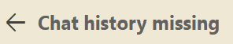
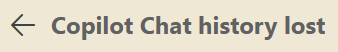
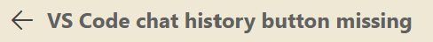
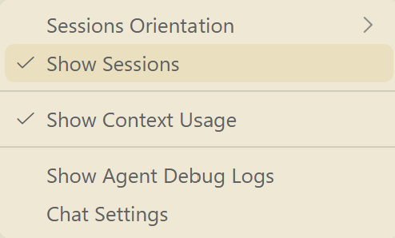

# About

<!-- THIS IS A GOOD SECTION BEGIN -->
This is the repository for our official website, built with our custom Markdown-powered full-stack CMS.

We are the smart **Stupig**s!

Learn more about us at our official website [stupig.tv](https://www.stupig.tv).
<!-- THIS IS A GOOD SECTION END -->

## 从这里开始

- [文档导航](docs/README.md)
- [业务、架构与依赖总集](docs/architecture.md)
- [本地开发](docs/development/README.md)
- [部署配置与步骤](docs/deployment/README.md)
- [Content 功能说明](docs/modules/content/README.md)
- [迁移工具](docs/operations/migrations.md)与[旧 Content 切换](docs/operations/content-cutover.md)

## 本地启动

准备 Node 24、项目 CI 对应的 pnpm、Docker，以及开发环境所需的服务凭据。环境文件生成器会保留已有值；缺少的必填值需要补齐。完整准备和排障步骤见[本地开发](docs/development/README.md)。

```sh
pnpm install --frozen-lockfile
pnpm env:build:dev
```

首次接入需要先按[本地开发](docs/development/README.md)启动依赖并初始化数据库，再完成[授权回调准备](docs/development/auth-tunnel.md)。`pnpm dev` 不会自动迁移数据库。准备完成后运行：

```sh
pnpm dev
```

它会使用 `.env.dev` 启动 Docker 依赖、Nuxt 和已配置的开发授权代理/frpc。生产统一使用 `.env.prod`；本地工具可用 `--env=prod` 切换，规则见[配置分层](docs/deployment/configuration.md)。默认应用端口由开发环境模板提供，当前为 3042；不要在已有开发服务运行时再启动一套。

## 验证与协作

```sh
pnpm lint
pnpm exec nuxt typecheck
pnpm test
```

测试分层、脚本类型检查和真实浏览器验证见[测试指南](docs/development/testing.md)。开发约束入口是 [AGENTS.md](AGENTS.md) 和 [.github/copilot-instructions.md](.github/copilot-instructions.md)。

## 部署注意

CI/CD、环境加密、镜像发布和健康检查详见[部署手册](docs/deployment/README.md)。已有生产数据必须先完成[Content 迁移预演与维护切换](docs/operations/content-cutover.md)；代码中已有迁移实现不代表生产已经迁移。不要直接把最新镜像启动成功当作业务切换验收。

<!-- THIS IS A GOOD SECTION BEGIN -->
# This is why you should always update your VSCode without reading the changelog

`POV: you click "update" in your VSCode as usual.`

the following 2 hrs:





occasionally:



you:


<!-- THIS IS A GOOD SECTION END -->
