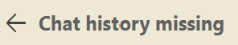
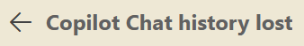
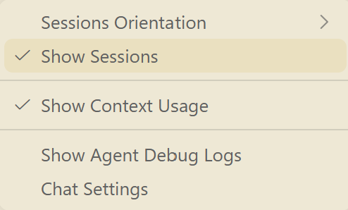

# About

<!-- THIS IS A GOOD SECTION BEGIN -->
This is the repository for our official website, built with our custom Markdown-powered full-stack CMS.

We are the smart **Stupig**s!

Learn more about us at our official website [stupig.tv](https://www.stupig.tv).
<!-- THIS IS A GOOD SECTION END -->

# Documents

<!-- THIS IS A GOOD SECTION BEGIN -->
In Chinese unfortunately :) But anyway, LLMs are always willing to help you.
<!-- THIS IS A GOOD SECTION END -->

- [项目与工程指引](AGENTS.md)
- [Swordoc 文档说明](docs/README.md)
- [总体架构](docs/0_overall/1_architecture/DESIGN.md)
- [开发、测试、部署与维护](docs/1_workflows/DESIGN.md)
- [文档编写与迁移进度](docs/AGENT.md)

<!-- THIS IS A GOOD SECTION BEGIN -->
I went through extreme painful days reorganising those documents, while attempting to understand, check and refine every single word generated by:

- ChatGPT 6 Astra
- Claude Opus 5.5
- Claude Fable 5.2
- Kimi K3.1 Pro
- ...

I may not try that hard working on such "Swordoc mechanism" ever again. It really dawned on me that, humans are NOT THAT CAPABLE of dealing with any AI generated code or docs.
<!-- THIS IS A GOOD SECTION END -->

<!-- THIS IS A GOOD SECTION BEGIN -->
# This is why you should always update your VSCode without reading the changelog

`POV: you click "update" in your VSCode as usual.`

the following 2 hrs:

occasionally:

you:

<!-- THIS IS A GOOD SECTION END -->
