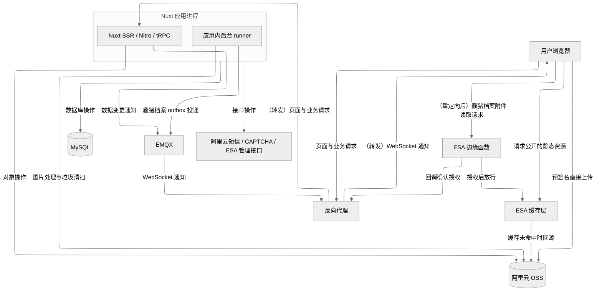
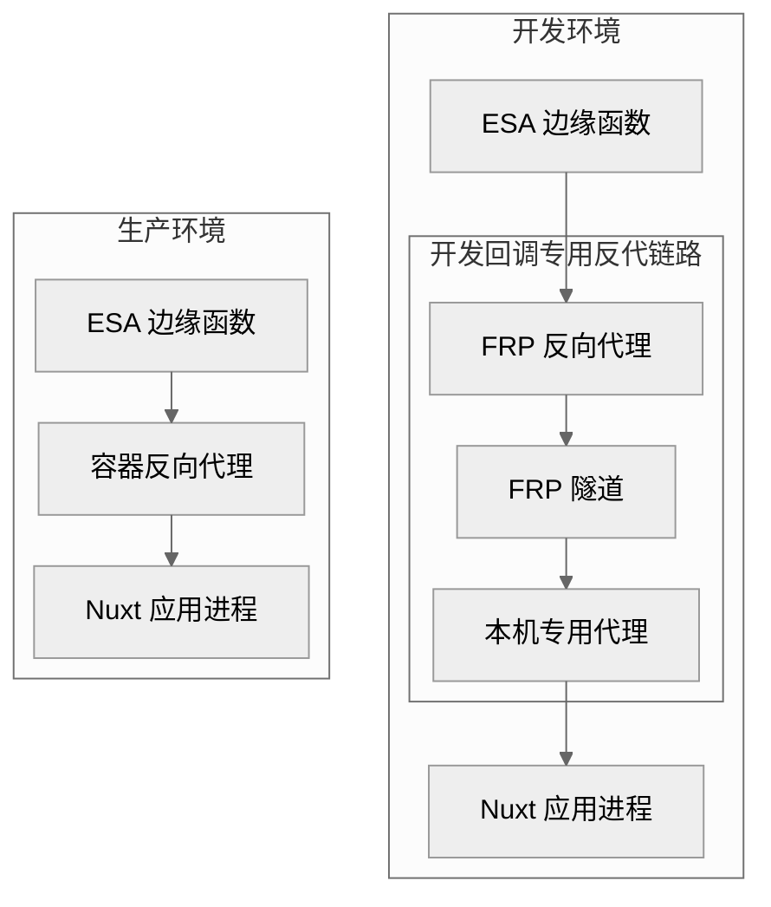
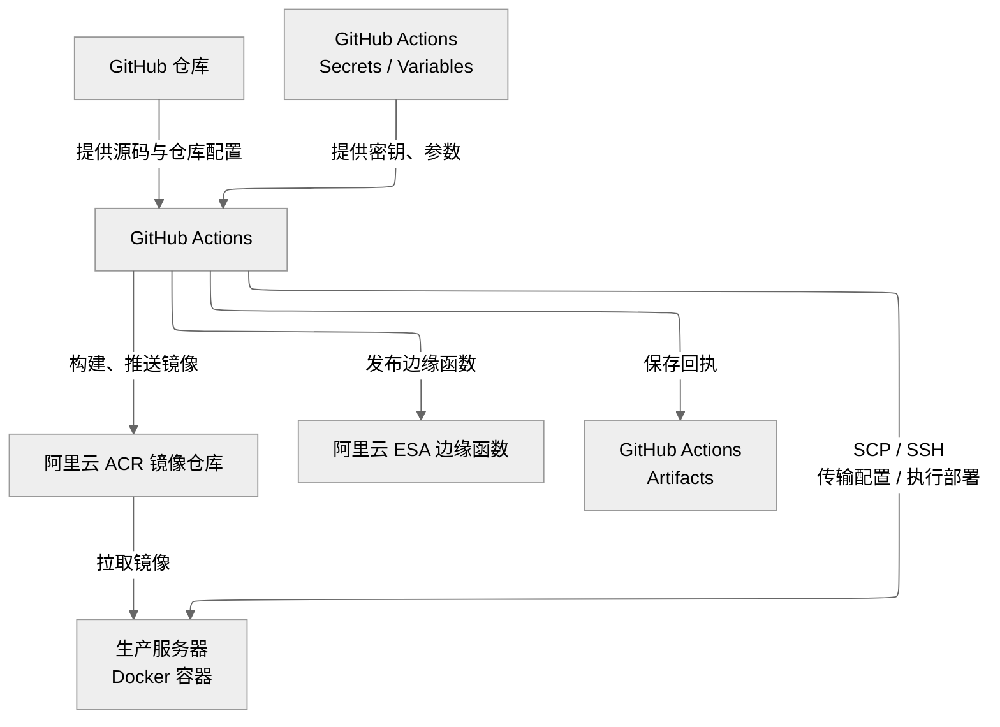
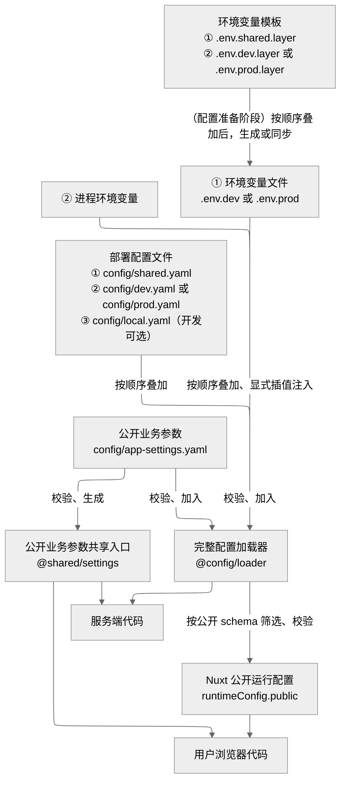

# DESIGN：项目架构

- 本文档状态：PENDING
- 覆盖范围：整个项目

## 基础设施

此处主要示意重要请求的流程、各基础设施的协作方式等，省略了部分环节。

### 业务流程

其中『回调确认授权』链路在生产、开发环境有如下差异：

### CI/CD

本图主要展示生产构建、部署的基础设施关系，实际 GitHub Actions 还承担代码检查与自动化测试；本地开发时，应用运行于宿主机，依赖服务由本地 Docker 容器提供。其他细节详见 TODO: 补充文档 Swordoc ID。

## 配置系统

本图仅示意总体的配置加载关系。其中『配置准备阶段』等在开发、构建、生产环境的具体表现有所不同，详见 TODO: 补充文档 Swordoc ID。

## 应用层主要依赖

此处仅列出应用层的主要依赖。相关基础设施请见上文；开发、生产构建的工具与流程将在 `SID#1` 中展开叙述；代码编辑器、图片处理等特定功能专用的依赖将在 `SID#2` 中展开叙述。

| 依赖 | 职责 |
| --- | --- |
| Node.js / TypeScript | 应用服务、运维脚本运行 |
| Nuxt / Vue / Nitro | 请求处理、SSR、后台任务的生命周期管理 |
| PrimeVue / Tailwind CSS | UI 组件、主题与样式 |
| Pinia | 前端应用状态管理 |
| tRPC | 承担前后端业务 API 调用、维护通信类型安全 |
| Zod | 共享数据、配置的运行时结构校验 |

## 代码产物结构

| 代码产物 | 职责 |
| --- | --- |
| `config/` | 配置定义、加载 |
| `config/lib/`（别名 `@config/`） | 配置加载、校验及应用集成 |
| `app/` | 前端入口；提供页面、组件、业务模块和公共能力 |
| `app/features/` | 负责业务查询、操作及状态管理，向页面和组件提供统一的业务入口 |
| `server/`（别名 `@server/`） | 后端入口；负责业务服务、后台任务及外部设施集成 |
| `server/shared/`（别名 `@shared/`） | 提供前后端共用的类型、校验、规则及公开配置 |
| `migrations/` | 数据结构构建、迁移 |
| `scripts/` 与 `.github/workflows/` | 开发、构建、发布、维护自动化 |
| `tests/` 及 `*.test.*` 测试文件 | 锚定源码行为、逻辑 |

## 通用模块

### 前端

| 位置 | 职责 |
| --- | --- |
| `app/app.vue`、`app/pages/` | 接入路由参数、设置页面信息、组合界面与业务能力 |
| `app/components/` | 提供自定义的交互组件，如表单集成、蠢猪档案编辑器等 |
| `app/features/` | 负责业务查询、操作及状态管理，如登录注册、资料修改、草稿编辑等 |
| `app/composables/` | 提供全站共用、需要 Vue/Nuxt 上下文的能力，如数据更新协调器、身份、统一确认框等 |
| `app/utils/` | 不提供依赖 Vue/Nuxt 上下文的工具函数；配置和环境能力由调用方传入 |

### 后端

### 前后端共享

## 前后端协作

## 用户身份

## 数据更新

## SSR 水合

## 后台任务

## 维护方式

