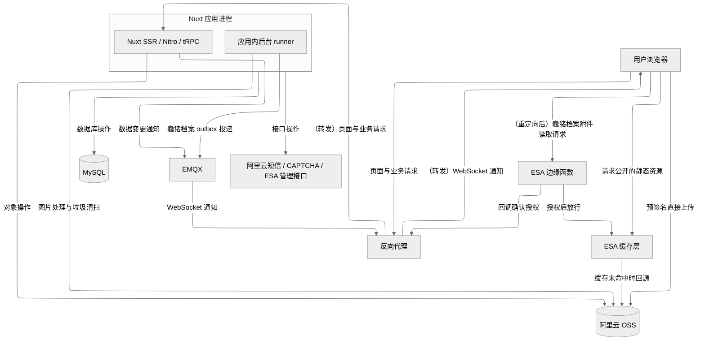
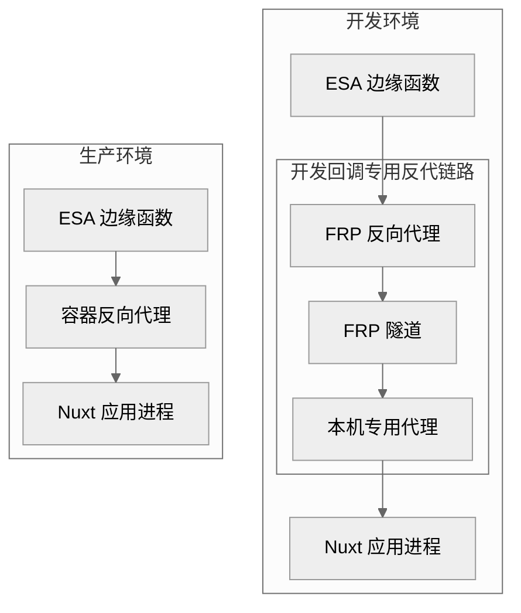
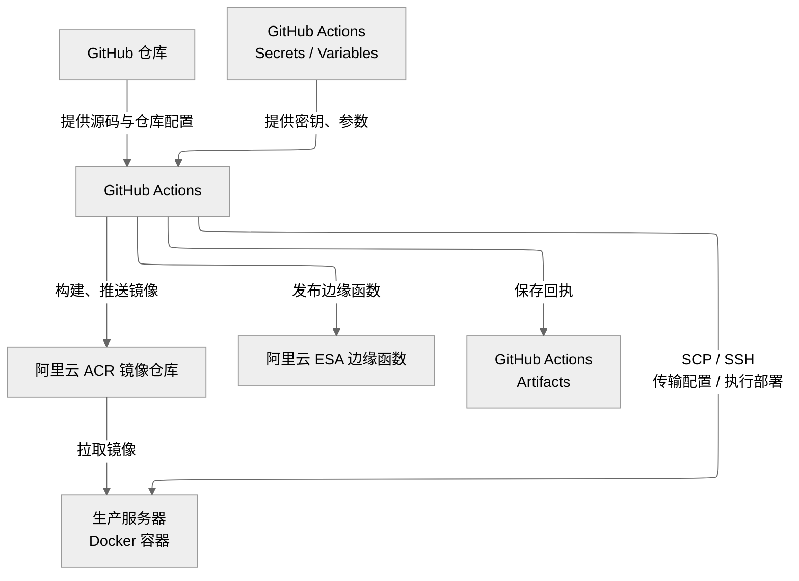
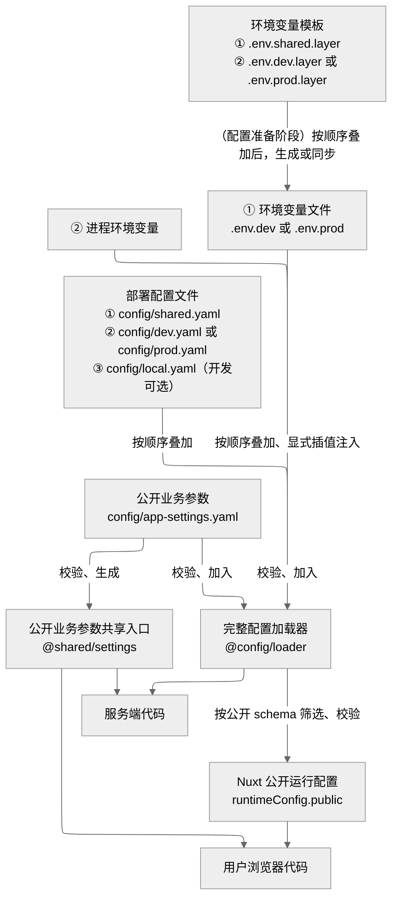
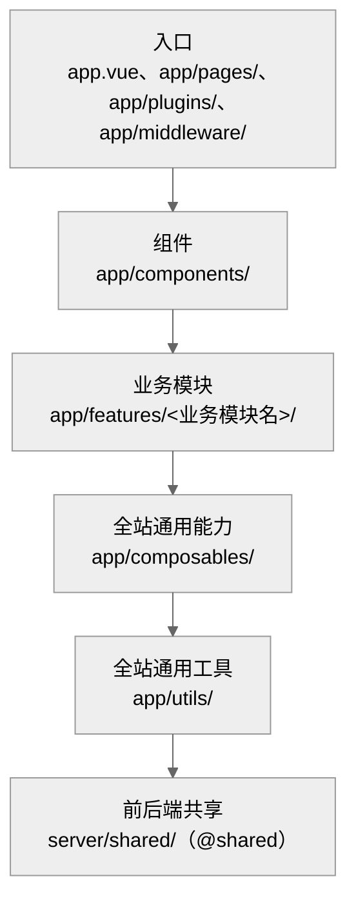
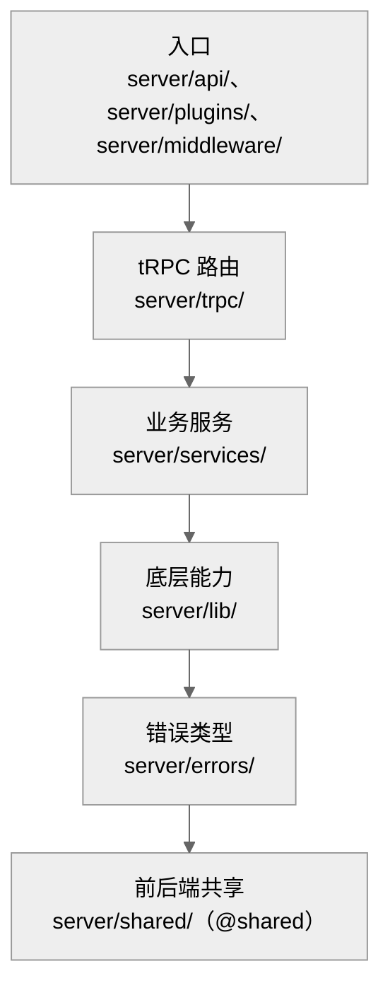
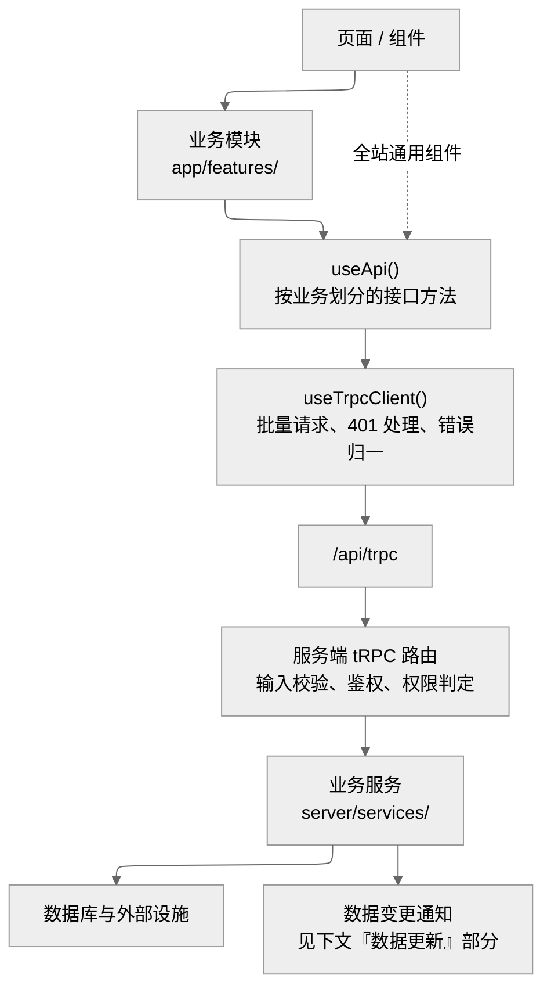
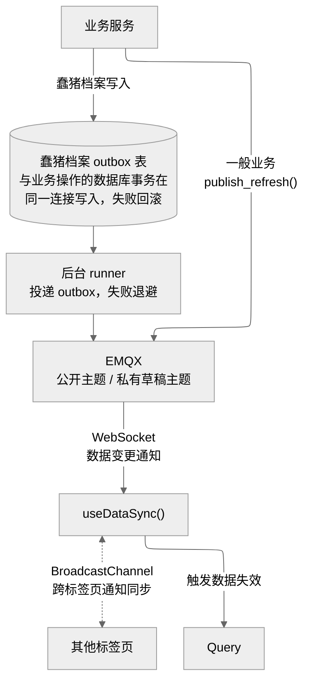
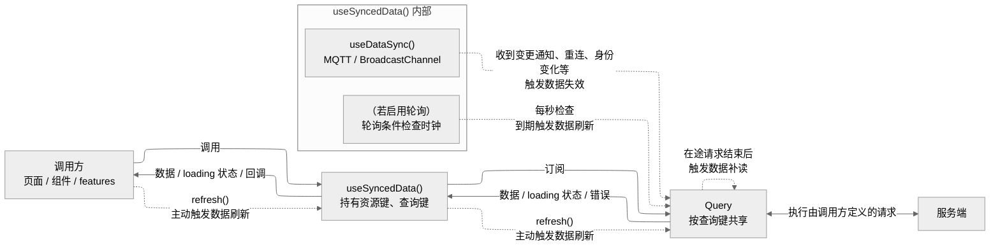

# DESIGN：项目架构

- 本文档状态：PENDING
- 覆盖范围：整个项目

## 基础设施

此处主要示意重要请求的流程、各基础设施的协作方式等，省略了部分环节。

### 业务流程



注意，其中『回调确认授权』链路在生产、开发环境有如下差异：



### CI/CD



注意：

- 本图主要展示生产构建、部署的基础设施关系，实际 GitHub Actions 还承担代码检查与自动化测试；
- 本地开发时，应用运行于宿主机，依赖服务由本地 Docker 容器提供。其他细节详见 TODO: 补充文档 Swordoc ID。

## 配置系统



注意：

- 本图仅示意总体的配置加载关系；
- 其中『配置准备阶段』等在开发、构建、生产环境的具体表现有所不同，详见 TODO: 补充文档 Swordoc ID。

## 应用层主要依赖

此处仅列出应用层的主要依赖。相关基础设施请见上文；开发、生产构建的工具与流程将在 `SID#1` 中展开叙述；代码编辑器、图片处理等特定功能专用的依赖将在 `SID#2` 中展开叙述。

| 依赖 | 职责 |
| --- | --- |
| Node.js / TypeScript | 应用服务、运维脚本运行 |
| Nuxt / Vue / Nitro | 请求处理、SSR、后台任务的生命周期管理 |
| PrimeVue / Tailwind CSS | UI 组件、主题与样式 |
| Pinia | 前端应用状态管理 |
| tRPC | 承担前后端业务 API 调用、维护通信类型安全 |
| Zod | 共享数据、配置的运行时结构校验 |

## 代码结构

### 总体

| 位置 | 职责 |
| --- | --- |
| `config/` | 配置定义、加载 |
| `config/lib/`（别名 `@config/`） | 配置加载、校验及应用集成 |
| `app/` | 前端入口；提供页面、组件、业务模块和公共能力 |
| `app/features/` | 按业务组织前端代码 |
| `server/`（别名 `@server/`） | 后端入口；负责业务服务、后台任务及外部设施集成 |
| `server/shared/`（别名 `@shared/`） | 提供前后端共用的类型、校验规则及公开业务参数等 |
| `migrations/` | 数据结构构建、迁移 |
| `scripts/` 与 `.github/workflows/` | 开发、构建、发布、维护自动化 |
| `tests/` 及 `*.test.*` 测试文件 | 锚定源码行为、逻辑 |

### 前端

#### 分区职责

| 分区位置 | 职责 |
| --- | --- |
| `app/app.vue`、`app/pages/` | 接入路由参数、设置页面信息、组合界面与业务能力 |
| `app/components/` | 提供自定义的交互组件，如表单集成、Markdown 编辑器等 |
| `app/features/` | 按业务模块组织前端代码，提供业务查询、操作、状态管理，以及业务组件使用的渲染、DOM 和交互实现，如登录注册、资料修改、草稿管理、Markdown 编辑与渲染集成等 |
| `app/composables/` | 提供全站通用、需要 Vue/Nuxt 上下文的能力，如数据更新协调、身份、统一确认框等 |
| `app/utils/` | 提供全站通用的工具函数，如日期时间格式化；不依赖 Vue/Nuxt 上下文、不调用 composables；所需配置和环境能力由调用方作为参数传入 |
| `app/middleware/` | Nuxt 路由中间件；进入页面前按登录状态与权限决定放行或跳转；需由页面显式加载 |
| `app/plugins/` | Nuxt 插件；初始化全站设施，并负责全站设施之间的接线，如数据更新通道 |
| `app/types/` | 全局类型声明，补充 TypeScript 未收录的浏览器 API |

注意：

- 只有全站通用的能力才放进 `app/composables/` 和 `app/utils/`，否则无论是 composables、工具函数还是 stores 都应该放进 `app/features/<业务模块名>/` 并按涉及业务来组织：
  - `app/composables/`、`app/utils/`：全站通用；顶层文件由 Nuxt 自动导入，子目录中的则需显式导入；
  - `app/features/`：特定业务专用；需由使用方显式导入。
- `app/components/` 只放 Vue 单文件组件及其组件测试，组件的配套实现（渲染、DOM、交互逻辑等）按如下规则放置：
  - 普通业务组件的放在 `app/features/`；
  - 全站通用组件的放在 `app/composables/` 或 `app/utils/`。
- Nuxt 路由中间件只用于界面跳转——即使绕过中间件进入页面，相关接口的访问仍会由服务端拒绝。

#### 依赖关系约定



注意：

- 上层可依赖其下任意一层（也即可以跨层，不必一层一层往下走），但下层不得依赖任何上层；同一层内部的依赖方向不受限制；
- 如 `app/features/` 不得依赖 components 和 pages，`app/composables/` 不得依赖 features，`app/utils/` 不得依赖 composables；features 需要的浏览器能力（打开链接、保存文件等）由调用方作为参数传入；
- 以上约定主要约束源码；测试文件为验证接线，可破例引用被测模块的使用方。

### 后端

#### 分区职责

| 分区位置 | 职责 |
| --- | --- |
| `server/api/trpc/` | 业务 API 统一入口（tRPC） |
| `server/api/hooks/` | 提供其他系统调用的非 tRPC 端点，如 ESA 授权回调、EMQX 认证回调、sitemap 数据源、健康检查 |
| `server/api/links/` | 浏览器原生请求（``、`<a>` 等）直接打开的地址，如附件读取跳转 |
| `server/trpc/` | 定义 tRPC 路由、输入校验、鉴权和权限判定，并将业务操作转交给 services |
| `server/middleware/` | Nitro 服务端中间件；负责请求前置处理，如产生请求 ID、识别设备身份 |
| `server/plugins/` | Nitro 插件；负责注册后台任务、全局错误处理、暴露及保护公开配置等 |
| `server/services/` | 按业务模块组织后端业务逻辑，负责执行数据库读写、事务，定义后台任务的业务内容 |
| `server/lib/` | 提供外部设施客户端等底层能力，如数据库、Redis、MQTT、OSS、ESA、短信、日志 |
| `server/errors/` | 定义错误类型、筛选对外展示的错误信息 |
| `server/types/` | 定义服务端内部类型，如鉴权后的用户 `AuthUser` |
| `server/shared/`（别名 `@shared/`） | 提供前后端共用的类型、校验规则及公开业务参数等 |

注意：

- tRPC 路由只做校验、鉴权，并将业务操作转交给 services，不应直接读写数据库等。

#### 依赖关系约定



注意：

- 上层可依赖其下任意一层（也即可以跨层，不必一层一层往下走），但下层不得依赖任何上层；同一层内部的依赖方向不受限制；
- 除 `server/shared/` 外，各分区均可：
  - 使用 `server/types/` 定义的服务端内部类型（如 `AuthUser`）；
  - 通过 `@config/loader` 读取部署配置。
- 以上约定主要约束源码；测试文件为验证接线，可破例引用被测模块的使用方。

### 前后端共享

| 位置 | 职责 |
| --- | --- |
| `server/shared/`（别名 `@shared/`） | 前后端共用的规则与校验，如权限判定、文件名与引用规则、Markdown 语法 |
| `server/shared/types/` | 作 API 数据类型的统一来源 |
| `server/shared/settings.ts` | 作公开业务参数的入口 |

注意：

- `server/shared/` 必须能在浏览器中运行——不得使用 Node 独有的能力及部署配置加载器等，也不得依赖 `app/` 或 `server/` 的其他分区。

## 前端状态

| 状态类型 | 维护者 | 说明 |
| --- | --- | --- |
| 服务端数据资源 | `useSyncedData` | 按资源键共享查询、去重请求、收到数据变更通知后重新请求 |
| 共享业务状态 | 所属 feature 的 store | 需跨页面共享或统一管理生命周期的状态，如云端草稿、上传队列 |
| 页面或交互会话状态 | 所属 feature 或组件中的 composable | 只属于一个页面或一次交互；随调用方退出而释放 |
| DOM、编辑器、焦点与滚动状态等 | 特定组件 | 随组件挂载创建、卸载释放 |
| 用户身份 | `useAuth()` 读取的 cookie | 见 TODO: 补充未来文档 Swordoc ID |

注意：

- 同一份服务端数据只由一处维护：若已交由 `useSyncedData` 完全接管，则 store 不再另存；需要同时保留本地状态与云端快照时（如档案草稿），可让服务端数据的快照只存于所属 store（如只将 `useSyncedData` 用作触发器，适时触发 store 的状态更新，避免向组件暴露第二份数据状态），且须明确二者的含义、版本判断及合并方式；
- 共享 store 长期存活，不会随第一个调用它的组件销毁；组件注册的监听、定时器等则随组件卸载移除；
- 依赖 Vue/Nuxt 上下文的调用（全局的 composables、stores 或 features 入口函数）都在 setup 的同步阶段完成；
- 若某个 features 入口函数的调用会引发异步的初始化过程、且需要向调用方暴露其『初始化是否完成』的状态：
  - 其同步返回的对象应通过 `ready` 属性提供一个 Promise（初始化完成后 resolve），供组件在 `<script setup>` 的顶层 await；
  - 依赖其他异步初始化的 features 入口时，用 `Promise.all` 合并它们的 `ready` 作为自己的 `ready`，而不是在自身函数体内 await。

## 前后端协作



注意：

- 前端业务调用统一通过 `useApi()` 的业务方法，故新增接口时须同时扩展服务端路由及 `useApi()`；
  - 例外：浏览器原生请求（附件 ``、`<a>`）直接访问 `server/api/links/`；`useTrpcClient()` 本身及 `useAuth()` 的退出登录请求也不经过 `useApi()`。
- `useDataSync()` 不依赖 `useApi()`；连接私有频道所需的 MQTT 凭据由 `app/plugins/data-sync.client.ts` 在启动时以函数形式传入；
- 服务端路由按访问要求分为 `public_procedure`（可匿名访问）、`protected_procedure`（需登录）与 `permission_procedure`（需特定权限）三个级别；
- 访问要求取决于访问者或输入时，使用 `public_procedure` 并在处理函数内调用 `optional_auth_user`（可匿名访问；对匿名访客与已登录用户展示不同内容）或 `resolve_operate_target`（只允许本人访问或管理员代访问）；
- 服务端以 `ApiError` 表达业务错误，其提示直接展示给用户，由路由层统一映射为 tRPC 错误码；校验错误只对外暴露自定义提示；其他意外错误在生产环境只返回统一的内部错误提示；
- 前端收到 401 即退出登录、重新加载当前标签页，并通知其他标签页同步退出，`useSyncedData` 与调用方不再重复提示认证失败；
- 前端收到的其他错误由调用方提示、或交由 `useSyncedData` 默认提示，二者择一；同一次操作的提示、确认与跳转只由某一方负责，避免重复。

<!-- TODO: 特定领域内容，迁移到 2.*.LAW/DESIGN

## 用户身份

| 身份数据 | 存放位置 | 职责 |
| --- | --- | --- |
| 登录令牌 | httpOnly cookie（JWT） | 服务端认证依据，浏览器不可读 |
| 登录会话及令牌代次 | 数据库 | 记录会话的封禁、退出、过期状态及令牌轮换 |
| 展示用户信息 | 普通 cookie，由 `useAuth()` 读取 | 前端唯一的身份来源，用于界面呈现与交互判断 |
| 设备身份 | httpOnly cookie，由 `server/middleware/identity.ts` 维护 | 验证码限流等匿名场景的设备识别 |

注意：

- 服务端在每个请求内只解析、续期一次身份：校验令牌后，查询其所属会话与令牌代次；封禁、已退出或已过期均返回 401；
- 令牌临近过期时，只有携带最新代次令牌的非 SSR 预取请求会尝试轮换；写入时再次确认期间未被其他请求抢先轮换，并发请求中只有写入成功者下发新 cookie；旧代次令牌在各自 JWT 过期前仍可认证，但不触发轮换；
- 前端不得另建独立的身份 store，应让业务模块与 `useAuth()` 组合；
- 退出登录时清除本地身份，经 BroadcastChannel 通知其他标签页并刷新页面；401 与跨标签页退出经底层认证通道处理，避免 API 与认证模块之间的循环依赖；
- SSR 请求转发浏览器 cookie 并标记 `X-Nuxt-SSR`；用户身份及用户相关的可变数据按请求隔离，不得存放于模块级变量；
- 身份变化后，没有同步资源键的查询统一失效重读；增量结果以服务端签发的 `viewer_key` 判断视角是否一致。

-->

## 数据更新

### 概念

| 概念 | 是什么 | 举例 |
| --- | --- | --- |
| 资源键 | 前后端约定的服务端数据标识，由 `sync_resource(<类型>, id)` 生成；也是 MQTT 主题的后缀 | `content_story:42`（蠢猪档案 #42） |
| 变更通知 | 服务端在某资源变化后发出的提示，说明『某资源已变化』；不携带业务数据 | — |
| Query | 同一份共享数据的存放单元：保存所有订阅者和最近一次结果，用第一个订阅者的请求函数发请求；按订阅者给出的资源键订阅变更通知；数据失效或刷新时重新请求，并丢弃过期结果 | — |
| 查询键 | 前端用来区分不同 Query 的标识：`universal: true` 下，同一个查询键指向同一个 Query | 默认与资源键相同，如 `content_stories:all`；显式指定如 `draft-list:<身份>:<页码>` |
| 订阅者 | 每次 `useSyncedData()` 的调用；向 Query 提供请求函数并接收结果；调用方卸载时退订 Query，最后一个订阅者离开后 Query 释放 | — |

Query 专用术语：

| 术语 | 含义 |
| --- | --- |
| 重新请求 | Query 再执行一次请求函数 |
| 数据失效 | 已有数据及在途请求的结果都可能已过时（收到变更通知、可能漏掉了通知，或登录身份变化），因此一律作废；没有在途请求时立即重新请求，否则等在途请求全部结束后补读；期间多次失效只补读一次 |
| 数据刷新 | 已有数据仍然可信，只是想拿到最新数据：按 `refresh_policy` 处理在途请求 |
| 数据补读 | 在途请求结束后补发的一次请求——起因有两种：期间发生了数据失效；或者提供请求函数的订阅者已经离开，改用下一位订阅者的请求函数 |

### 通知如何发出



| 业务 | 发布方式 | 原因 |
| --- | --- | --- |
| 蠢猪档案 | 在业务事务的同一连接内写入 outbox 表，提交后由后台 runner 投递，失败自动重试 | 数据库写入牵涉多个业务对象、常发生在后台任务中；数据不随时间变化，相关页面没有轮询兜底，通知丢失后无法自行恢复 |
| 其他业务 | 数据库写入后直接调用 `publish_refresh()` | 写入操作简单；相关页面本就为随时间变化的数据（如：最后在线时间）保留轮询，通知丢失最多延迟数秒 |

注意：

- 资源键含敏感标识（手机号、设备身份、草稿 ID）时，服务端以带密钥的 HMAC 摘要替换敏感标识部分后发布，浏览器只能使用服务端下发的频道名；
- 蠢猪档案草稿使用独立、需凭据的私有连接与主题。

### useSyncedData()

```ts
const { refresh } = await useSyncedData<T>(resource, fetcher, data, loading, options)
```

| 参数 | 类型 | 说明 |
| --- | --- | --- |
| `resource` | 资源键，`string \| null`；可为 `Ref` 或其数组 | 指定要订阅的资源；为 `null` 时不订阅任何资源 |
| `fetcher` | `() => Promise<T>` | 请求函数；只返回数据，不得直接修改渲染状态 |
| `data` | `Ref<T \| null>`（可选） | 接收请求结果的 ref；参与首屏渲染时须用 `useSyncedState()` |
| `loading` | `Ref<boolean>`（可选） | 接收 loading 状态的 ref；需跨组件共享时用 `useState()` |
| `options` | 对象（可选） | 见下表 |

其中 `options` 的可选项：

| 选项 | 默认 | 作用 |
| --- | --- | --- |
| **前端何时重新请求** |||
| `immediate` | `true` | 首次调用、以及资源键或查询键变化后，若 Query 尚无数据则立即请求；为 `false` 时跳过这次请求，之后仍在数据失效、数据刷新时重新请求 |
| `server` | `true` | 是否在 SSR 阶段请求；须 `immediate: true` |
| `polling_interval` | `undefined`（不轮询） | 轮询周期（毫秒）；若开启轮询，某次请求完成后，『无请求』的空闲窗口达到 `polling_interval` 即触发新请求；轮询只在标签页可见时进行 |
| **如何共享** |||
| `universal` | `true` | 决定是否按查询键共享 Query；为 `false` 时每次调用独占一个 Query；SSR 阶段总是独占 |
| `query_key` | 由资源键得出 | 自定义查询键（字面量或 ref）；只影响 Query 共享的依据，不影响订阅哪些资源 |
| `fetch_without_resource` | `false` | 决定没有查询键时是否仍然请求；须同时设定 `universal: false`，否则调用时报错 |
| **结果如何处理** |||
| `on_data` | — | 有新数据生效后回调（包括加入已有数据的共享 Query 时）；水合期间，此回调延迟到水合结束后 |
| `on_error` | 弹出默认的错误提示 | 自定义错误处理，代替默认提示；401 不会触发此回调，由传输层统一处理；同一 Query 中，每发生一次错误，未自定义 `on_error` 的订阅者总共只触发一次默认错误提示 |
| `refresh_policy` | `'join'` | 数据刷新时如何处理在途请求（若有）：`'join'` 复用在途请求的 Promise，不单独发新请求；`'latest'` 立即发出新请求，只采用最后发起的那次请求的结果；共享同一 Query 的调用须使用相同策略，否则报错 |
| `throw_resource_null_error` | `false` | 决定没有查询键且 `fetch_without_resource: false` 时，是否通过 `on_error` 或默认提示抛出错误 |

返回 Promise，resolve 后为 `{ refresh }`。

- 需要立即请求时（`immediate: true` 且 Query 尚无数据），会等首次请求完成后才 resolve；但水合期间若 `data` 类型为 `useSyncedState()`（或不传数据状态），不等请求完成即 resolve，并直接使用服务端 SSR prefetch 到的 payload 数据。
- features 入口函数通常把它（返回的 Promise）作为 `ready` 交给组件。

### 前端何时重新请求



| 如何触发 | 动作 | 范围 |
| --- | --- | --- |
| 收到某资源的变更通知 | 数据失效 | 订阅了该资源的 Query |
| 页面运行中的新增订阅生效后 | 数据失效 | 订阅了新增资源的 Query；补上订阅生效前可能错过的通知 |
| 连上或重连 MQTT、页面重新可见、网络恢复 | 数据失效 | 订阅了资源的全部 Query；补上断线期间可能错过的通知 |
| 登录身份变化 | 数据失效 | 全部 Query，包括没有资源订阅的 |
| 调用方执行 `refresh()` | 数据刷新 | 该调用对应的 Query |
| 轮询到期 | 数据刷新 | 启用轮询的 Query；有在途请求时跳过本次（详见 `polling_interval`） |
| 资源键或查询键变化 | 换 Query | 退订旧 Query、改用新 Query；`immediate: true` 且新 Query 尚无数据时立即请求 |

注意：

- 请求失败时不自动重试，等下一次触发；
- 公开通知使用持久会话，断线后在会话有效期内重连可通过 broker 补发暂存的通知；
- 草稿私有频道、会话失效、队列溢出及未送达 broker 的通知均不通过 broker 补发；
- 前端不依赖 broker 补发，靠新增订阅生效后、重连及页面重新可见时的数据失效机制兜底。

### Query 的共享方式

| 方式 | 写法 | 适用 |
| --- | --- | --- |
| 按资源共享（默认） | 调用 `useSyncedData()` 时只传资源键、不改 `options` | 一个资源对应一份数据，例如多个组件同时显示档案列表 |
| 按自定义键共享 | 调用 `useSyncedData()` 时指定 `query_key` | 同一资源下须有多份不同的数据，需要分开缓存 |
| 不共享 | 调用 `useSyncedData()` 时设定 `universal: false` | 请求有调用方特有的副作用，或没有资源键、只靠轮询；每次调用须独占一个 Query；查询键只用于判断何时重新请求 |

注意：

- 共享的 Query 只用第一个订阅者的请求函数，请求结果会分发给所有订阅者，故查询键相同的调用必须具有相同的请求逻辑，否则后订阅者会拿到先订阅者请求的、通常为预期外的结果。

## SSR 与水合

### 偷梁换柱

SSR 与水合过程中，浏览器首次渲染出的内容必须与服务端首次渲染的一致，否则 Vue 会报水合 mismatch，页面可能发生闪烁、错位等一系列奇奇怪怪的问题。

为解决由异步操作、数据随时间变化等导致的此类问题，我们选择改造 `useSyncedData()`、并用封装的 `useSyncedState()` 代替 `useState()`，使浏览器首次请求取得的数据『延迟生效』——

也即在 SSR 水合阶段，不论浏览器首次请求是否已经完成，我们都使用 SSR prefetch 阶段的遗产数据（通过 payload 从服务端传递而来）来渲染；等到水合结束，再将对应的遗产数据更换为此前浏览器首次请求取得的数据；若届时请求尚未完成，则在稍后完成时立即生效——这样就完成了从水合 mismatch 到正常状态变更的『偷梁换柱』。

Nuxt 官方实际上提供了 `useAsyncData()` 和 `useFetch()` 来解决此类由请求引发的水合问题。不过，鉴于它们的默认行为是直接复用 payload、不立即进行浏览器的首次请求，而我们的自动更新机制希望浏览器尽快读到 SSR prefetch 之后可能已变化的数据；再加上我们对已经完整封装了自动更新、资源复用、错误处理等的 `useSyncedData()` 的偏爱——

必须为此发扬手搓精神了！

### 实践方式

```ts
// 用于接收请求回调的状态必须用 useSyncedState()
const waifu_list = useSyncedState<WaifuProfile[] | null>('waifu_list', () => null)
// loading 状态可以直接用 useState()
const waifus_loading = useState('waifu_list_loading', () => false)

await useSyncedData(sync_resource('waifu_list', 'all'), () => world.execute(me).list_waifus(), waifu_list, waifus_loading)

if (waifu_list.value[0].name === 'Asuna')
  ask_like_a_fool('Asuna, have you ever been married?')
```

由 `useSyncedData()` 写入、用于接收请求回调的状态，其能否进入首屏取决于其声明方式：

| 声明方式 | 是否进入 payload | 水合期间是否暂存更新 | 适用 |
| --- | --- | --- | --- |
| `useSyncedState()` | 是 | 是 | 须首屏渲染的数据 |
| 不传数据状态，只利用 `useSyncedData()` 的 `on_data` 回调 | — | — | 只需在数据到达时执行回调 |
| 普通 `ref` | 否 | 否 | 不参与服务端首屏渲染的数据，配合 `server: false` |
| `useState()` | 是 | 否 | 不得用于 `useSyncedData()`——水合期间的更新会直接改写浏览器首次渲染的结果，造成 mismatch |

### 注意事项

<!-- TODO: 审 -->

- `useSyncedState()` 的键即 payload 的键：迁移模块位置或改用 store 时，不得改变键名、序列化内容与初始化方式；
- 服务端只有一个 Node 进程，同时为所有用户渲染页面：
  - 每个 SSR 请求有自己的 Nuxt 应用实例，这意味着 stores、`useState()`、`QueryClient` 等挂在实例上的状态互不干扰；
  - 但模块顶层的变量仍由所有请求共用，故不得存放用户身份及等与用户相关的可变数据；
  - 的确需要模块级存储时，应以应用实例为键（如 `WeakMap<NuxtApp, ...>`）。
- SSR 阶段的业务请求转发浏览器 cookie，并标记 `X-Nuxt-SSR`，服务端据此不轮换登录令牌；
- 首屏时间统一使用 `useDisplayTimeContext()`：服务端按时区 cookie 渲染（缺省 UTC），浏览器在水合结束后切换为本地时区并开始每秒更新；渲染时不得直接读取 `Date.now()` 或浏览器时区。

## 后台任务


