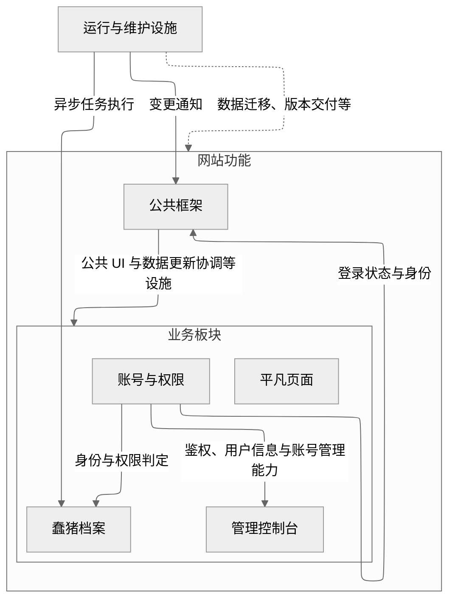

# LAW：项目架构

- 本文档状态：DONE
- 覆盖范围：整个项目

## 功能板块

| 板块 | 负责业务 | 对应文档 |
| --- | --- | --- |
| 公共框架 | 各页面的共用设施，如导航栏、悬浮确认框、数据更新协调器等 | `SID#2.0` |
| 账号与权限 | 注册、登录、退出登录、个人资料、登录会话记录、登录状态管理，并为其他板块提供鉴权等能力 | `SID#2.1` |
| 平凡页面 | 网站主页、联系方式展示 | `SID#2.2` |
| 管理控制台 | 展示用户列表及信息，支持封禁解封、设置认证、设置权限、修改个人资料等管理操作 | `SID#2.3` |
| 蠢猪档案 | 档案列表、正文阅读、档案编辑与发布、附件上传及管理等 | `SID#2.4` |
| 运行与维护设施 | 消息通知队列、后台任务处理、数据迁移、版本交付等 | `SID#2.5` |

注意：此图定义了『网站功能』与『业务板块』的范围。

上图仅说明各功能板块之间的大致关系；箭头方向表示能力提供的方向，不一定表示数据流向、依赖方向和执行顺序等。

## 板块交界

### 『公共框架』和『账号与权限』

『公共框架』只承担共有导航栏的登录注册入口、当前用户展示等；

实际登录注册弹窗、其业务逻辑与状态管理由『账号与权限』板块负责。

### 『账号与权限』和『管理控制台』

『账号与权限』提供账号、会话与权限的管理能力；

而『管理控制台』负责面向管理员的用户信息展示与管理操作，使用前者提供的能力。

### 『运行与维护设施』和『公共框架』

『运行与维护设施』负责管理与分发通知；

『公共框架』接收通知并负责触发数据更新请求。

### 『运行与维护设施』和『业务板块』

『运行与维护设施』提供通用的消息通知、任务调度与执行能力；

各『业务板块』决定消息的产生条件、订阅范围，以及后台任务的触发条件、业务内容和完成标准。
