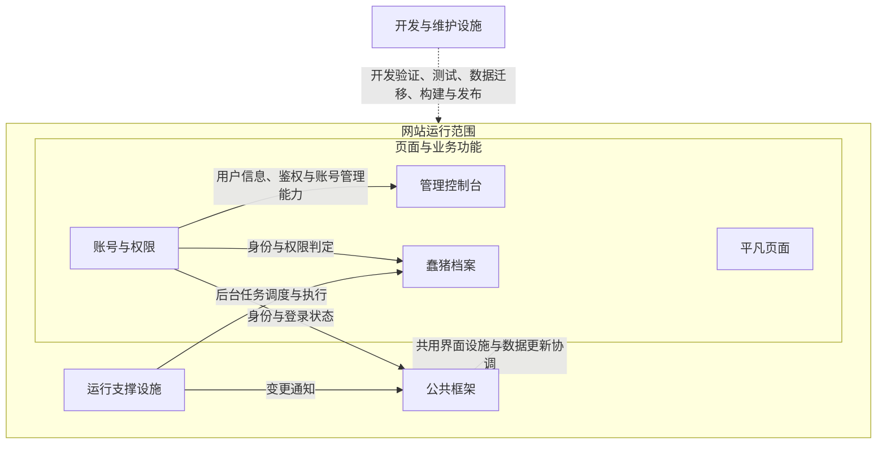

# TMP：总体功能架构图

- 性质：非权威草案，供人类核对并选用。
- 依据：[SID#0.1.LAW](LAW.md) 的功能板块表，以及本轮将「运行与维护设施」拆成两个板块的讨论。
- 覆盖范围：总体功能分工与板块之间的主要关系。

## 架构图

实线箭头表示「能力提供方 → 使用方」，标签说明提供什么；虚线箭头表示开发与维护的作用范围。

## 如何读这张图

- 「网站运行范围」和「页面与业务功能」是分组框，七个具体板块是其中及框外的方框。分组表示功能关系，不规定代码目录、进程或部署位置。
- 公共框架向整个「页面与业务功能」分组提供共用能力，因此不再向每个板块重复连线。平凡页面也使用这些能力。
- 账号与权限提供身份、权限判定和账号管理能力；具体业务操作的成立条件仍由对应板块定义。
- 运行支撑设施负责变更通知、后台任务的公共执行机制；各板块产生哪些变更、何时需要什么后台处理，仍由各自的业务规则决定。图中的箭头展示主要使用关系，不穷举所有通知来源和任务类型。
- 开发与维护设施作用于整个网站，包括运行支撑设施；虚线表示验证、迁移与交付等关系。

这些箭头描述能力关系，不表示请求顺序、完整数据流或代码导入依赖。具体实现关系可在 DESIGN 中另画。

## 对应的表格拆分建议

| 板块 | 负责业务 |
| --- | --- |
| 运行支撑设施 | 向各板块提供变更通知、后台任务调度与执行等公共能力 |
| 开发与维护设施 | 支持开发验证、测试、数据迁移、版本构建与发布等工作 |

当前 LAW 表格尚未拆分；本文件先记录讨论后的方案，供人类同步时参考。
