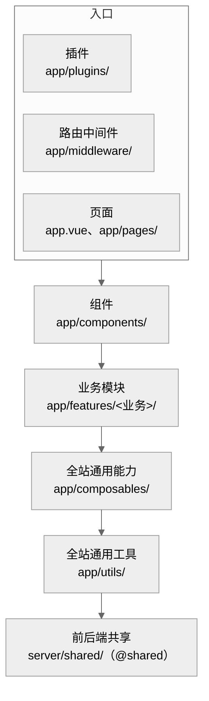
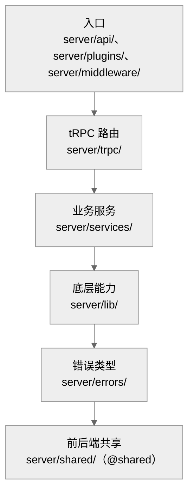
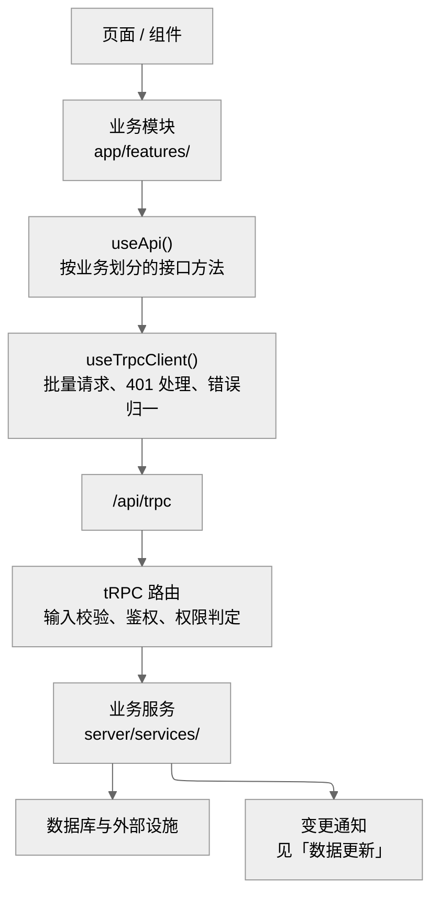
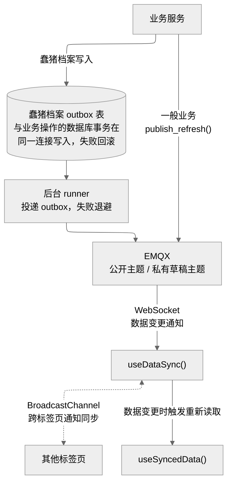
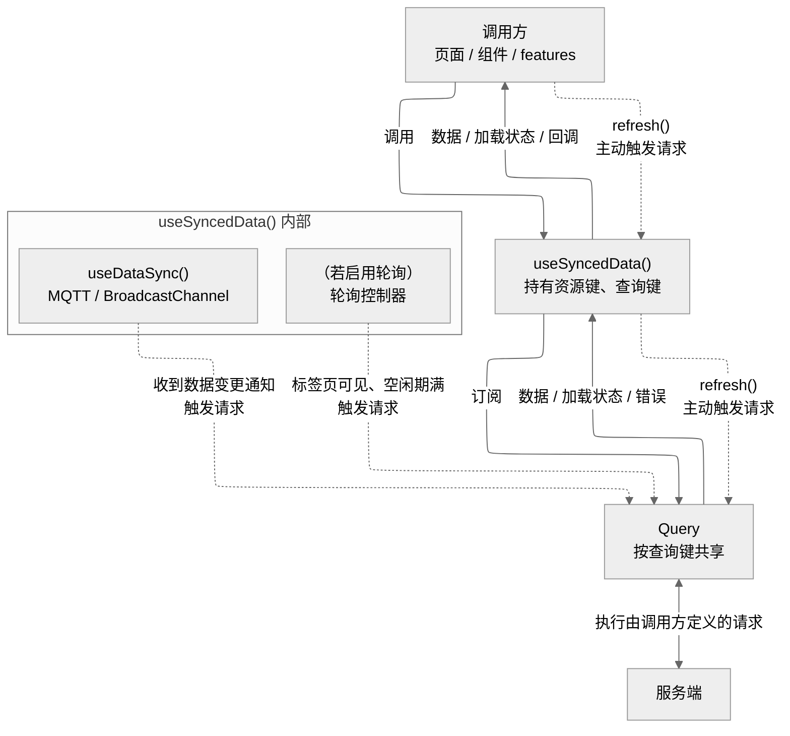
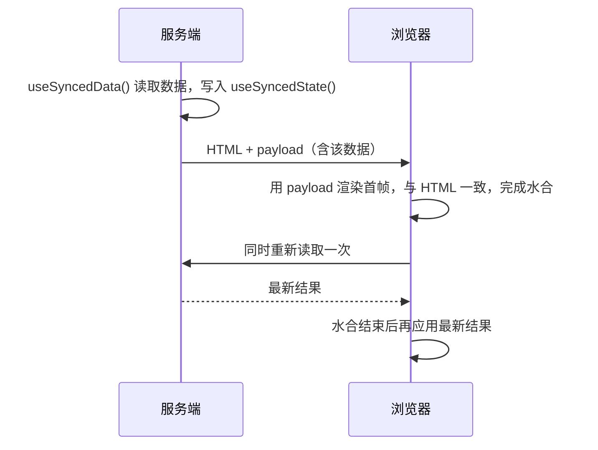
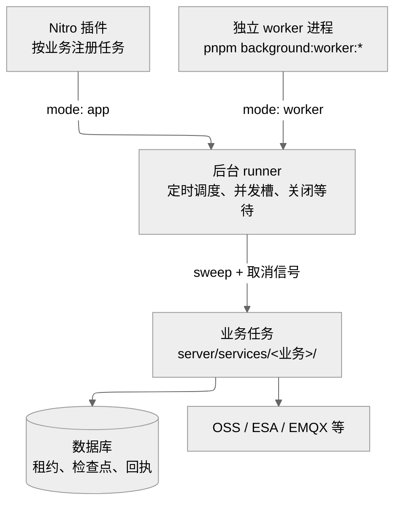

# TMP：项目架构后续章节草稿

- 本文档状态：PENDING
- 覆盖范围：SID#0.1.DESIGN「代码结构」之后的章节

## 代码结构

### 前端

#### 分区职责

补充 SID#0.1.DESIGN「前端 → 分区职责」：

| 分区位置 | 职责 |
| --- | --- |
| `app/middleware/` | 路由中间件；进入页面前按登录状态与权限决定放行或跳转，由页面通过 `definePageMeta({ middleware })` 指定 |
| `app/plugins/` | Nuxt 插件；应用启动时初始化全站设施，并负责全站设施之间的接线，如数据更新通道 |
| `app/types/` | 全局类型声明，补充 TypeScript 尚未收录的浏览器 API；不含运行时代码 |

注意：

- 路由中间件只用于界面跳转，不替代服务端鉴权：即使直接访问页面，相关接口仍由服务端拒绝；
- 中间件不承载业务流程，权限判定复用 `@shared/permissions`。

#### 分区依赖关系约定

替换 SID#0.1.DESIGN「前端 → 分区依赖关系约定」现有的图。



注意：

- 上层可依赖其下任意层，下层不得依赖上层；同一层内部不受限制；
- 如 `app/features/` 不得依赖 components 和 pages，`app/composables/` 不得依赖 features，`app/utils/` 不得依赖 composables；features 需要的浏览器能力（打开链接、保存文件等）由调用方作为参数传入；
- `app/types/` 只提供全局类型，不参与上述依赖；
- 以上约定主要约束源码；测试文件为验证接线，可破例引用被测模块的使用方。

### 后端

#### 分区职责

| 分区位置 | 职责 |
| --- | --- |
| `server/api/trpc/` | 业务 API 唯一入口；前端发起的业务调用一律经此 |
| `server/api/hooks/` | 其他系统调用的端点，如 ESA 授权回调、EMQX 认证、站点地图数据源、健康检查 |
| `server/api/links/` | 浏览器原生请求（``、`<a>`）直接打开的地址，如附件读取跳转 |
| `server/trpc/` | 定义 tRPC 路由、输入校验、鉴权与权限判定，将业务操作交给 services |
| `server/middleware/` | 请求级前置处理，如请求 ID、设备身份 |
| `server/plugins/` | Nitro 插件；注册后台任务、全局错误处理与公开配置保护 |
| `server/services/` | 按业务组织后端业务逻辑、数据库读写、事务及后台任务的业务内容 |
| `server/lib/` | 外部设施与底层能力的客户端，如数据库、Redis、MQTT、OSS、ESA、短信、日志 |
| `server/errors/` | 业务错误类型及对外错误信息筛选 |
| `server/types/` | 服务端内部类型，如鉴权后的用户 `AuthUser`；不对前端公开 |

注意：

- tRPC 路由只做校验、鉴权与调用，不直接读写数据库；
- 一次外部设施调用成功，仅表示该设施操作的结果；跨数据库与外部设施的一致性、重试和业务完成判定由所属 services 组织；
- 数据库时间统一以 UTC 存储与读写；`tinyint(1)` 布尔值在返回 API 数据前转换。

#### 分区依赖关系约定



注意：

- 上层可依赖其下任意层，下层不得依赖上层；同一层内部不受限制；
- 如 `server/services/` 不得依赖 trpc 和入口，`server/lib/` 不得依赖 services，`server/shared/` 不得依赖 `server/` 其他分区和 `app/`；
- 依赖其下任意层，不表示必须逐层经过：`server/api/hooks/` 可直接调用 services；
- `server/types/` 仅含服务端内部类型（如 `AuthUser`），各层均可使用；各分区均可通过 `@config/loader` 读取部署配置；
- 以上约定主要约束源码；测试文件为验证接线，可破例引用被测模块的使用方。

### 前后端共享

| 位置 | 职责 |
| --- | --- |
| `server/shared/` | 前后端共用的规则与校验，如权限判定、文件名与引用规则、Markdown 语法 |
| `server/shared/types/` | API 数据类型的唯一来源；前端直接使用，不另行定义 |
| `server/shared/settings.ts` | 公开业务参数入口；`settings.generated.ts` 由 `config/app-settings.yaml` 生成，不得手动修改 |

注意：

- `server/shared/` 必须能在浏览器中运行：不得引用部署配置加载器、密钥及 Node 专用能力，不得依赖 `server/` 其他分区和 `app/`；
- 需要前后端一致执行的规则放在此处，服务端仍负责最终校验；
- `@shared/` 是项目自定义别名，指向 `server/shared/`；Nuxt 的 `#shared/` 指向根目录 `shared/`，两者不可混用。

## 前端状态

| 状态类型 | 维护者 | 说明 |
| --- | --- | --- |
| 服务端资源 | `useSyncedData` | 按资源键共享查询、去重请求、接收失效通知后重新读取 |
| 共享业务状态 | 所属 feature 的 Pinia store | 需跨页面共享或统一管理生命周期的状态，如云端草稿、上传队列 |
| 页面或交互会话状态 | 所属 feature 或组件中的 composable | 只属于一个页面或一次交互，随调用方退出释放 |
| DOM、编辑器、焦点与滚动状态 | 组件 | 随组件挂载创建、卸载释放 |
| 用户身份 | `useAuth()` 读取的 cookie | 见「用户身份」 |

注意：

- store 不另存服务端资源的副本；需要同时保留本地编辑与云端快照时，应明确两者的含义、版本及合并方式；
- 共享 store 不随第一个调用它的组件销毁；组件注册的监听、定时器与订阅随组件卸载移除；
- 身份变化、切换业务对象或实例退出时，按各状态的生命周期重置或释放；异步结果先按 owner／代次核对，再决定是否接纳；
- 使用 Vue/Nuxt 上下文的 composable 只能在 setup 同步阶段初始化；初始查询为异步时提供 `ready` promise 供调用方等待，不在 `await` 之后初始化 composable；
- `File`、DOM 节点、编辑器实例、上传驱动等浏览器对象不得放入需要序列化的状态。

## 前后端协作



注意：

- 前端统一通过 `useApi()` 的业务方法访问服务端；新增接口时同时扩展服务端路由与 `useApi()`；
- `useDataSync()` 不依赖 `useApi()`；它需要的服务端能力（如草稿通知凭据）由 `app/plugins/data-sync.client.ts` 在启动时传入；
- 路由按访问要求分为 `public_procedure`、`protected_procedure` 与 `permission_procedure`；
- 服务端以 `ApiError` 表达业务错误，由路由层统一转换为 tRPC 错误码；校验错误只对外暴露自定义提示；非业务错误在生产环境只返回统一的内部错误提示；
- 401 由传输层在每个应用实例内只处理一次并退出登录；`useSyncedData` 和调用方不再重复提示认证失败；
- 其他错误由调用方或 `useSyncedData` 的默认处理二选一提示；同一次操作的提示、确认与跳转只由一方负责；
- 输入校验、身份认证与权限判定以服务端为准；前端的身份与权限状态仅用于界面呈现。

## 用户身份

| 身份数据 | 存放位置 | 职责 |
| --- | --- | --- |
| 登录令牌 | httpOnly cookie（JWT） | 服务端认证依据，浏览器脚本不可读 |
| 登录会话及令牌代次 | 数据库 `user_login_sessions`、`user_login_session_tokens` | 记录会话的封禁、退出、过期状态及令牌轮换 |
| 展示用户信息 | 普通 cookie，经 `useAuth()` 读取 | 前端唯一的身份来源，用于界面呈现与交互判断 |
| 设备身份 | cookie，由 `server/middleware/identity.ts` 维护 | 验证码限流等匿名场景的设备识别 |

注意：

- 服务端在每个请求内只解析、续期一次身份：校验令牌后查询其所属会话与代次，封禁、已退出或已过期均返回 401；
- 令牌临近过期时由最新代次的请求轮换，同时刷新令牌与展示用户 cookie；SSR 预取请求与旧代次请求不轮换；
- 前端不得另建独立的身份 store；业务模块可组合 `useAuth()`；
- 退出登录时清除本地身份，经 BroadcastChannel 通知其他标签页并重载应用；401 与跨标签页退出经底层认证通道处理，避免 API 与认证模块循环初始化；
- SSR 请求转发浏览器 cookie 并标记 `X-Nuxt-SSR`；用户身份及用户相关的可变数据按请求隔离，不得存放于模块级变量；
- 身份变化后，没有同步资源键的查询统一失效重读；增量结果以服务端签发的 `viewer_key` 判断视角是否一致。

## 数据更新

### 概念

| 概念 | 是什么 | 例子 |
| --- | --- | --- |
| 资源键 | 前后端约定的服务端数据标识，由 `sync_resource(类型, id)` 生成；也是 MQTT 主题的后缀 | `content_story:42`（蠢猪档案 #42） |
| 变更通知 | 服务端在某资源变化后发出的提示，只说明「某资源已变化」，不携带业务数据 | 「`content_story:42` 已变化」 |
| Query | 前端一份数据的请求协调者：保存最近一次结果、合并同时发生的请求、丢弃过期结果；它不认识资源键，何时请求完全由外部触发 | — |
| 查询键 | 前端用来区分 Query 的标识，查询键相同的调用共用一个 Query；默认直接取资源键（多个资源时取其排序后的组合），可另行指定 | 默认：`content_stories:all`（与资源键相同）；指定：`draft-list:<身份>:<页码>` |
| 订阅者 | 一次 `useSyncedData()` 调用；向 Query 提供请求函数并接收结果，调用方卸载时退订，最后一个订阅者离开后 Query 释放 | — |

### 通知如何发出



| 业务 | 发布方式 | 原因 |
| --- | --- | --- |
| 蠢猪档案 | 在业务事务的同一连接内写入 outbox 表，提交后由后台 runner 投递，失败自动重试 | 写入牵涉多个业务对象、常发生在后台任务中；数据不随时间变化，相关页面没有轮询兜底，通知丢失后无法自行恢复 |
| 其他业务 | 写入后直接调用 `publish_refresh()` | 写入简单；相关页面本就为随时间变化的数据保留轮询，通知丢失最多延迟数秒 |

资源键含个人标识（手机号、设备身份等）时，经服务端派生的密钥通道发布，不直接出现在主题和载荷中；蠢猪档案草稿使用独立、需凭据的私有连接与主题。

### 前端何时重新读取



| 触发 | 重新读取的范围 |
| --- | --- |
| 收到某资源的变更通知 | 订阅了该资源的 Query |
| 轮询到期 | 启用轮询的 Query；只在标签页可见、且距上次请求结束已满一个周期时进行，用于在线状态、登录会话、管理员列表、草稿保活等没有变更通知、随时间变化的数据 |
| 调用方执行 `refresh()` | 该调用所在的 Query |
| 订阅确认、页面重新可见、网络恢复、登录身份变化 | 全部 Query，补上可能错过的通知 |
| 资源键或查询键变化 | 该调用退订旧 Query、改用新 Query 并读取 |

公开通知使用持久会话，断线后在会话有效期内重连可补发暂存的通知；草稿私有频道、会话失效、队列溢出及未送达 broker 的通知均不补发。前端不依赖补发，靠上表第四行兜底。

### Query 的共享方式

| 方式 | 写法 | 适用 |
| --- | --- | --- |
| 按资源共享（默认） | 只传资源键 | 资源相同即同一份数据，例如多个组件同时显示档案列表 |
| 按自定义键共享 | 指定 `query_key` | 同一资源下有多份不同的数据，需要分开缓存 |
| 不共享 | `universal: false` | 请求有调用方特有的副作用，或没有资源键、只靠轮询；每次调用独占一个 Query，查询键只用于判断何时重新读取 |

共享的 Query 只用第一个订阅者的请求函数，结果分发给所有订阅者，故查询键相同的调用必须读取同一份数据。SSR 时每次调用都独占一个 Query，不跨请求共享。

## SSR 水合

### 机制

SSR 时，服务端先执行页面的 setup、读取首屏数据并渲染出 HTML；浏览器收到后，用同一套组件接管这份 HTML，称为水合。浏览器首次渲染出的内容必须与服务端的 HTML 一致，否则 Vue 会报水合不匹配，页面可能闪烁或错位。

为此，首屏数据只在服务端读取一次，经 Nuxt 的 payload（随 HTML 下发的序列化状态）交给浏览器；浏览器水合时直接用 payload 渲染，不等自己的请求：



浏览器的这次重新读取与水合同时进行：结果在水合结束前到达时先暂存，结束后再应用；结束后才到达则直接应用。这样首帧与 HTML 一致，随后再更新为最新数据。

### 用法

```ts
const stories = useSyncedState<ContentStorySummary[] | null>('content_stories', () => null)
const loading = useState('content_stories_loading', () => false)
const ready = useSyncedData(sync_resource('content_stories', 'all'), () => content.list_stories(), stories, loading)
```

页面在 `<script setup>` 顶层 `await ready`：SSR 时等待服务端读取完成后再渲染；水合时立即返回，直接用 payload 渲染。

`useSyncedData()` 写入的数据状态，按其声明方式决定能否进入首屏：

| 数据状态 | 进入 payload | 水合期间暂存更新 | 适用 |
| --- | --- | --- | --- |
| `useSyncedState(key, init)` | 是 | 是 | 首屏渲染的数据 |
| 不传数据状态，只用 `on_data` 回调 | — | 是 | 只需在数据到达时执行回调 |
| 普通 `ref` | 否 | 否 | 不参与首屏渲染的数据，配合 `server: false` |
| `useState()` | 是 | 否 | 不得用于 `useSyncedData()`：水合期间的更新会直接改写首帧，造成不匹配 |

相关选项：

| 选项 | 默认 | 作用 |
| --- | --- | --- |
| `server` | `true` | 是否在 SSR 阶段读取；为 `false` 时首帧没有数据，由浏览器挂载后读取 |
| `immediate` | `true` | 是否在调用时立即读取；为 `false` 时只作刷新触发器，不提供首屏数据 |

### 注意事项

- `useSyncedState()` 的键即 payload 的键：迁移模块位置或改用 store 时，不得改变键名、序列化内容与初始化方式；
- 取数函数只返回数据，不直接修改渲染状态，否则会绕过水合期间的暂存；
- 每个 SSR 请求使用独立的应用实例，Query 等状态不跨请求共享；用户身份及用户相关的可变数据不得存放于模块级变量；
- SSR 阶段的业务请求转发浏览器 cookie，并标记 `X-Nuxt-SSR`，服务端据此不轮换登录令牌；
- 浏览器专属的对象与副作用（MQTT 连接、定时器、编辑器、上传驱动、`File`、DOM）在挂载后启动、随卸载释放，不得放入需要序列化的状态；
- 首屏时间统一使用 `useDisplayTimeContext()`：服务端按时区 cookie 渲染（缺省 UTC），浏览器在水合结束后切换为本地时区并每秒更新；渲染时不得直接读取 `Date.now()` 或浏览器时区。

## 后台任务



注意：

- `backgroundRunner.mode` 决定运行方式：`app` 在应用进程内运行（默认），`worker` 由独立进程运行，`disabled` 关闭；
- runner 只负责调度、并发与关闭；可靠性由各业务在数据库中的租约、检查点与幂等重试保证；
- 并发槽按进程限制各类外部资源的同时扫描数，不表示 HTTP 请求数或集群容量；
- 本地唤醒只是提示，持久记录与周期扫描始终为准；
- 关闭时停止新调度、发出取消信号，并在 `shutdownTimeoutMs` 内等待执行结束；任务须响应取消信号，已发出的外部操作不会自动撤销，须留有回执供下次核对；
- 新任务在所属业务的 services 中实现，经 Nitro 插件注册，不另起定时器；
- 任务状态（管理员页、`pnpm background:status:*`）只返回固定字段，不得包含载荷、密钥、签名 URL 或云服务错误信息。

## 维护方式

| 变更内容 | 方式 |
| --- | --- |
| 公开业务参数 | 修改 `config/app-settings.yaml`，运行 `pnpm settings:generate` |
| 部署配置 | `config/shared.yaml` → `config/dev.yaml` 或 `config/prod.yaml` → 可选 `config/local.yaml`（仅开发） |
| 密钥 | 本地 `.env.dev`、`.env.prod` 或运行环境；模板 `.env.*.layer` 只含变量名、安全默认值与占位符 |
| 数据库结构 | 在 `migrations/` 新增版本；不得修改已应用的迁移 |
| 新增前端代码 | 只服务业务组件或属于某项业务 → `app/features/<业务>/`；全站通用且需要 Vue/Nuxt 上下文 → `app/composables/`；全站通用的纯函数 → `app/utils/` |
| 新增后端代码 | 业务逻辑 → `server/services/<业务>/`；外部设施客户端 → `server/lib/`；前后端共用规则 → `server/shared/` |

注意：

- 提交前运行 `pnpm check`（生成检查、lint、类型检查及单元、工具、组件测试）；浏览器流程使用 `pnpm test:e2e`；
- 服务端日志为单行 JSON，以请求 ID 关联；对外错误与内部诊断分开处理，完整异常不得作为业务响应返回；
- `/api/hooks/healthz` 供容器健康检查与部署验收使用；
- 调整分区职责或依赖方向时，先修改本文档，再修改代码。
