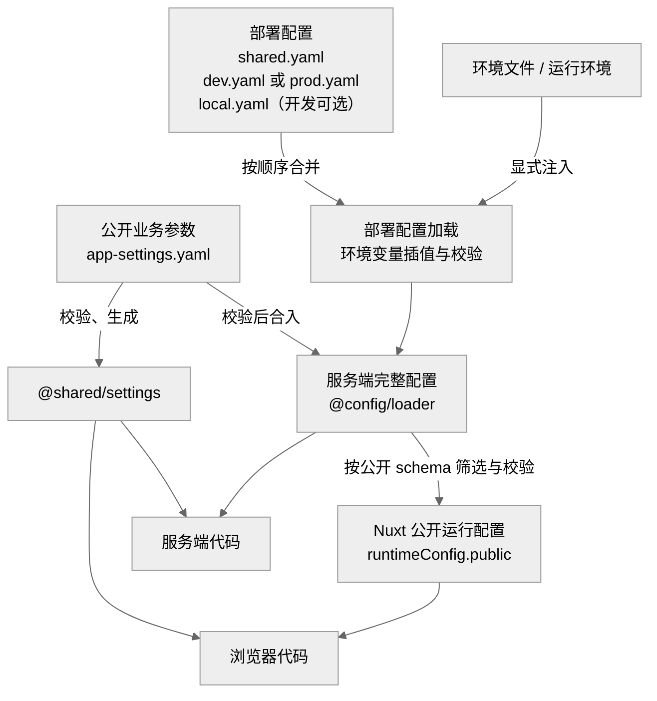

# TMP：总体实现架构（SID#0.1.DESIGN 草案）

- 本文档状态：PENDING（供人类编写、核对总体 DESIGN）
- 覆盖范围：总体运行形式、代码组织、应用层主要依赖与全站共用机制
- 整理依据：全站共用机制集中在总体 DESIGN、领域文档主要展开业务逻辑及其具体实现的要求，以及现有 [SID#0.1.LAW](LAW.md)、[SID#0.1.DESIGN](DESIGN.md)
- 原调查基线：2026-11-03；提交 `67f8dad0a15c76acdb079c1334b143fcc146b935` 加当时工作区
- 本次整理：2026-11-04；按最新章节安排整理，并静态复核相关配置、SSR、同步及 runner 代码
- 权威依据：[SID#README](../../README.md)、[SID#0.0.LAW](../0_background/LAW.md)

本文是非权威候选稿，供人类编写、核对总体 DESIGN。已有实现作为设计讨论的依据，不自动成为必须长期沿用的要求。本次仅做文档整理及相关源码核对，未重新开展完整业务验收或生产部署验证。

## 基础设施总览

基础设施关系以现有 [SID#0.1.DESIGN](DESIGN.md#基础设施) 为准，此处不维护第二份图。

项目采用同一 Nuxt 应用承载页面渲染与业务 API，默认由应用内 runner 执行后台任务。浏览器、应用、MySQL、OSS、EMQX 与外部服务协作；LAW 中的功能板块不分别对应独立部署服务。

## 代码产物结构

总体目录职责沿用现有 [SID#0.1.DESIGN](DESIGN.md#代码结构) 中的表格。

一个功能板块通常横跨 app、server 及共享模块；文档按业务领域组织，代码同时按运行位置和职责分层。领域文档负责指出自己的具体文件与模块，本文保留总体结构。

## 应用层主要依赖

此处列出应用层主要依赖。基础设施依赖见总览图，开发、部署工具在 workflows 中说明，编辑器、图片等领域专用依赖在相应领域 DESIGN 中展开。

| 依赖 | 职责 |
| --- | --- |
| Node.js / TypeScript | 应用服务与工程脚本的运行，以及代码的类型约束与检查 |
| Nuxt / Vue / Nitro | 应用组织、页面渲染、SSR 与服务端请求处理 |
| PrimeVue / Tailwind CSS | UI 组件、主题与样式 |
| Pinia | 前端应用状态管理 |
| tRPC | 前后端业务 API 调用与类型衔接 |
| Zod | 业务输入、共享数据结构及配置的运行时校验 |

版本范围与实际解析版本分别以 [package.json](../../../package.json)、[pnpm-lock.yaml](../../../pnpm-lock.yaml) 为准。

## 配置系统

配置按用途及可见范围分开管理：

| 类别 | 来源与使用方式 | 边界 |
| --- | --- | --- |
| 公开业务参数 | `config/app-settings.yaml` 经校验、生成后，由前后端通过 `@shared/settings` 共用 | 内容必须可公开；生成文件不手工修改 |
| 部署配置 | `config/shared.yaml` 与当前环境的 `dev.yaml` 或 `prod.yaml` 合并，开发环境可再由 `local.yaml` 覆盖；经服务端 loader 校验后使用 | 包含服务地址、凭据及部署开关等，不整体下发浏览器 |
| 浏览器运行配置 | 从部署配置中按公开 schema 提取，经服务端插件校验后放入 Nuxt public runtime config | 只允许经过明确筛选的字段进入浏览器 |

配置的来源、处理与使用关系如下，图中 YAML 文件均位于 `config/`：

环境变量按配置中明确声明的位置注入。仓库中的 `.env.*.layer` 保存模板、默认值和占位符，真实凭据由本地环境文件或运行环境提供。

本节规定配置的来源、加载关系与公开边界。具体业务参数的含义由所属领域说明，如何准备环境、生成配置及排查配置错误由 workflows 说明。

实现入口：[配置加载与公开投影](../../../config/lib/loader.ts)、[业务参数生成](../../../config/lib/generate.ts)、[public config 校验](../../../server/plugins/public-config-guard.ts)。

## SSR

首屏由 Nuxt 在服务端渲染，浏览器随后接管已有页面并继续交互。服务端与浏览器首次渲染所需的数据、身份视图及时间显示上下文应保持一致，避免接管时出现内容跳变或 hydration 不匹配。

与用户相关的可变状态、查询缓存按 SSR 请求隔离。需要从服务端延续到浏览器的初始状态通过 Nuxt 可序列化状态传递；普通局部变量或任意 `ref` 不会仅因参与 SSR 就自动具备这一能力。浏览器专用的订阅、存储及 DOM 操作在客户端阶段启动，并随所属实例释放。

共享取数机制协调 SSR 取数与 hydration 期间的更新，领域页面决定首屏需要哪些业务数据、哪些交互只能在浏览器中启用。

实现入口：[同步取数](../../../app/composables/useSyncedData.ts)、[同步状态](../../../app/composables/useSyncedState.ts)、[时间显示上下文](../../../app/composables/useDisplayTimeContext.ts)。

## 前后端协作

主要调用关系为：页面／组件 → composables 与 API 门面 → 服务端传输入口 → 业务服务 → 数据库及外部设施。业务 API 主要使用 tRPC；回调、文件访问等有专门协议需求的入口使用 HTTP 路由。此处概括职责分工，不要求每个入口机械经过相同层数。

前端组织展示、交互与请求，服务端负责输入校验、身份与权限判定，以及业务操作条件和持久化。前端的隐藏按钮、类型约束和本地校验不能代替服务端检查；tRPC 的类型衔接也不能代替运行时校验。

`server/shared/` 提供前后端共用的类型、schema、规则和公开参数，其运行时依赖必须可安全进入浏览器。仅用于编译期的服务端类型引用与运行时引入服务端模块需要区分；配置 loader、数据库连接及密钥不得随共享模块进入浏览器产物。

本节说明共用调用方式与职责边界。具体接口、业务输入、鉴权条件和业务状态转换在所属领域展开。

实现入口：[API 门面](../../../app/composables/useApi.ts)、[tRPC 客户端](../../../app/composables/useTrpcClient.ts)、[服务端 tRPC 初始化](../../../server/trpc/init.ts)、[共享模块](../../../server/shared/)。

## 数据更新机制

系统中的数据与状态各有职责：

| 位置 | 负责内容 |
| --- | --- |
| MySQL | 结构化业务记录及需要持久保存的任务、协作状态 |
| OSS | 文件内容；其业务归属、可见性及生命周期由服务端业务状态决定 |
| EMQX | 传递资源变更通知，提示订阅方重新读取数据 |
| 浏览器状态与查询缓存 | 当前交互、未提交编辑和已获取数据的本地副本；权限、发布结果及任务完成状态以服务端确认为准 |

业务变更通过共享同步机制通知受影响的资源，浏览器据此使相关查询失效并重新取数。MQTT 通知用于提示变化，不作为完整业务数据或操作成功的凭据。当前普通资源通知与草稿私有通知使用不同的订阅通道；接收通知不代替读取业务数据时的鉴权。

共享取数层负责同一客户端中的查询复用、失效与刷新；订阅建立或重连后，在订阅确认后补读，缩小首次取数与订阅之间遗漏变化的窗口。需要额外兜底的查询可以启用可见页面轮询，不能假定所有查询都已开启轮询或通知必定及时送达。

当前蠢猪档案的写入与 outbox 通知记录使用同一业务事务，后台任务再投递通知，失败时保留记录重试；其他领域仍通过共享发布工具直接发出通知。这两种实现的可靠性边界不同，不能将 outbox 的保证视为全站已经具备的能力。

本节保留数据归属、通知与查询之间的共用关系。各领域定义哪些业务操作影响哪些资源、数据何时允许展示，以及编辑冲突和业务状态变化如何处理。

实现入口：[通知订阅](../../../app/composables/useDataSync.ts)、[查询协调](../../../app/utils/sync/query.ts)、[直接发布工具](../../../server/lib/sync.ts)、[Content outbox 存储](../../../server/services/content/sync-outbox.repository.ts)与[投递](../../../server/services/content/sync-outbox.service.ts)。

## 后台任务机制

后台工作默认在 Nuxt 应用进程内运行，经 Nitro 插件注册，并随应用关闭而停止。通用 runner 接收领域提供的任务适配器，负责周期触发、主动唤醒、进程内并发与资源占用协调，以及关闭时的协作取消和等待。

runner 提供执行机制，各领域仍负责持久任务状态、领取与租约、幂等处理、检查点、重试条件、外部副作用回执和完成判定。具体任务是否启用由注册入口及配置决定；通用 runner 的进程内调度不自动提供跨实例互斥或持久队列保证。

任务触发后不能仅凭一次执行结束就认定业务完成，也不能仅凭关闭信号发出就认定外部操作已撤销。恢复与重试需要依据领域保存的状态和回执继续处理。

本节描述共用执行方式及其边界。图片处理、附件清理、通知投递等任务的业务步骤在所属领域说明；如何启停、部署、观察与恢复由 workflows 说明。

实现入口：[通用 runner](../../../server/services/background/runner.ts)、[Content 任务注册与生命周期接入](../../../server/services/content/background.service.ts)。

## 文档分工与调查材料

| 位置 | 展开内容 |
| --- | --- |
| 总体 DESIGN | 系统组成、代码分层、主要依赖，以及配置、SSR、前后端协作、数据更新和后台任务等全站共用机制 |
| 领域 LAW / DESIGN | 业务含义、状态、操作和验收约束，以及对应的接口、数据结构、算法与任务步骤；引用共用机制，说明自身如何使用及有哪些特殊要求 |
| workflows | 开发、测试、部署、迁移、恢复和排障的操作流程；引用总体及领域设计，说明如何执行与验证 |

已有 [SID#2.TMP-IMPLEMENTATION-NOTES](../../2_domains/TMP-IMPLEMENTATION-NOTES.md) 暂存了配置、SSR、同步及领域实现的调查材料，其中的共用机制供本文取材；材料当前的存放目录不代表这些内容最终都应进入领域 DESIGN。[SID#2.TMP-DOMAIN-NOTES](../../2_domains/TMP-DOMAIN-NOTES.md) 保留领域业务调查，[SID#1.TMP-ENGINEERING-NOTES](../../1_workflows/TMP-ENGINEERING-NOTES.md) 保留工程流程调查，均需按本次分工取舍。

共用机制在总体 DESIGN 中集中说明，各领域通过引用补充具体业务，不必为每项依赖或每种技术另建一份文档。
