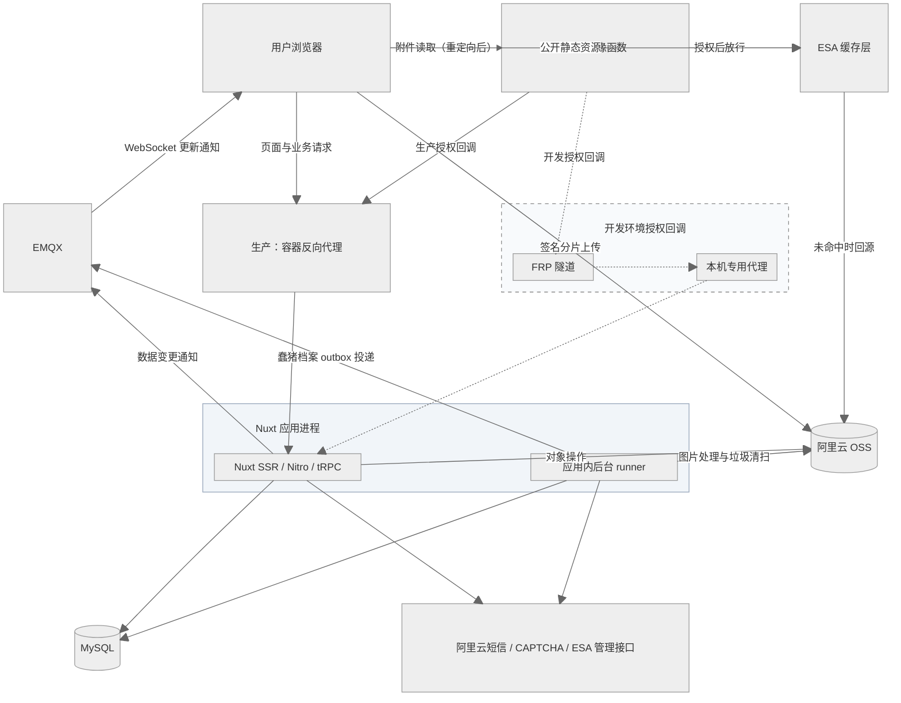
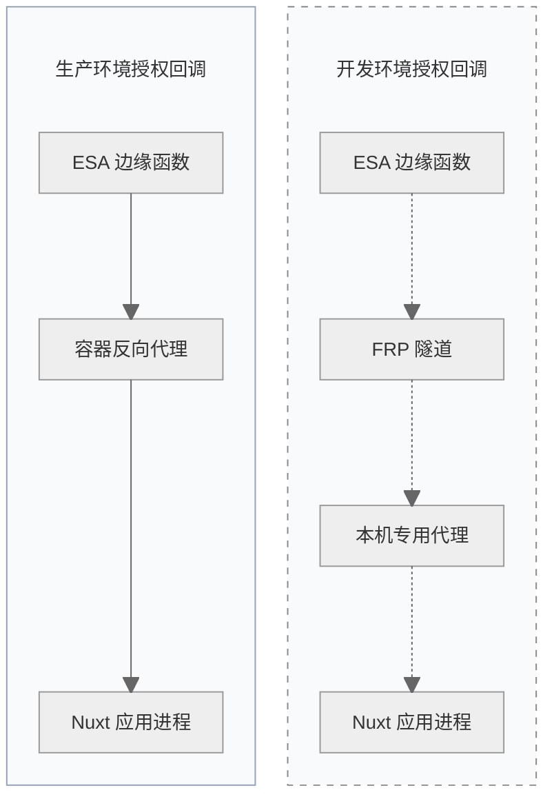

# TMP：基础设施总览的固定布局试稿

此方案已放弃，仅保留试排记录。原依据是 [SID#0.1.DESIGN](DESIGN.md) 此前将开发回调加入主图的版本；当前改为保留主图，另设普通 flowchart 对照图，见 [SID#0.1.TMP-AUTH-CALLBACK](TMP-AUTH-CALLBACK.md)。本文件不定义新的架构要求。

## 总览试稿

完整保留原图的 20 条有向关系，缩短部分连线标签。此版用于比较布局能力，暂不建议直接替换主图：节点位置固定后，直线连接仍会穿过其他节点或与标签重叠。

本图以生产环境为基础；虚线和虚框表示开发环境专用的授权回调通道，两条回调通道按环境配置选择。Nuxt 应用节点代表对应环境的实例。

本机专用代理仅转发 `POST /api/content/authorize`；开发回调的公网 HTTPS 入口等中间环节未单独展开。图中箭头延续 DESIGN 的主要请求、消息和任务处理关系。

## 回调通道并列版

将两种环境展开成左右两个视图；两边的 ESA 与 Nuxt 节点分别代表对应环境的实例。此图仅比较授权回调，不重复其余存储、消息及业务请求关系。

两条链路均为 ESA 发起的授权确认请求，通道按环境选择；响应按请求链路返回。本机专用代理只放行授权接口，公网 HTTPS 入口等中间环节与总览版一样省略。

## 布局约定

- `columns` 与 `space` 控制节点所处的行列；生产入口与开发回调通道占据同一行的左右两列。
- 组内标题仅作视觉标签，不表示独立的服务。
- 修改节点文案仍可能改变列宽与行高；固定行列不等于固定像素坐标，连线与标签需要一并检查。

## 试排结论

`block-beta` 可以稳定表达左右并列，回调通道的局部图效果较好。完整总览包含多条跨区连线，当前本地渲染器会以直线穿过中间节点；固定网格没有解决这部分可读性问题。

因此，这份试稿支持将局部对比图作为补充，但不足以证明整个主图适合改为 `block-beta`。若要求一张图同时保留全部关系、固定布局并控制折线路径，应考虑可手工布线的绘图工具。
