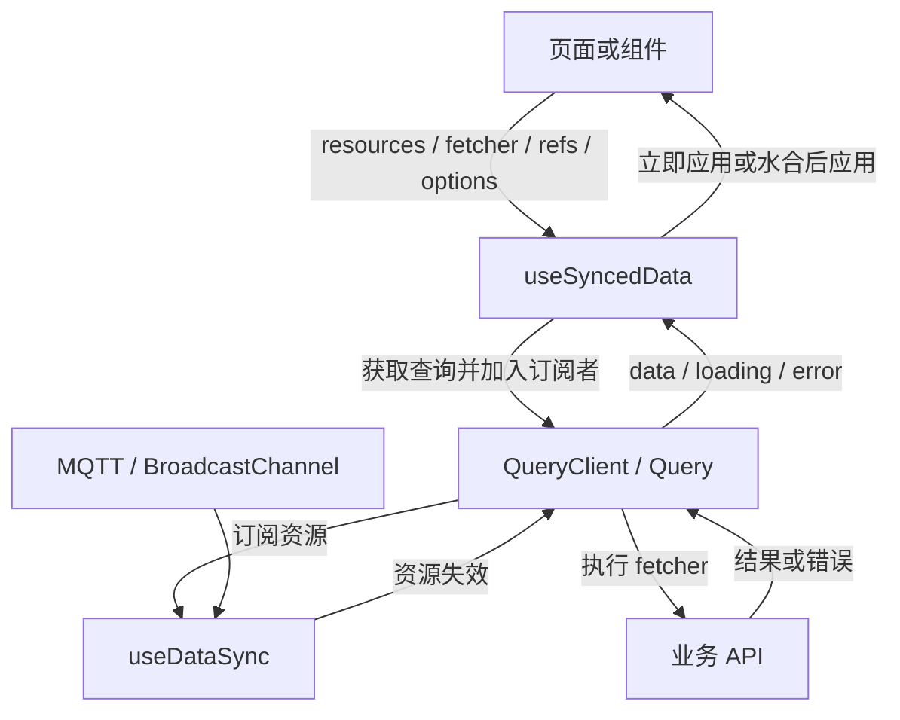

# 架构风险与优化空间

本文记录项目当前架构中的主要风险、技术难点和后续优化方向。风险按影响和实施优先级排序，建议结合实际流量、对象数量和部署方式逐步推进。

## 总体判断

项目是一个以 Nuxt 为核心的模块化单体应用，包含社区身份、权限、内容 CMS、Markdown 编辑器、附件管理、对象存储、附件加密和实时同步。

当前架构的优点是边界清晰、业务建模充分、前后端类型共享完整，并且处理了 SSR、并发登录、跨标签页同步和附件操作冲突等真实场景。主要风险集中在跨系统一致性、实时事件可靠性、全局状态复杂度和部分服务体量过大。

## SSR 与 Hydration 约束

首屏的相对时间、在线状态和服务端数据必须在 SSR 与客户端 hydration 期间保持同一份渲染快照。共享时间上下文由 `useDisplayTimeContext()` 序列化 `{ now_ms, timezone }`：服务端从时区 cookie 初始化（缺省 UTC），客户端在 hydration 前只复用 payload；`app:suspense:resolve` 后才切换到浏览器时区、写回 cookie 并启动时钟。`app:mounted` 不保证异步页面已完成 hydration。所有日期/时长工具都显式接收 timezone，不得使用模块级可变 timezone 或在渲染路径提前读取浏览器时区。

对由 `useState` 序列化的 SSR 数据，使用 `useSyncedState()` 创建传给 `useSyncedData` 的 data ref（writable computed 包装 payload state 时也用此 helper 标记）。客户端首次请求照常发出；识别到品牌 ref 后，data/loading、`on_data` 和 `on_error` 更新会暂存到 `app:suspense:resolve` 再应用，避免 hydration 中途用不同的在线状态或内容覆盖 SSR 快照。若响应到达时 hydration 已结束，则立即应用。资源切换、查询失效和组件卸载会清除旧暂存结果。完全不传 data ref 的 options-only 重载也会在 hydration 期间暂存回调；显式传入普通 `ref` 则保持立即更新。Fetcher 应返回数据，不应直接修改参与渲染的共享状态。

`useSyncedData(resource, fetcher, data, options)` 会在内部管理 loading；只有界面确实消费 loading 状态时，才额外传 `loading` ref（`useSyncedData(resource, fetcher, data, loading, options)`）。

新增或调整日期显示、在线状态与 SSR 数据同步时，必须检查是否使用了共享时间上下文、显式 timezone 和 hydration 暂存机制；直接调用 `Date.now()`/`Intl.DateTimeFormat()`、默认 timezone 格式化或在 fetcher 中直接写渲染状态都需要说明并证明不会造成首帧不一致。

## 主要风险

### 1. OSS 与数据库之间缺少原子一致性

附件和头像分别由 MySQL 元数据与 OSS 对象共同组成，两个系统之间没有分布式事务。当前删除流程通常是：

1. 删除或更新数据库记录；
2. 删除 OSS 对象。

因此可能出现：

- 数据库有记录，但 OSS 对象不存在；
- 数据库记录已经删除，但 OSS 对象删除失败；
- 上传临时对象、复制对象或 multipart upload 在中途失败后遗留；
- 旧头像替换成功，但旧对象未能删除。

相关代码：

- [server/services/content.service.ts](../server/services/content.service.ts)
- [server/services/profile.service.ts](../server/services/profile.service.ts)
- [server/lib/storage.ts](../server/lib/storage.ts)

当前已有 [scripts/cleanup-orphan-attachments.ts](../scripts/cleanup-orphan-attachments.ts) 对账工具，默认只报告，`--delete` 才执行清理。它覆盖正式附件、历史数据库 orphan 行、临时上传、multipart upload 和未引用头像。

**建议：**

- 保留定期 reconciliation job，先 report-only，再自动删除；
- 为 OSS 删除增加重试记录，不要静默吞掉所有异常；
- 长期增加 `storage_delete_jobs` 或 outbox 表；
- 对数据库有引用但 OSS 缺失的对象只告警，不自动删除数据库记录；
- 为临时上传和 multipart upload 设置明确的保留期限。

优先级：**高**。

### 2. MQTT 刷新事件可能丢失

实时同步通过 MQTT 发布资源刷新事件，客户端收到事件后重新请求数据。当前 MQTT 发布逻辑在连接未就绪时有限重试，最终仍可能丢弃事件。

相关代码：

- [server/lib/mqtt.ts](../server/lib/mqtt.ts)
- [server/lib/sync.ts](../server/lib/sync.ts)
- [app/composables/useDataSync.ts](../app/composables/useDataSync.ts)
- [app/composables/useSyncedData.ts](../app/composables/useSyncedData.ts)

事件本身只表示“资源需要刷新”，不保存完整状态。因此事件丢失后，客户端可能长时间看不到最新数据，除非存在轮询或重新进入页面。

**建议：**

- 把 MQTT 定位为低延迟通知，而不是可靠消息队列；
- 对关键资源保留 `updated_at`、revision 或版本号校验；
- 客户端重连后主动刷新已订阅资源；
- 需要严格可靠时，增加数据库 outbox：业务事务写数据时同时写事件，后台任务负责发布；
- 记录发布失败次数和资源标识，便于定位同步问题。

优先级：**高**。

### 3. OSS 删除失败被静默忽略

多个业务路径使用 `.catch(() => {})` 忽略 OSS 删除异常。这能避免外部存储故障阻塞用户操作，但会隐藏真正的一致性问题。

**建议：**

至少记录结构化日志：

```ts
try {
  await delete_object(key)
}
catch (error) {
  console.error('[storage-delete-failed]', { key, error })
}
```

更好的方案是：数据库事务只记录待删除对象，后台任务异步删除并重试。

**现状（已实施最低方案）：** 所有业务删除统一走 [server/lib/storage.ts](../server/lib/storage.ts) 的 `delete_object_best_effort()`，失败时输出 `console.error('[storage-delete-failed]', { key, error })`，业务路径不再静默吞错；数据库待删除记录 + 后台重试仍未做。新代码禁止再写 `delete_object(...).catch(() => {})`。

优先级：**高**。

### 4. 内容服务职责过多

[server/services/content.service.ts](../server/services/content.service.ts) 同时处理：

- Story 创建、更新、删除；
- Markdown 校验和引用解析；
- 附件上传、替换、重命名和移动；
- 文件夹操作；
- 附件加密和解密；
- OSS 对象复制和删除；
- 内容同步事件。

目前逻辑仍可维护，但继续加功能会使测试、依赖关系和事务边界越来越难理解。

**建议：**

渐进拆分为以下领域服务：

- `content-story.service.ts`
- `content-upload.service.ts`
- `content-folder.service.ts`
- `content-encryption.service.ts`
- `content-rendering.service.ts`

拆分时保持现有 tRPC API 不变，先移动内部函数和测试，再调整 import，避免一次性大重构。

优先级：**中**。

### 5. 实时同步的所有权与兼容约束

同步分为三个职责层，运行时实例通过 Nuxt app 对象关联，不写入 payload：

- [app/composables/useDataSync.ts](../app/composables/useDataSync.ts)：应用级传输工厂，管理 MQTT、BroadcastChannel、事件分发和连接生命周期；[app/plugins/data-sync.client.ts](../app/plugins/data-sync.client.ts) 显式提供身份变化与退出处理，并启动传输。不再依赖首次调用组件的 `useAuth` 或生命周期。
- [app/utils/sync/query.ts](../app/utils/sync/query.ts)：`QueryClient` 管理共享注册表；共享与独立 `Query` 使用同一个请求引擎，负责缓存、请求版本、在途失效、事件订阅和轮询。
- [app/composables/useSyncedData.ts](../app/composables/useSyncedData.ts)：适配 Vue refs、订阅者回调和 hydration 暂存。只有数据快照由 `useSyncedState` 进入 payload。

**信息流：**



首次调用会按 `immediate` 加载；已有共享缓存时直接采用。服务端快照不替代客户端首个查询的请求。手动 `refresh()` 和轮询直接进入 Query，不经过传输层。资源事件进入 `invalidate()`，使旧响应与水合暂存结果失效；在途请求结束后合并补一次请求。普通刷新事件不携带业务数据，实际数据由 fetcher 获取；`task_progress` 等自带快照的事件是例外，可通过 `useDataSync().subscribe()` 直接应用，不必进入查询层。

组件仅拥有自己的订阅者、refs 和水合暂存，不拥有共享查询或连接。组件卸载先退订；最后一个订阅者离开才释放 Query 的缓存、事件订阅与轮询。应用卸载清理整个 QueryClient 和传输实例。SSR 当前使用独立 Query，客户端才按 key 共享；运行时 Promise、回调和连接状态均不序列化。

**调用示例：**

```typescript
await useSyncedData(sync_resource('content_stories', 'all'), fetch_stories, stories)

await useSyncedData(
  [otp_sync_source, otp_sync_by_identity_source],
  sync_otp_cooldown,
  otp_cooldown_until,
  otp_sync_loading,
)

const { refresh } = await useSyncedData(null, fetch_users, users, {
  universal: false,
  fetch_without_resource: true,
  polling_interval: settings.app.admin.pollIntervalSeconds * 1000,
})
```

固定资源直接传字符串或 `sync_resource()` 的返回值，无需包 `ref`/`computed`；动态资源使用 ref/computed，资源数组也可包含它们。OTP 的手机号和身份事件触发同一个带手机号的查询，服务端已按身份或手机号查询冷却记录。`query_key` 接受字符串、`null` 或 ref，只覆盖查询身份，不改变事件订阅；同一事件资源下的不同筛选/分页结果应使用不同 key，并把所有影响结果的参数纳入 key。多个资源直接放在第一个参数，options 不再提供 `resources` 字段。

**行为规则：**

- 第一个参数直接接受单个资源、资源数组、ref 或包含 ref 的数组，例如 `'profile:1'`、`['profile:1', 'profile_sessions:1']`、`ref(['profile:1'])` 和 `['profile:1', ref('profile_sessions:1')]`。资源会过滤空值、去重并排序；单资源保持原查询 key，多资源默认以排序后的数组 JSON 作为查询 key，顺序和重复项不影响共享。可用 `query_key` 字面量或 ref 独立指定缓存身份；未传时回退到资源集合，显式 `null`/空字符串停用查询（除非启用 `fetch_without_resource`）。空数组/null 默认停用查询；显式非空 query key 可以启用无事件订阅的查询，独立无 key 查询继续使用 `universal: false` 和 `fetch_without_resource: true`。相同 query key 的 fetcher 必须等价；兼容模式在每次请求开始时选择第一个仍活跃的 fetcher。创建者离开后自动交接；其在途响应不再发布，剩余订阅者重新请求。依赖组件私有状态的不同 fetcher 应使用不同 query key 或 `universal: false`。
- 共享手动刷新合并为一个任务；独立手动刷新允许并发，默认仅最新响应生效。同步/身份失效令旧版本无效；在途失效会在当前请求结束后补一次请求，不丢失通知。
- 请求失败通知所有活跃自定义错误回调，默认 toast 对同一次失败只显示一次；401 保持不弹 toast。订阅者回调异常单独记录，不改写为请求失败。
- 每个查询只持有一份轮询，采用活跃订阅者请求的最短间隔；仅在标签页可见、没有在途请求且距上次完成达到间隔时运行。失败也计入完成时间。最后一个订阅者离开时停止轮询/事件订阅并忽略晚到结果。
- 传输按 tab ID 保存远端资源并取并集；一个标签页退订不影响其他标签页。事件 ID 在可配置的有界集合内去重。重连由传输层单独调度；pagehide、bfcache 恢复和应用卸载分别暂停、恢复和清理连接、监听器及计时器。
- 身份变化通过传输的全资源失效通知刷新有订阅的查询与原始监听者；插件另行失效没有事件资源的查询，避免漏掉无 key 的 admin 请求。HTTP 请求身份仍由服务端 cookie 决定，不能用页面身份 ref 跳过请求。

**剩余约束：** 没有加入 leader election，仍保持隐藏标签页断开 MQTT 的现有策略。tab ID 来自 sessionStorage；异常终止的远端订阅会在下一次资源收集时清除。底层 fetcher 暂无统一取消协议，失效/卸载通过版本与订阅生命周期阻止晚到写入，而不是中止 HTTP 请求。

### 6. 生产错误响应可能泄露内部信息

[server/error-handler.ts](../server/error-handler.ts) 对一般 `Error` 会直接使用 `error.message` 返回给客户端。某些数据库、OSS 或第三方 SDK 异常可能包含内部路径、SQL 片段、服务地址或实现细节。

**建议：**

- 生产环境仅向客户端返回通用错误消息；
- `ApiError` 和校验错误才返回明确的用户提示；
- 服务端日志保存完整 stack；
- 给响应增加 request ID，方便从日志定位；
- 区分可预期业务错误、外部服务错误和内部错误。

优先级：**高**。

### 7. 批量操作的规则在客户端和服务端之间重复

附件批量加密、移动和删除会在客户端提前拆分可操作项，服务端仍会对整个请求执行最终校验。这种设计提升了交互体验，但客户端规则和服务端规则可能逐渐漂移。

**建议：**

服务端返回结构化部分成功结果，例如：

```json
{
  "succeeded": ["a.png"],
  "skipped": [
    { "file_name": "secret.png.good", "reason": "encrypted" }
  ]
}
```

客户端可以继续提前预览，但服务端结果应当是最终权威。

优先级：**中**。

**现状（已实施）：** 批量加密、移动和删除现在由服务端返回 `succeeded` 与带原因的 `skipped`，客户端仍可提前拆分以改善交互，但只按服务端结果更新本地 markdown 和附件列表；服务端结果是最终权威。

### 8. 数据库迁移流程仍可加强

项目有独立的 `migrations/` 目录和参考 schema，但随着 Session generation、附件加密、文件夹行等结构持续演进，手工执行迁移的风险会增加。

**建议：**

- 增加迁移版本记录表；
- 明确迁移命名和执行顺序；
- 部署时自动检查待执行迁移；
- 对不可逆迁移记录明确说明；
- 在 CI 中用全新数据库执行完整迁移；
- 参考 schema 由迁移链取代（`migrations/` 为唯一事实源），不再维护手工导出的 dump——它已随迁移推进而漂移。

优先级：**中**。

**现状（2026-10-08 部分已实施）：** 执行器（[scripts/migrate.ts](../scripts/migrate.ts)）自带版本记录表、checksum 篡改检测、`GET_LOCK` 命名锁和 `--baseline` 接管；存量结构已固化为 `migrations/20261008000000_init_schema.sql`，开发库与生产库均完成 baseline 登记，容器启动自动幂等执行增量迁移；对"有业务表但无迁移记录"的存量库会自动 baseline（登记而不重放），不会重演启动死循环。CI（[check.yml](../.github/workflows/check.yml)）在全新 MySQL 8.4 上做空库全量重放 + 二次执行幂等验证，并前置 lint/typecheck/单测。未做：参考 schema drift 自动检测、dev 启动时的 pending 迁移警告、执行耗时记录。

### 9. 生产可观测性不足

当前主要依赖 `console` 日志，难以完整回答以下问题：

- 哪次上传卡住或失败；
- 哪个请求触发了锁竞争；
- 某个同步事件是否发布失败；
- 某个 Session 为什么被判定为无效；
- OSS 与数据库何时开始不一致。

**建议：**

统一结构化日志字段：

- request ID；
- user ID / session ID；
- story ID；
- operation kind；
- duration；
- 外部服务名称和结果；
- 错误分类。

同时为 OSS 对账、MQTT 发布、附件锁竞争和登录失败增加计数指标。

优先级：**中**。

## 技术难点与维护重点

### Session token generation family

[server/services/session.service.ts](../server/services/session.service.ts) 没有简单地让 JWT 失效，而是将 token hash 按 generation 保存到数据库，并允许旧 generation 在自身过期前继续完成并发请求。这解决了 SSR、多个标签页和 Set-Cookie 丢失造成的随机登出问题。

后续修改认证逻辑时必须重点回归：

- 并发刷新；
- 旧 generation 请求；
- Session logout；
- ban 用户；
- SSR 请求不得轮换 token；
- generation 数量上限。

### 附件路径和加密状态

附件名称、扩展名、`.good` 标记和数据库中的 `encryption_key` 共同决定渲染状态。文件重命名不能改变加密状态，替换加密文件也必须被拒绝。

相关共享规则位于 [server/shared/content-markdown.ts](../server/shared/content-markdown.ts)，不要在页面、router 和 service 中分别重新实现文件名规则。

### Markdown 编辑器与预览的一致性

编辑器、预览和服务端保存使用共享 Markdown 规则，但 CodeMirror 语言解析、lint、补全、源代码行锚点和 HTML 嵌套解析仍然是多个独立实现面。

新增 Markdown 语法时应同时考虑：

- 服务端解析和保存校验；
- 编辑器高亮和补全；
- 预览渲染；
- SSR 输出；
- 图标 bundle 注册；
- 对应测试 fixture。

## 优先级路线图

### 高优先级

1. 保持 OSS 对账任务定期运行，先报告再自动删除；
2. 为 OSS 删除失败增加重试或删除任务表；
3. 对生产错误响应做脱敏；
4. 为 MQTT 事件增加重连刷新和版本校验；
5. 为上传、删除、加密和目录移动增加故障注入测试。

### 中优先级

1. 拆分 `content.service.ts`；
2. 抽象 `SyncRuntime`；
3. ~~建立正式数据库迁移执行记录~~（已完成，见上文 #8 现状）；
4. 增加结构化日志、request ID 和关键指标；
5. 让批量操作返回结构化部分成功结果。

### 低优先级

1. 清理历史兼容代码；
2. 统一少量命名和注释风格；
3. 为拖拽、IndexedDB、Canvas、MQTT 浏览器行为增加端到端测试；
4. 继续优化前端同步代理的测试工具。

## 验证基线

当前项目已有较完整的单元测试，最近验证结果为：

- 19 个测试文件；
- 436 个测试通过；
- `npx nuxt typecheck` 通过；
- `pnpm lint` 通过。

后续每次处理上述风险时，应至少补充对应领域的回归测试，并优先验证失败路径，而不是只验证正常流程。
