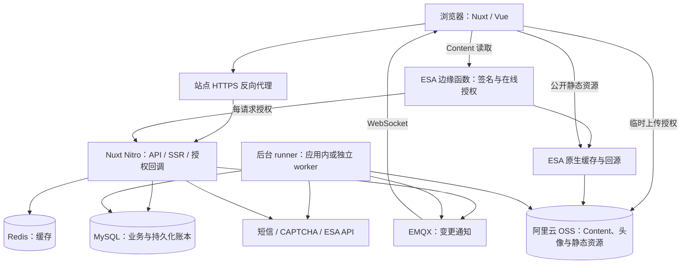

# 业务、架构与依赖总集

本项目是『蠢猪小组』网站，包含公开展示、账号与用户资料、管理控制台，以及『蠢猪档案』的正文和附件工作区。本文建立系统全貌；部署值、控制台操作和模块细节分别由对应手册维护。

## 业务与权限

| 模块 | 用户能做什么 | 详细说明 |
| --- | --- | --- |
| 账号与会话 | 注册、登录、验证码验证、管理个人资料和会话 | [账号](modules/accounts.md) |
| 管理控制台 | 查看用户、按授权管理账号与权限、读取后台状态 | [账号](modules/accounts.md) |
| 档案 | 浏览和编辑 Markdown、封面及档案属性 | [Content 总览](modules/content/README.md) |
| 附件工作区 | 管理文件/目录、上传续传、替换、改名、移动、删除、处理冲突 | [工作区](modules/content/workspace.md)、[上传](modules/content/uploads.md) |
| 图片 | 普通预览、编辑、独立另存、原图及删减版本 | [图片](modules/content/images.md) |
| 内容引用 | 档案/附件链接、文件夹卡片、图片和其他方言渲染、诊断 | [Markdown](modules/content/markdown.md) |
| 实时更新 | 跨页面、标签页及浏览器同步变更 | [同步](modules/realtime.md) |

权限定义在 [server/shared/permissions.ts](../server/shared/permissions.ts)，不能只根据菜单是否可点击判断权限：

- `admin_access` 有只读和完全级别；只读不等于可以修改用户。
- `content_manage:full` 控制档案管理；`content_private:read` 控制完整机密内容读取。
- `is_admin` 用户在统一权限判断中拥有全部权限。普通用户没有自动获得的授权项。
- 页面可以呈现不同权限视角，最终读取、修改、上传发布和在线授权仍由服务端判断。

当前 `.good` 是文件/目录的机密标记，目录状态可以传递给子路径。它不表示当前上传内容经过 AES 加密。历史 AES 对象的解密仅属于[旧数据迁移](operations/content-cutover.md)。

## 部署拓扑与边界

此图表示逻辑职责。生产 Compose 当前只编排应用容器，MySQL、Redis、EMQX 由外部 Docker 网络中的服务提供；开发 Compose 提供这些依赖。runner 默认随应用运行；独立 worker 当前可在源码工作区启动，生产镜像和 Compose 尚未提供对应交付产物，不能仅切换模式配置。详细步骤见[部署总流程](deployment/README.md)。

Content 读取链路中，边缘函数先验证请求并调用应用授权接口，放行后由 ESA 原生缓存/OSS 交付对象。函数不代理大文件字节流。缓存命中仍需经过授权；回调故障按拒绝读取处理。具体匹配条件、缓存键、响应头及回源规则见 [ESA](deployment/esa.md) 和[函数部署](deployment/esa-functions.md)。

## 代码分层

| 位置 | 责任与边界 |
| --- | --- |
| `app/pages/`、`app/components/` | 页面、交互和展示，复用 `My` 组件 |
| `app/composables/` | 页面会话、API facade、同步资源、编辑/上传协调 |
| `app/stores/` | 跨组件保留的客户端状态；草稿与上传分别管理 |
| `app/utils/` | 纯逻辑与渲染辅助，配置由调用方传入 |
| `server/trpc/` | 过程入口、输入校验、认证中间件；业务交给 services |
| `server/api/` | tRPC 适配器及授权/附件等 HTTP 协议入口 |
| `server/services/` | 授权、事务、业务状态机与对外操作协调 |
| `server/lib/` | MySQL、Redis、存储、MQTT、云 SDK 等基础设施 |
| `server/shared/` | 浏览器安全的类型、规则、schemas、生成 settings |
| `server/types/` | 仅服务端使用的内部类型 |
| `config/` | 配置层、schema、生成器、边缘函数及 RAM 策略 |
| `migrations/` | 按版本排序的 SQL/TS 迁移及其冻结实现 |
| `scripts/` | 本地启动、部署、维护打包、迁移和验证入口 |

主要 API 域为 `auth`、`profile`、`admin`、`content`、`presence` 和 `system`，由 [router.ts](../server/trpc/router.ts) 汇合。前端通过 [useApi.ts](../app/composables/useApi.ts) 的领域方法调用；API-facing 类型放在 `server/shared/types/`。

## 核心数据与一致性

MySQL 是业务事实源。迁移链描述实际结构，不能单独看初始 SQL 推断当前模型。

| 数据 | 当前职责 |
| --- | --- |
| 用户与登录会话 | 身份、权限、会话有效性和活动时间；在线状态从会话数据推导 |
| 档案正文与附件节点 | 正文版本、目录父子关系、稳定节点身份、名字和对象指针 |
| 上传会话与预约 | 限定本次操作目标、临时对象和发布条件，支持续传与取消 |
| 引用历史与工作区版本 | 改名/移动后的引用重放、草稿同步和过期基线检查 |
| 图片任务 | 从受控输入产生原图/AVIF/JPEG/LQIP，完成后发布指针 |
| 通知 outbox | 与 Content 事务一起落库，确认发送并重试 |
| 对象退役与预热记录 | 外部副作用、租约、重试、未知结果对账及额度 |
| `migration_runs` | SQL/TS 统一执行回执；已应用或开始的版本保持冻结 |

目录改名、移动、删除等结构操作使用事务和相应路径/版本约束。上传和图片转换把耗时对象操作分成准备、执行、发布阶段，完成对象上传不等于业务发布已经完成。前端列表和草稿正文应以发布结果与版本同步为准。

Content 变更把通知写入业务事务内的 outbox，后台确认 MQTT 投递。非 Content 域仍使用直接刷新通知。MQTT 是变更提醒，浏览器重新请求 API 获取经过当前权限过滤的数据；它不是业务状态的唯一存储。时间推导的在线状态另有可见标签页轮询，见[实时同步](modules/realtime.md)。

## 四条关键业务链路

### 上传与替换

选择/拖入文件 → 规范化名字与机密继承 → 服务端校验和预约 → 分片上传或续传 → 完整性检查/图片派生 → 事务发布 → 引用与通知同步。

遇到名称、权限、已有删减版等冲突时，resolve 汇总并允许按原因选择处理方式，重试仍重新校验。取消、发布和迟到完成需要仲裁；不能只删除任务卡片当成取消成功。详见[上传](modules/content/uploads.md)。

### 图片与删减版

可编辑静态图片具有独立原图以及展示用 AVIF/JPEG 派生版本。删减版是同一附件 row 的额外版本；不创建依赖源附件的新 row。另存为则创建独立附件和自身原图。GIF/SVG 等其他图片按原始字节处理，其编辑能力与可解码静态图片不同，见[图片模型](modules/content/images.md)。

### 引用与草稿

正文中的 `att://`、`content://` 通过统一解析与当前工作区上下文确定目标。重命名、移动、机密切换等操作涉及路径变化时，通过版本化记录更新正文和本地草稿。历史不足或并发版本冲突不能静默套用；上传替换与正文更新也必须协调，见[引用](modules/content/markdown.md)和[草稿](modules/content/drafts.md)。

### 读取、撤销与回收

服务端选择允许的资源版本并签发读取信息 → ESA 在线授权 → 原生交付。普通版本、原图和删减版各有明确语义，普通下载不会偷偷降级为删减版。

权限撤销依赖在线授权和版本检查；存储删除及缓存刷新由退役流程完成。这两件事有不同的完成条件。已经下载到客户端的副本不能撤回，已在进行的传输边界见[访问控制](modules/content/access.md)。

## 后台工作与维护

统一 runner 管理六类有界扫描：图片、上传生命周期、对象退役/刷新、预热、Content 通知、OSS 全桶对账。领域服务继续拥有自己的表、租约和检查点。资源槽限制每进程扫描并发，不能当作云端 QPS 或集群容量；当前没有通用 job/attempt/step 调度内核。对账默认只报告；可显式开启受连续周期、对象身份和发布互斥保护的 Content 孤立对象退役，见[对账手册](operations/storage-audit.md)。

引用历史清理由独立 Nitro 插件维护，不在这六类适配器内。SQL/TS 迁移是显式维护工具，也不由后台 runner 自动接管。

`/healthz` 检查数据库查询及当前迁移回执表可读性，返回已完成数量；它不证明每个外部服务可用，也不替代版本链检查或端到端验收。

## 配置与依赖

配置分为三类：浏览器安全的稳定业务参数、随环境变化的部署配置、秘密和显式引用的环境变量。YAML 使用 shared → dev/prod → 可选本地开发覆盖；数组整体替换，映射递归合并。详细字段和启动来源见[配置手册](deployment/configuration.md)。

| 依赖组 | 当前用途 | 事实入口 |
| --- | --- | --- |
| Node 24、pnpm | 服务运行、依赖锁定和脚本 | [Dockerfile](../Dockerfile)、[CI](../.github/workflows/check.yml) |
| Nuxt 4、Vue 3、TypeScript | SSR、路由、Nitro 服务、类型 | [package.json](../package.json)、[Nuxt 配置](../nuxt.config.ts) |
| PrimeVue、Tailwind 3、Pinia | 组件、设计样式与客户端状态 | [前端规则](../.github/instructions/frontend.instructions.md) |
| tRPC、Zod | 类型化 API、输入与配置校验 | `server/trpc/`、`config/lib/schema.ts` |
| CodeMirror、markdown-it | 正文编辑、方言编译与预览 | [Markdown](modules/content/markdown.md) |
| CropperJS、ViewerJS、Sharp | 浏览器编辑/预览和服务端图片转换 | [图片](modules/content/images.md) |
| MySQL、mysql2 | 事务、业务数据、持久化工作与迁移回执 | [数据库部署](deployment/mysql-redis.md) |
| Redis、ioredis | 外部信息等缓存；调用方处理缓存故障 | [集成](modules/integrations.md) |
| EMQX、mqtt | 服务端发布及浏览器 WSS 通知 | [MQTT 部署](deployment/mqtt.md) |
| ali-oss、Aliyun SDK、ESA CLI | OSS、分片签名上传、短信/CAPTCHA、边缘部署与云任务 | [部署总流程](deployment/README.md) |
| AWS S3 SDK | 仅历史存储兼容、盘点和迁移；当前业务使用阿里云 OSS | [Content 切换](operations/content-cutover.md) |
| Vitest、ESLint、vue-tsc、esbuild | 验证、风格、类型与维护脚本打包 | [测试](development/testing.md) |

准确依赖版本以 `package.json` / `pnpm-lock.yaml` 为准。本表说明职责，不另维护一份完整依赖版本清单。浏览器最低兼容配置也不能等同于文件句柄、画布等所有原生能力都可用。

## 上线边界

- 当前生产编排、边缘发布配置和云端实际资源需要按[部署手册](deployment/README.md)逐项核对；仓库中的配置不证明控制台已经完成设置。
- 2026-10-25 已完成生产 Content 副本预演、正式迁移和同步上线，静态资源已复制到新桶。
- 日常运行仅使用阿里云 OSS；旧对象和源凭据仅作受保护的历史恢复材料，不自动全桶清理。
- 没有业务回收站或通用自动数据回滚。恢复需要数据库元数据、对象版本及相关密钥材料配套，见[备份恢复](operations/backup-recovery.md)。
