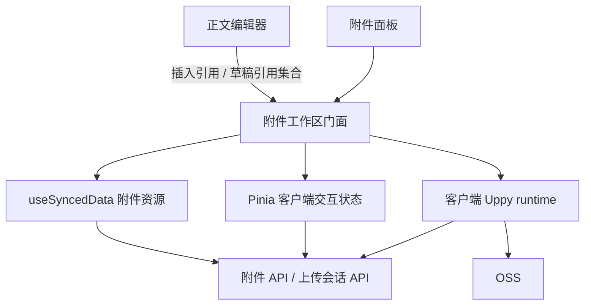

# 附件工作区重构提案：OSS + Uppy + 上传会话

状态：目标架构和实施依据。引用语法阶段已实施，完整附件工作区尚未切换；具体完成项、验证及前置条件见[执行记录](./content-refactor-progress.md)，本文不表示所有目标已经实现。

配套文档：[正文引用语法：`att://` 与 `content://`](./content-reference-links.md)。旧文档中仍有价值的内容已并入本文，取舍见附录 A。

目标：降低长期维护成本，而非保留现有任务框架或降低重建成本。附件管理与正文编辑在模块、资源和版本上解耦（正文仍以 `att://` 路径引用附件，见 §4.2）；移除通用附件任务模型和 AES 加解密链路（机密附件改存独立的私有存储桶，读取经服务端鉴权后签名，删减版保留，见 §10.4）；保留选择、拖拽、disabled、确认和 resolve 交互。

## 1. 结论与边界

- 服务端拥有附件身份、命名空间、上传预约和正式落库结果。
- Uppy 拥有本地字节传输、分片调度、传输重试与进度；上传成功不等于附件已落库。是否采用 Uppy 以 §7.4 的前提验证为准；不满足时由现有自制上传器实现同一适配接口。
- 独立附件领域模块向 UI 暴露列表、操作和选择状态；store 不复制 Uppy 或服务端通用任务状态机。
- 普通操作直接请求，不先调用 lock 或 preflight API；服务端在短事务内处理一致性。
- 上传先请求创建会话并原子预约目标，成功后才发任何对象存储写请求。
- 可处理的业务冲突返回结构化 409；前端保存待处理请求，resolve 后以修改过的新请求重新提交。服务端不保存待确认任务。
- 批量命令带按错误分类的处理策略（报错／跳过／改后缀／清洗）；默认全部为“报错”，任何一项最终报错则整体失败、零业务修改（§6.1）。
- 正文以 `att://路径` 引用附件、以 `content://标题` 引用档案。命名空间有版本号和变更日志：改名／移动在同一事务内改写已保存正文但不抬正文 revision；attachment list 更新后，前端若持有 draft，就主动提交给服务端，由与已入库正文同源的逻辑替换引用，保存时服务端再重放兜底（§4.2）。档案标题改名走同一条路径（配套文档 §7）。
- 不新增 BullMQ、Temporal、通用 command runner 或通用工作流框架。

“无客户端预锁请求”不等于“服务端无锁”；“无服务端 retry 任务”不等于“无幂等记录”。

## 2. 当前实现中的耦合

| 位置 | 已确认的问题 | 重构目标 |
| --- | --- | --- |
| [编辑页](../app/pages/content/[id]/edit.vue) | 列表来源、行投影、树、选择、拖拽、围栏、上传和操作弹窗集中在页面；选中目录后又展开子文件提交 | 页面仅处理正文、光标与附件插入 |
| [任务 store](../app/stores/contentTasks.ts) | 同时接收任务快照、保存文件、控制上传及处理任务生命周期 | 上传运行时与附件工作区分离 |
| [结构服务](../server/services/content/attachment-structure.service.ts) | 重命名／移动逐对顺序改写正文引用（链式移动会串改），并递增正文 revision；目录改名不改写目录引用 | 按命名空间日志一次替换改写，目录按前缀改写，不抬正文 revision |
| [正文方言](../server/shared/content-markdown.ts) 与 [渲染链接](../app/utils/content/markdown/links.ts) | 附件靠“无 scheme 相对路径”、档案靠 `@` 前缀推断；识别规则在共享模块、渲染端和补全中各写一份 | 显式 `att://`／`content://`，单一解析入口（配套文档 §3） |
| 名称规则 | 数据库 `utf8mb4_unicode_ci` 与前端 `toLowerCase` 的重名判断不一致 | 统一 `name_key`（§4.1） |
| [正文服务](../server/services/content/story.service.ts) | get_story 带附件、目录、任务和锁；update_story 同时接收 delete_files | 正文与附件使用独立读取、写入、版本和同步资源 |
| [传输错误归一化](../app/composables/useTrpcClient.ts) | 错误主要保留 message/status，无法完整携带 resolve 选项 | 端到端保留白名单化的类型化冲突详情 |
| [对象清理](../scripts/cleanup-orphan-attachments.ts) | 暂存清理按对象年龄判断，尚不了解新上传会话 | 以存活会话、正式引用和过期规则为清理依据 |

旧 [任务重构文档](./old/content-task-refactor.md)、[架构风险](./old/architecture-risks.md) 和 [交接文档](./old/handover.md) 描述当前系统背景，不作为新协议的兼容要求；其中仍有价值的经验已并入本文，逐项取舍见附录 A。实现切换后再更新它们的状态及相关入口文档。

## 3. 选择、目录与命令

### 3.1 提交选择根，不提交展开清单

选择 `folder`、`folder/sub`、`folder/sub/file.pdf` 时仅提交 `folder`，即保留选中集合中最上层的祖先，不是仅去掉直接子项。没有选中祖先时不凭空添加祖先。

前端仍可展开子树计算预览、统计和 disabled，但请求目标仅包含选择根。服务端再做同样的去重，并按当前数据展开目录；不信任客户端的去重、父子关系或权限判断。

API 请求使用带类型的稳定节点 ID，而非依赖尾部 `/` 区分文件夹；正文引用仍用路径（§4.2）。用户界面仍显示 `folder/`，语义仍是“操作这个目录本身”：

```json
{
  "request_id": "new-command-id",
  "story_id": 42,
  "targets": [
    { "kind": "folder", "id": "folder-id" },
    { "kind": "file", "id": "file-id" }
  ],
  "destination_folder_id": "destination-id",
  "on_error": { "name_conflict": "fail", "reserved": "fail", "source_busy": "fail", "other": "fail" }
}
```

例子是 move 的请求契约草案，不是通用 `kind + 任意 payload` 执行接口。delete 不含 destination，但目录根带确认时的子树指纹（§3.2）；rename、create_folder 使用各自的严格 schema。`on_error` 各分类缺省为 `fail`，可选值按操作收窄（§6.1）。

### 3.2 批量命令按错误策略整体提交或整体拒绝

- 批次指一次用户操作提交的全部选择根（一次拖入的文件、一次拖拽移动、一次多选删除等）；同一批只有一种操作。
- 服务端在同一事务内按请求的 `on_error` 逐项求值，不在第一项出错时停止。只要有一项最终为“报错”，就整体回滚、零业务修改，并返回列出全部条目的结构化 409；否则提交，返回成功、跳过和改名的明细。规则见 §6.1。
- “跳过”“改后缀”是用户在提交前明确选择的策略，执行仍是原子的；不做“部分已执行、部分等用户 resolve”的隐式流程，否则前端又需要重建任务账本。
- 一个目录根整体处理：错误归到选择根上，跳过即跳过整个根；目录中有引用或上传预约时不能偷偷删除其余子项。若用户明确要求仅处理部分子项，那是重新选择后的新请求。
- 不合并同名目录，也不覆盖文件；resolve 不提供合并选项。以后需要 merge 时必须是显式请求选项，并在同一事务内重新校验整棵目标树。
- 上传批量 begin 在一个事务内按同一规则预约多个目标；开始字节传输后，每个文件独立提交，不能承诺整个上传批次回滚。

目录删除需要防止误删用户没见过的内容：确认时前端带上每个目录根的子树指纹（例如子孙节点 ID 与版本的摘要），服务端在锁内重算，不一致返回 `SOURCE_CHANGED`（归入 §6.1 的“其他”分类）。不用整个档案的 namespace_revision 做判断，否则任何无关上传都会让删除冲突。

## 4. 身份与路径：建议本次一起改

### 4.1 稳定节点和显式目录

建议使用显式树节点：`id / scope_id / parent_id / kind / name / name_key / version`。文件额外关联不可变对象 key、大小和类型；目录也是有 ID 的节点，路径是树的派生结果。

- 同一父目录下文件与目录共用命名空间，唯一约束使用统一的 name_key。
- scope 就是档案（story）；新档案在创建前不能上传附件，因此不引入独立的 scope 表。
- 每个 scope 有显式根节点，普通节点 parent_id 非空，避免根目录的 NULL 唯一约束漏洞。
- 明确 Unicode 规范化、大小写、尾部空格等名称规则；前后端校验、冲突检测和数据库唯一键使用同一语义。建议 `name_key` 由应用层统一计算（NFC + 小写），列用 `utf8mb4_bin`，不依赖 `utf8mb4_unicode_ci` 的比较语义；计算函数放在 `@shared`。迁移前报告旧排序规则与新规则造成的重名。
- 重命名修改 name；移动修改 parent_id；稳定 ID 不变，移动到自身或后代明确拒绝。
- 不引入树的多套真相：路径缓存若存在只能是派生字段，不维护第二个独立路径索引协议。
- 对象 key 使用不可变随机标识，不拼接逻辑路径；不调用 OSS prefix 删除来实现目录删除。

### 4.2 正文以 `att://` 路径引用，命名空间日志保持草稿一致

正文和封面以路径引用附件，写作 `att://dir/file`；档案引用写作 `content://标题`。语法、解析、补全和迁移见[配套文档](./content-reference-links.md)。稳定节点 ID 只用于 API、选择状态和上传预约，不进入正文。替换内容保留节点和路径，只切换对象 key 和版本，正文无需改动。

这意味着附件与正文并未完全解耦：引用改写和下面的日志是有意保留的耦合，换来正文可读、可手写。

- **命名空间版本**：每篇档案有单调递增的 `namespace_revision`（`content_stories` 的新列或 1:1 表），任何结构变更和上传入库都会递增。
- **变更日志**：改名、移动、删除在同一事务内写入日志表（例如 `content_attachment_journal(story_id, namespace_revision, op, from_path, to_path, is_folder, created_at)`），文件夹条目表示前缀映射。日志有可配置的保留期，定时清理。
- **已保存正文**：结构变更在同一事务内用共享的 `rewrite_content_refs` 一次改写正文和封面，不抬正文 `revision`（与档案标题级联一致）；只有正文确实发生变化时才发布正文资源事件。
- **前端草稿**：attachment list 经 `useSyncedData` 更新后，若前端持有 draft，且列表的 `namespace_revision` 高于草稿基线（或基线未知），正文桥接层主动把当前草稿快照交给服务端的草稿引用替换接口；没有草稿时不请求。客户端不再拉取日志自行执行引用替换。
- **服务端替换**：请求携带 `story_id`、草稿正文（含封面行）、`base_namespace_revision` 和 `base_title_revision`。服务端按正文编辑权限鉴权，按保存一致的顺序取标题锁和档案行锁，读取当前版本及基线之后的日志，复用已入库正文改写和保存兜底的 `rewrite_content_refs`，返回替换后的正文、实际处理到的命名空间／标题版本，以及引用诊断。该接口仅转换传入快照，不保存草稿、不修改已入库正文、不抬任何 revision，也不发布资源事件。
- **应用结果与并发输入**：请求时记录编辑上下文、草稿本地版本和两条基线；仅在响应仍对应当前身份、档案、草稿及基线，且请求期间草稿没有变化时，在一次 CodeMirror 事务中应用变化区间，并同步推进服务端已成功重放的基线。请求期间继续输入、保存、切换档案或更新基线后，旧响应作废；仍需替换时以最新草稿重新请求，不能用返回的整段正文覆盖新输入。同一草稿的请求串行合并；列表版本相同且已处理时不重复请求，处理期间出现更高版本则接着处理。请求失败保留正文和基线，由后续列表更新、重连或保存兜底处理。
- **保存兜底**：`update_story` 携带 `base_namespace_revision`。服务端在档案行锁内对传入正文重放基线之后的日志（步与步之间有序，步内一次替换），再校验和写入。这覆盖漏收事件的标签页、离线草稿以及改写与保存交错的情况。
- **删除后同名重建**：日志中的删除不改写引用。草稿替换和保存时，若某个引用的路径在基线之后被删除、而当前同一路径已是另一个节点，则拒绝本次替换或保存（409 `REF_TARGET_REPLACED`，列出位置及当前 `namespace_revision`），保留草稿及基线，避免旧引用悄悄指向新文件。编辑器列出这些位置：用户确认仍引用新文件时，草稿基线推进到该版本后重新请求；否则先修改引用。没有重建的只是失效链接（lint 警告）。
- **基线不可用**：基线早于日志保留期，或草稿由 v2 升级而来、基线未知时，对该命名空间不重放；草稿替换响应明确标记基线不可用并附带无法解析的引用清单，不把返回的当前版本冒充已成功重放的基线，也不在相同列表版本上循环请求。保存照常进行。这一窗口内无法识别“删除后同名重建”，属于可接受的残余风险。

保存正文只保存正文，不再接受 delete_files。删除被已保存正文或封面引用的文件返回 `REFERENCED`；先编辑并保存去掉引用，再提交删除。当前草稿中的引用是额外的前端围栏；提交草稿替换只让服务端处理一次快照，不把草稿引用登记为附件删除的服务端约束。

正文保存与附件删除共享一致性检查：两者都先取档案行 `FOR UPDATE`（即 scope 锁，§5.2），再读写正文和命名空间；保存时在锁内重放日志并校验引用，删除时在锁内验证没有已提交引用。现有 `update_story` 在事务外读取 `get_story`，切换时要收进锁内。不能只把两个 API 分开而留下并发悬空引用。

## 5. 并发控制：长预约与短事务

### 5.1 上传预约

`uploads.begin` 的业务原子单元是“校验名称／权限／替换版本 + 分配会话和服务端 object key + 预约目标”。不对外拆成 `lock` 然后 `create_session` 两个请求。

- 新增上传占用最终目标位置；替换上传同时保护被替换的文件身份，若换名则也预约目标位置。
- 新建路径中的缺失目录由服务端在准入事务中统一检查和创建；同名、同批互撞、规范化后重名和非法名称按批量错误策略在准入时裁决（§6.1），入库时不再改名。
- 预约不能靠前端可见性维持，暂停仍保留；取消、落库完成或过期才释放。
- 预约有配置化保留期；传输中可续期，但不能把高频进度事件等同于续租协议。
- 无活跃客户端的暂停会话也会过期，不能无限占名；前端显示保留期限。
- 预约挂在 `(parent_id, name_key)` 上。祖先目录改名或移动不改变 parent_id，因此允许，入库后的路径以提交时为准；禁止的是删除父链，以及移动、改名或删除正在被替换的文件本身。其他子树、同目录下不同文件仍可操作。
- 保留非终态会话不意味着该对象已是正式附件；列表可以显示预约行，但正文不能插入未提交对象。

### 5.2 普通操作只持短锁

统一用档案行（`content_stories`）的 `SELECT ... FOR UPDATE` 作为 scope 锁，序列化一次命名空间变更。在同一事务内检查版本、展开子树、检查全部上传预约、验证引用、写入变更、日志和幂等回执。MySQL 唯一键仍是最后一道防线：1062 映射为 `NAME_TAKEN`，不当作 500。

所有写入口，包括 begin、finalize、cancel、过期释放、正文引用保存，都遵守同一锁顺序。正文保存、改标题和删除档案先取标题锁，再取档案行锁（配套文档 §7）；纯附件操作不取标题锁。单 scope 内短事务串行，不同 scope 独立；数据库锁不得跨越 OSS 网络 I/O 或用户确认框。

客户端不看到 queued，不需要预锁调用；真实业务冲突返回 409。数据库短锁竞争可以短暂等待，不能把每次正常数据库争用都当作需要用户 resolve 的业务冲突。

这比保留一套覆盖所有操作的分布式路径执行锁更适合当前单体和关系库。上传预约仍按目标／祖先关系检查，但无需给每次 rename/delete 创建租约记录。

## 6. Resolve、传输重试与幂等

### 6.1 批量错误策略与 resolve

每个条目级错误归入一个分类，请求通过 `on_error` 为每个分类选择处理行为。各分类缺省为“报错”；不提供按单个条目覆盖的选项。

| 分类 | `on_error` 键 | 例子（code） | 可选行为 |
| --- | --- | --- | --- |
| 名称冲突 | `name_conflict` | 目标名已被文件或文件夹占用；同批两项规范化后同名（`NAME_TAKEN`） | 报错／跳过／改后缀 |
| 预约占用 | `reserved` | 目标名已被其他上传会话预约（`UPLOAD_RESERVED`） | 报错／跳过／改后缀 |
| 源占用 | `source_busy` | 要移动、改名或删除的子树里有活跃上传（`SOURCE_BUSY`） | 报错／跳过 |
| 非法名称 | `invalid_name` | 上传文件名含非法字符或超长（`INVALID_NAME`） | 报错／跳过／清洗 |
| 其他 | `other` | `REFERENCED`、`NOT_FOUND`、`MOVE_INTO_SELF`、`SOURCE_CHANGED`、`VERSION_MISMATCH`、空文件、超过大小上限等 | 报错／跳过 |

各操作可能出现的分类（schema 只接受对应的键）：

| 操作 | 名称冲突 | 预约占用 | 源占用 | 非法名称 | 其他 |
| --- | --- | --- | --- | --- | --- |
| 上传 begin | ✓ | ✓ | — | ✓ | ✓ |
| 替换 begin | 换名时 | 换名时 | — | 换名时 | ✓ |
| 移动 | ✓ | ✓ | ✓ | — | ✓ |
| 删除 | — | — | ✓ | — | ✓ |
| 改名、新建文件夹 | ✓ | ✓ | 改名时 | 输入框即时校验 | ✓ |

单条目操作（改名、新建文件夹、单个替换）中“跳过”等同于取消，对话框不显示。

**服务端求值规则**

1. 请求级错误（401/403、schema 不合法、网络断开、5xx、超过批量上限）不受策略控制，也不进入 resolve 对话框。
2. 在档案行锁内按请求顺序逐项求值，不在第一项停止。每项先处理非法名称（策略为清洗时先清洗），再处理名称冲突和预约占用，最后处理其他。
3. 同批中前面条目已规划的名称，对后面的条目视为已占用，结果由请求顺序决定。
4. 任一项最终为“报错”：整体回滚，返回 409 `BATCH_REJECTED`，列出全部出错条目 `{ target, category, code, reason, allowed }` 及无错条目数。业务数据、预约和日志均无修改。
5. 否则提交，返回 `{ succeeded, skipped: [{ target, code, reason }], renamed: [{ target, from, to, via: 'suffix' | 'sanitize' }] }`。
6. 目录根的错误归到选择根上；跳过即跳过整个根，改后缀只改根的名称。

**改后缀规则**（共享函数放在 `@shared`，以服务端结果为准）

- 用 `split_attachment_editable_name` 取可编辑部分，扩展名和 `.good` 标记保持不动；文件夹的整个名称都可编辑。
- 可编辑部分已经以 `_N`（N 为无前导零的正整数）结尾时，从 N+1 开始试；否则追加 `_1`。例如 `file.txt → file_1.txt`、`file_1.txt → file_2.txt`、`a.tar.gz → a.tar_1.gz`、`cards → cards_1`。
- 取从起始值开始最小的可用 N，按 name_key 同时避开当前兄弟节点、活跃预约和同批已规划的名称。
- 结果超过 `fileNameMaxBytes` 时，从可编辑部分末尾按字符（不拆 UTF-8 字节）截断；截到为空仍放不下时，该项按“报错”处理。
- 分隔符 `_` 取自配置 `app.content.name.suffixSeparator`（§10.3）。

**清洗规则**：使用现有的 `sanitize_attachment_path`。清洗后的名称再按名称冲突分类及其策略处理；清洗后为空或仍不可用则报错。选择文件时不再静默清洗；是否清洗由策略决定，并在报告中列出。

**前端对话框**

- 每批一个对话框。标题显示操作、条目数和出错数。出错条目按分类分组，每组列出名称和原因，并提供一个只含可选行为的选择器（默认“报错”）。无错条目折叠为“其余 K 项无错误”，可展开查看。
- 确认后用新的 `request_id` 和更新后的 `on_error` 重新提交同一意图；关闭对话框即放弃，没有副作用。重新提交仍被拒绝时，用最新清单重新打开，保留上次的选择。
- 提交成功且有跳过或改名时，同一组件以只读报告模式展示。跳过的条目只出现在报告中，不进入附件列表。
- 上传在 `uploads.begin` 应用策略，插入正文的引用使用 begin／commit 返回的最终名称。预约之后的传输或入库失败属于传输重试（§6.2），不进入这个对话框。

这套规则取代旧文档中“逐项 apply／跳过、默认跳过、持久化 paused 任务”的 resolve 模型，以及“移动撞名跳过”的旧决策。

协议通过现有 ApiError → tRPC errorFormatter → TrpcApiError 保留安全的结构化字段：`ApiError` 增加 `code` 和按 schema 校验的 `details`；errorFormatter 只对 `ApiError` 放行白名单字段；`TrpcApiError` 与上传 XHR 路径（`useTrpcClient.ts`）都携带这些字段。不靠中文 message 字符串匹配，也不直接透传内部异常或 SQL。

### 6.2 两种 retry 必须分开

- **业务 resolve**：原命令已被明确拒绝，零业务副作用。前端保存原意图和输入；用户修改错误策略（或输入）后生成新的 request_id，按当前状态重新校验，不引用旧任务或旧 resolve ID。
- **网络重试**：无法确定上次是否提交成功，保持同一 request_id 和相同 body；服务端返回原结果，不能再次执行。

服务端可以持久化短期幂等回执（请求身份、body 指纹、提交结果），不保存等待用户的执行任务。同 ID 不同 body 拒绝。回执过期后的旧请求不得作为全新命令盲重放，需重新取状态确认。

同名后缀、清洗结果和可选行为都是快照，提交时再次验证；resolve 可再次冲突，这是正常情况。

上传完成／取消发生竞争时也遵守原子终态：取消先赢则不能落库；完成先赢则返回已完成，不能把取消升级成删除正式附件。

## 7. 上传会话与 Uppy 的接口边界

### 7.1 会话是资源，不是通用执行任务

会话保存：scope、创建者、最终目标、替换文件及其版本、目标桶（公开／私有，§10.4）和服务端 object key、multipart 关联、保留期限、幂等身份，以及取消／提交等必要生命周期信息。允许有有限的 `open / committing / completed / cancelled / expired` 状态；“不复制通用任务状态机”不意味着完全没有状态。

不持久化每个 UI 百分比、排队位置或任意操作 payload，不建立父任务和任务项，不创建等用户 resolve 的会话。准入冲突只返回错误。

### 7.2 对外职责

| 接口职责 | 约束 |
| --- | --- |
| list attachments | 独立附件目录快照及 namespace_revision；权限不同的会话信息分开返回；另有供查看页使用的公开目录投影（§9） |
| rewrite draft references | 接收草稿快照及命名空间／标题基线；服务端读取日志并复用已入库正文的替换逻辑，返回改写结果、实际处理版本及诊断；不保存草稿（§4.2） |
| move / rename / delete / create_folder | 严格类型请求，短事务，按错误策略整体提交或整体拒绝（§6.1） |
| begin uploads | 按错误策略原子准入并返回上传会话与最终名称；此后才允许 Uppy 接触 OSS 写入 |
| sign / resume uploads | 会话鉴权、期限及控制权检查；只访问已分配的对象／multipart |
| commit upload | 以存储端结果验证文件，幂等地创建或替换正式附件 |
| cancel / renew upload | 终态竞争安全、预约生命周期与清理 |

具体 S3 签名钩子跟随选定 Uppy 版本，不固化已过时的插件回调名称。Uppy upload-success 只触发业务 commit；只有 commit 成功才显示已入库和发出附件插入事件。

OSS 与数据库不能原子提交：先在短事务中认领可重入的提交阶段，事务外验证／完成对象，最后短事务校验会话并落库。存储成功、数据库失败或响应丢失时，重试同一会话即可收敛；不得重新上传全部字节，也不得错误显示完成。提交阶段有可恢复的超时策略，不依赖常驻 task runner。

已签发 URL 不会因数据库中取消会话而立即失效。对象 key 不得被后续会话复用，取消后的迟到字节不能进入正式附件，签名 URL 也不得覆盖已发布的对象。推荐做法如下：

- 所有上传都用 multipart 直接写入会话分配的最终随机 key（小文件就是只有 1 个分片的 multipart）。`CompleteMultipartUpload` 会使 `upload_id` 失效，之后迟到的分片签名无法再写入，从而得到发布隔离，也省去一次服务端复制。取消或过期时 `AbortMultipartUpload`（尽力而为，`NoSuchUpload` 视为已完成）。
- 单次 PUT 只作为待验证的优化：签名时带 `x-oss-forbid-overwrite: true`（目标已存在时返回 409 `FileAlreadyExists`）。该头在 bucket 开启或暂停版本控制时不生效，采用前必须确认 bucket 配置。
- 保留 staging → 正式 key 的 CopyObject 方案则需注意：同一 bucket 且不改变加密方式和存储类型时可以复制超过 5 GB 的对象；跨 bucket 上限 5 GB；改变加密方式或存储类型时上限 1 GB，更大的对象需用 UploadPartCopy。早先评审中“上限 1 GB”的说法不适用于同 bucket 场景，已更正。
- RAM 策略必须允许 `AbortMultipartUpload`、`ListParts` 和对会话 key 的 `DeleteObject`；旧方案在开发环境删除暂存对象时遇到过 `AccessDenied`。私有桶同样需要这些权限，另需跨桶复制和签名 GET（§10.4）。

### 7.3 恢复与多端控制

- 服务端列出的有效会话是恢复入口；Uppy 缓存仅是本地文件和运行状态的恢复手段，不能反过来创建服务端事实。
- 刷新后不保证仍持有大文件字节；可使用已持久化文件句柄，必要时要求重新选择源文件。续传还需验证所选文件，不能只凭同名就拼接旧分片。
- 续传核对源文件时使用原始文件名、大小和修改时间，不使用改后缀或清洗后的目标名（旧方案踩过这个坑）。
- `client_id` 只用于提示“本机可以续传”，不作为权限或控制权依据。
- 传输速率只在发起方本地计算，不进入服务端或同步事件。
- 每个会话至多一个活跃上传驱动端；其他标签页展示共享会话状态，不自动创建第二个驱动。
- 若保留跨标签／跨设备接管，必须验证控制权代次和旧签名请求隔离；仅有数据库 owner 标记不能阻止旧签名写同一 multipart。能力验证前不承诺无条件原地接管，也不静默移除现有恢复入口。
- 本地实时进度从 Uppy 派生；远端可展示会话和已确认分片进度。若要求远端也显示实时百分比，只增加非权威的节流进度事件，不恢复任务快照协议。

### 7.4 重新引入 Uppy 的前提与反模式

旧方案移除 Uppy 时记录的症状包括：`pending_uploads` 与 Uppy 双份状态反复对账、GoldenRetriever 恢复出幽灵条目、IndexedDB 句柄恢复和 `NoSuchUpload` 自救逻辑堆叠。当时的根因是“服务端对上传任务一无所知”。本方案由服务端会话消除了这个根因，但重新引入 Uppy 仍须遵守：

- 不把 Uppy 的文件状态复制进 store 或视图模型；列表从服务端会话和 Uppy 进度派生（§8）。
- 只有一个恢复入口：服务端的有效会话列表。GoldenRetriever 默认关闭，若启用也只用来提供字节，不得自行创建列表行。
- `NoSuchUpload` 和签名被拒一律视为会话失效，引导重新 begin，不在客户端自行重建 multipart。
- Uppy 只在适配器边界内使用。验证阶段（§10.2 第 1 步）的放行条件：能使用服务端分配的 key 和 `upload_id`，每个分片通过我们的 API 签名，能用 `ListParts` 续传，并支持暂停和取消。不满足时，由现有自制上传器（已有测试）实现同一适配接口，上层不受影响。新增依赖前单独审批。

## 8. 前端领域边界

目标不是把 edit.vue 原样搬成一个超大 store，而是提供一个独立附件工作区入口。



| 模块 | 拥有 | 不拥有 |
| --- | --- | --- |
| 附件资源 composable | 独立列表请求、namespace_revision、会话查询、既有同步订阅 | 用户草稿、Uppy 内部状态 |
| 附件工作区 store | 选择根、展开目录、正在提交的命令、本地待 resolve 请求、派生操作能力 | MQTT 连接、独立的服务端状态副本、DOM、正文内容 |
| 上传 runtime / adapter | File、文件句柄、Uppy 实例、会话映射、上传后的 commit 编排 | Vue 页面实例、正文光标、业务名称裁决 |
| 树／选择／能力纯函数 | 行投影、去重、拖拽有效性、disabled 原因 | 网络、注入上下文、持久化 |
| 附件面板及对话框 | 确认、输入、预览、拖拽 DOM 和菜单交互 | 操作业务和 OSS SDK 调用 |
| 正文桥接层 | 生成 `att://` 引用、光标插入、提供草稿引用集合、列表更新后提交草稿给服务端替换、安全应用返回结果并推进其基线 | 上传调度、目录操作、执行日志重放 |

外部可以通过一个 useAttachmentWorkspace 门面取得完整行为；内部仍遵循现有规范：服务端同步资源由 useSyncedData 持有，Pinia 只持有客户端状态，二者共享同一资源引用而非双份对账。

列表是“正式目录快照 + 会话预约 + Uppy 本地进度”的纯派生视图，以稳定 ID 关联。响应或快照不能把新版本回滚成旧版本。重命名不更换选择 identity，节点删除后清理无效选择。

runtime 仅在客户端初始化，不进入 SSR payload/localStorage JSON。作用域至少按身份与 story 隔离；组件卸载清理订阅，路由离开时是否继续上传由 runtime 生命周期决定，不能靠捕获已销毁页面的 on_landed 回调继续插入正文。默认仅发起方仍在同一编辑上下文时插入一次引用。

disabled 围栏保留，但在一个能力投影中集中派生：权限、草稿引用、上传预约、操作 pending、目录关系及当前快照。组件不各自复制规则；服务端仍是最终权威。

### 8.1 拆分 edit.vue 的做法

沿用旧任务文档 §13.2 的拆分经验，但目标改为上表的模块：

- 先抽纯函数（行投影、树、选择去重、拖拽有效性、disabled 原因），再抽选择与拖拽 composable，最后抽操作层。前几步不改变行为，现有测试应零改动通过；不要顺手改行为。
- 选择和拖拽状态属于本次编辑会话，不放进 `useState` 或跨页面共享。
- 旧文档列出的重复规则（同名判断、目录关系、引用围栏等在多处各写一份）在抽纯函数时合并；与服务端共用的规则放在 `@shared`。
- 编辑器工厂（`create_story_editor`）、预览 composable（`useBilibiliVideoCards`、`useStoryBodyEnhancements`；旧文档提议的 `useDecryptedAttachments` 不再抽取，解密链路随 §10.4 发布 B 移除）和方言清单（`content-dialect.ts`）与本方案独立，可以随时推进；引用构造登记进方言清单（配套文档 §3）。

## 9. 同步、对象回收与独立版本

- 正文 revision 与附件 namespace_revision 分开；上传或目录变化不再为了刷新列表而修改正文更新时间。引用改写确实改动了已保存正文时，才发布正文资源事件（§4.2）。
- 附件提交后发布独立附件资源事件；会话的创建、取消、过期、完成发布会话资源事件，复用既有 MQTT / BroadcastChannel / useSyncedData，不新增连接。
- 查看页（`index.vue`）目前在 SSR 中使用 `story.attachments`。附件从 `get_story` 拆出后，查看页需要在 SSR 中用 `useSyncedState` + `useSyncedData` 获取公开目录投影（路径 → 地址、类型、版本、机密标记），否则会出现 hydration 不一致。投影按查看者权限计算：机密文件只对有 `content_private:read` 的查看者给出稳定的鉴权地址，不把会过期的签名 URL 写进 payload（§10.4）。附件事件只让目录资源失效。
- MQTT 只是低延迟通知，不保证送达：`namespace_revision` 单调递增，客户端拒绝版本回退；附件事件经既有同步模块更新 attachment list 后，持有草稿的前端主动提交草稿给服务端替换，服务端依据日志重放，不依赖事件携带映射。该请求是草稿转换，不额外主动拉取附件资源；漏收事件由保存兜底重放覆盖。
- 断线重连重新获取快照；鉴权变化使旧身份资源失效，不能继续展示上一身份的私有会话。
- HTTP 成功响应是调用方的提交结果，可用版本化结果更新同一资源；事件负责其他客户端及最终收敛。不因成功响应再发无条件的第二次 fetch。
- 封面替换等确实影响档案摘要时才更新对应摘要／缓存，不能把所有附件变化都当作正文修改。
- 数据库提交后再回收旧对象；对象删除失败进入持久化回收记录或现有对账清理，不能反向撤销已成功的命名空间操作。对象删除统一经过 `delete_object_best_effort`，禁止 `.catch(() => {})`。
- 回收先用条件 DELETE 认领会话行，再删除对象或 abort multipart，避免与 commit 竞争。
- 数据库有引用但 OSS 对象缺失时只告警，不自动删除行。
- 回收必须保护正式引用、有效上传会话、提交中的对象以及延迟签名写入窗口。清理与 commit/cancel 共用生命周期条件，不能仅按 key 年龄删除。
- 定时执行的是过期回收／存储对账，不是重新引入所有操作都排队的用户任务系统。上传会话、幂等回执和命名空间日志都有保留期，由同一定时清理控制表的大小。
- 可观测性：会话和结构命令输出结构化生命周期日志（request_id、story_id、session_id、操作、耗时、结果、错误 code），用于定位卡住的会话和对账差异。

## 10. 迁移与移除范围

迁移前先核实当前工作区已有改动，不回退其他工作。只添加新迁移，不改已应用 SQL 或校验和；按本方案退休的旧模块清单与数据迁移结果一起审查。

### 10.1 必须盘点的数据

- 正式附件、显式及隐式目录、大小写／规范化重名（按新 `name_key` 规则出报告）、附件正文引用和封面引用。
- 正文中的旧写法（无 scheme 相对路径、`@标题`）与封面行：用配套文档 §5 的脚本转为 `att://`／`content://`，先 dry-run 出报告。
- 有效旧上传任务、暂停分片和 staging；切换时不能让两个模型同时写同一命名空间。
- 已加密的 `.good` 对象、密钥及删减版：按 §10.4 解密后写入私有桶，名称与密钥不一致等异常行单列；新节点模型带上 `is_private` 字段。核对完成前不得删除密钥或旧密文，任何时候都不得把机密原文件写进公开桶。
- 浏览器草稿和文件句柄。草稿升到 schemaVersion 3，读取 v2 时用同一转换器升级，不再直接丢弃；切换前已打开的旧前端由服务端兼容转换兜底。

### 10.2 建议顺序

1. 固化契约和错误策略语义；用针对性用例验证所选 Uppy 版本（或自制上传器）与真实 OSS 的 multipart 直写最终 key、forbid-overwrite 单 PUT、暂停、取消、恢复及 commit 失败重试，并核对 RAM 权限；私有桶的匿名拒绝、跨桶复制（含 5 GB 以上的 UploadPartCopy）、签名 GET 及跟随 302 后的 CORS 也在此验证。此阶段不迁移真实用户对象。
2. 引用语法先行：单一解析入口、`att://`／`content://`、渲染、补全与菜单 UI、lint、一次替换的改写函数（顺带修正链式移动和目录引用不改写的现有问题）、转换脚本、草稿 v3 和兼容开关。这一步不依赖新命名空间，可以单独发布。
3. 机密附件改存私有桶（§10.4）：发布 A 引入私有桶和鉴权地址，设为机密／取消机密改为跨桶复制，删减版编辑器改读鉴权地址；脚本迁移旧密文并核对；发布 B 移除浏览器解密。它不依赖新命名空间，放在其前面，使新上传、会话和目录投影只需区分两个桶，不必支持密文。
4. 新命名空间／节点身份、`name_key`、上传会话、幂等边界、命名空间日志与档案标题日志、保存兜底；新增 API 和并发测试。正文写接口移除附件删除副作用。
5. 独立附件资源（含查看页公开投影）、工作区 store、上传适配器和附件面板；attachment list 更新后，前端若持有 draft，则主动把 draft 交给服务端替换引用，与已入库正文的替换同源，并安全应用返回结果（§4.2）；批量 resolve 对话框保持当前列表视觉和围栏交互。
6. 数据迁移演练并形成报告；切换期间停止旧新写入并发，迁移或明确结束旧会话；旧数据保留到核对完成。
7. 切换完成后移除通用 task API、表依赖、runner、task_progress 协议和自制分片器（若 Uppy 通过验证）；下一个发布周期关闭 `legacyCompat`；保留期满后执行 §10.4 的清理；更新说明、旧文档状态和测试。

当前不把跨设备无缝接管、自动目录合并、完整操作历史、软删除回收站或通用后台队列加入本次目标。这些不是完成附件管理解耦的必要前提。

### 10.3 配置项提案

放在 `config/app-settings.yaml` 的 `app.content` 下，形状和关系在 `config/lib/schema.ts` 中定义，并在配套的 settings 测试中检查。名称在实施时确定：

| 键 | 建议值 | 用途 |
| --- | --- | --- |
| `reference.legacyCompat` | `true` | 兼容期内，服务端在保存时把旧写法转为 `att://`／`content://`；下一个发布周期关闭，关闭后旧写法拒绝保存 |
| `reference.journalRetentionDays` | 30 | 附件命名空间日志与档案标题日志的保留期；草稿基线早于此期时不重放 |
| `name.suffixSeparator` | `_` | 改后缀的分隔符；必须是合法的名称字符 |
| `draft.schemaVersion` | 3 | 现有键，从 2 升级 |
| `encrypt.maxSizeMb` | 20 | 现有键；发布 A 起设为机密改为跨桶复制，不再受它限制，只作迁移脚本的单文件内存上限；清理阶段随脚本删除（§10.4） |
| `private.urlTtlSeconds` | 18000 | 机密文件签名 GET 的有效期（5 小时）；需覆盖一次音视频播放（§10.4） |
| 上传会话保留期、续期间隔、幂等回执保留期、批量条目上限 | 待定 | 按 §5、§6 使用 |

`att`、`content` 这两个 scheme 名称是方言常量，不进入配置。`oss` 改为多桶结构：`forcePathStyle` 是 `oss` 下的顶级字段，`oss.buckets.<键>` 下各有 `endpoint`、`region`、`name`、`accessKeyId`、`accessKeySecret`，桶之间可以使用不同的 endpoint 和凭证；现有平铺字段改为 `oss.buckets.public`，私有桶为 `oss.buckets.private`。这些是服务端部署配置，放在 `config/*.yaml` 并由 `deployment_config_schema` 校验，不进入 app-settings；开发与生产各用独立的私有桶。

### 10.4 机密附件：私有存储桶

已决定：移除 AES 加解密链路；机密附件存放在独立的私有存储桶，读取经服务端鉴权后签名；删减版保留。

**现状（代码核对）**

- `.good` 行的对象是公共读的密文（`content/att/<uuid>`），密钥存于 `content_story_attachments.encryption_key`。`get_story` 只向有 `content_private:read` 的查看者下发密钥，浏览器整块 AES-GCM 解密（`app/utils/content/attachment-crypto.ts`，以及 `Preview.vue`、`Card.vue`、`attachment.ts` 中的解密分支）。
- 加密／取消加密是异步任务：服务端读出整个对象，变换后写入新 key，再改名并改写引用（`task-operations.service.ts`，单文件上限 `encrypt.maxSizeMb`）。任何内容管理员都能取消加密。
- 删减版是同目录下去掉 `.good` 的公开同名文件（`abridged_twin_of`）。编辑器（`Redact.vue`）在浏览器解密原图后打码，结果经 `apply_abridged_attachment` 作为公开文件入库。无权查看者看到删减版，没有删减版时看到无权查看卡片；有权查看者可在完整版与删减版之间切换。
- 签名下载拒绝加密行，替换加密行被拒绝。`server/lib/storage.ts` 的所有命令固定使用 `config.oss.bucket`。

**目标形态**

- **存储**：新增私有桶，拒绝匿名读写和列举，不绑定公开域名或 CDN。`storage.ts` 的每个函数显式接收 `bucket: 'public' | 'private'`，不设默认值，避免机密对象被默认写进公开桶。公开桶继续写 `Cache-Control: public, max-age=31536000, immutable`，私有桶写 `private, no-store`。对象 key 仍为 `content/att/<uuid>`，所在桶由行决定。
- **数据**：新迁移增加 `is_private TINYINT(1) NOT NULL DEFAULT 0`，它是唯一权威，决定对象所在的桶。`.good` 继续作为锁定的名称标记：用户不能添加或去掉，改名时与扩展名一起锁定；不变量为 `is_private = 1` 当且仅当名称以 `.good` 结尾。因此正文引用和删减版的按名配对都不变。`encryption_key` 在清理阶段删除。
- **读取**：机密文件使用稳定的鉴权地址 `GET /api/content/private-attachments/<attachment_id>?version=…`（Nitro 传输路由，因为 tRPC 不能返回 302；业务在 service）。每次请求按 `getStory` 的方式解析可选查看者并校验 `content_private:read`：通过则 302 到私有桶的签名 GET，响应 `Cache-Control: private, no-store`；无权返回 403，行不存在或不是机密行返回 404。同源的 `` 请求会自动带上登录 Cookie。
  - 不把签名 URL 写进 `get_story` 或目录投影。`get_story` 有未变化短路（`base_updated_at` + `viewer_key`），客户端会一直沿用旧 payload，签名到期后图片、大图预览和完整版切换都会失效；每次重新获取也会换掉 `src`，导致重新下载。
  - 签名有效期单独配置（§10.3 `private.urlTtlSeconds`）。音视频按 Range 续读时会复用重定向后的地址，有效期需覆盖一次播放。
- **投影**：`ContentStoryAttachment` 用 `is_private` 取代 `is_encrypted` 和 `encryption_key`。`url` 对公开行是现在的根相对对象路径（由 `useStaticUrl` 加上静态域名）；对有权查看者的机密行是上面的鉴权地址（不加静态域名）；对无权查看者为 `null`。客户端统一用一个取地址函数。渲染规则不变：无权时有删减版就显示删减版，否则显示无权查看卡片；有权时显示原文件，可切换到删减版。
- **下载**：`signAttachmentDownload` 对机密行要求 `content_private:read`，在私有桶签名，文件名用去掉 `.good` 的 `attachment_download_name`；不再拒绝机密行。
- **封面**：`list_cover_urls` 只取公开行。封面指向机密文件时使用其删减版，没有删减版则按无封面处理，编辑器给出 lint 警告。
- **设为机密**（取代加密）：服务端跨桶 CopyObject（公开 → 私有，新随机 key），字节不经过应用内存，因此不再受 `encrypt.maxSizeMb` 限制；`upload.maxSizeMb` 为 20480，超过 5 GB 的文件用 UploadPartCopy 分片复制。复制完成后，在档案行锁内短事务：以旧 `object_key` 做条件更新，置 `is_private = 1`，名称加 `.good`，写入新的 `object_key`／`version`，并按改名改写引用。提交后用 `delete_object_best_effort` 删除公开桶中的旧对象并发布事件；事务失败则删除私有桶中的新对象。设为机密收不回已经公开过的副本（浏览器缓存、他人下载）；静态域名若有 CDN 缓存，删除旧对象后需刷新对应 URL。
- **取消机密**（取代解密）：流程相同，方向相反（私有 → 公开，名称去掉 `.good`）。目标名与删减版同名时按名称冲突处理（§6.1）。操作者需要 `content_private:read`，因为这一步会把内容公开；现状中任何内容管理员都能取消加密，这里一并收紧。
- **删减版**：编辑器和配对规则保留。源文件必须是机密的可打码图片，操作者需要 `content_private:read`。`Redact.vue` 改为 `fetch` 鉴权地址取原图（跟随 302 到私有桶），代替 `decrypted_blob_url`，因此私有桶的 CORS 需允许站点源的 GET。打码结果仍作为公开文件写入公开桶。`apply_abridged_attachment` 的前置条件从“有密钥”改为 `is_private`，其余校验（保持格式、`sniff_image_mime`、名称冲突）不变。
- **替换与上传**：第 3 步沿用现状：机密文件不能替换，上传只写公开桶。新模型中会话带目标桶：替换机密文件时分片直接写入私有桶，因此允许替换；上传时也可以直接选择“机密”（名称加 `.good`），省去先公开再转移的窗口。届时不再需要 `RESTRICTED`。
- **移动、改名、删除**：只改元数据。删除按行所在的桶删除对象；删除档案时两个桶都要清理。
- **回收与对账**：`cleanup-orphan-attachments.ts` 同时列举两个桶，按 `(桶, object_key)` 与行比对，HEAD 也使用行所在的桶。旧任务的暂存对象（`staged_object_key`）所在桶由任务类型推出：设为机密在私有桶，取消机密在公开桶，不给任务表加列。
- **凭证与配置**：每个桶有自己的 endpoint、region 和凭证（`oss.buckets`，§10.3），`storage.ts` 按 `bucket` 参数选择对应的客户端配置。私有桶凭证需要读写、删除和 multipart 权限；跨桶复制需要源桶读和目标桶写。开发与生产各用独立的私有桶。

**业务层改动（第 3 步，基于现有代码）**

| 位置 | 改动 |
| --- | --- |
| `config/*.yaml`、`config/lib/schema.ts` | `oss` 改为多桶结构（§10.3），新增 `app.content.private.urlTtlSeconds`；清理阶段删除 `encrypt.maxSizeMb` 及其关系检查 |
| `server/lib/storage.ts` | 所有命令接收 `bucket` 并据此选择桶配置与客户端；`copy_object` 支持跨桶，超过 5 GB 时用 UploadPartCopy；按桶设置 `Cache-Control` |
| 新迁移 | `is_private` 列和迁移备份表 |
| `content-attachments.service.ts` | 行映射带 `is_private`；`format_row` 按查看者权限给出 `url`；`update_attachment_row_encryption` 改为切换访问级别；对象 key 查询返回 `(桶, key)`；`list_cover_urls` 只取公开行，回退到删减版 |
| `story.service.ts` | `get_story` 不再下发密钥，改为按权限投影 |
| `upload.service.ts` | `sign_attachment_download` 接收查看者并支持机密行；新增鉴权跳转使用的签名函数；`apply_abridged_attachment` 的前置条件改为 `is_private` |
| `server/api/content/private-attachments/[id].get.ts`（新增） | 传输层：解析查看者，调用 service，返回 302／403／404 |
| `task-operations.service.ts` | 设为机密／取消机密改为跨桶复制、条件更新和引用改写，去掉字节变换和大小上限；`execute_redact_task` 校验 `is_private`；暂存清理按任务类型选桶 |
| `server/trpc/routers/content.ts` 与任务入口 | 取消机密和删减版增加 `content_private:read` 校验；`signAttachmentDownload` 传入查看者 |
| `@shared/types/content.ts`、`@shared/content-markdown.ts` | `is_encrypted`／`encryption_key` 换成 `is_private`；`.good` 相关函数保留；任务种类名不变（第 7 步随任务模型一起移除），界面文案改为“设为机密／取消机密” |
| `link-cards.ts`、`Preview.vue`、`Card.vue`、`attachment.ts` | 删除解密分支，`data-encrypted` 改为 `data-private`；完整版／删减版切换只换 `src`；打开走鉴权地址，下载走签名下载 |
| `Redact.vue` | 原图改为 fetch 鉴权地址 |
| `encryption.service.ts`、客户端 `attachment-crypto.ts` | 发布 A 只服务旧加密行的显示，发布 B 删除；服务端 `attachment-crypto.ts` 留给迁移脚本，清理阶段删除 |
| `scripts/cleanup-orphan-attachments.ts` | 覆盖两个桶 |

测试（服务边界，mock `storage`、`db`、`sync`）：

- 机密写入只落私有桶；先故意传错桶，确认守卫会变红。
- 鉴权地址：未登录和无权返回 403；有权返回指向私有桶签名的 302，并带 `no-store`；公开行返回 404。
- 投影：无权者的机密行 `url` 为 `null`；任何身份的 payload 都不含签名 URL。
- 设为机密／取消机密：复制方向、条件更新、改名与引用改写、旧对象删除，以及数据库失败时删除新对象。
- 取消机密和删减版缺少 `content_private:read` 时被拒；签名下载按权限对私有桶签名；对账脚本检查两个桶。

**新模型中的形态（第 4 步起）**

- 节点带 `is_private`，目录投影规则同上。
- 设为机密／取消机密复用上传会话，属于换名替换（§5.1）：begin 按错误策略（§6.1）原子预约新名称，并在目标桶分配 object key；commit 由服务端执行跨桶复制，代替校验上传字节，再短事务切换节点、写日志、改写引用。重试同一会话即可收敛；过期回收按会话的目标桶清理。不新增任务类型或后台队列。
- 删减版是一次写公开桶的上传会话，目标为去掉 `.good` 的名称，begin 校验源文件和权限；删减版已存在时走替换会话。
- 新上传和替换按会话的目标桶直写（§7.2）。私有桶需要与公开桶相同的上传 CORS 和 multipart 权限。

**迁移步骤**

1. 发布 A：新迁移增加 `is_private` 列和备份表 `content_attachment_encryption_backup`（attachment_id、旧 object_key、encryption_key、明文 SHA-256、迁移时间）。上线私有桶读写、鉴权地址，以及新的设为机密、取消机密和删减版流程；此后不再产生密文。旧加密行只保留现有的浏览器解密显示；对它们的取消机密和删减版请求返回“迁移中”，改名、移动、删除照常。
2. 迁移脚本（`scripts/` 下）默认 dry-run，只有 `--apply` 才写入。
   - 报告：每个加密行的档案、路径、大小、对象是否存在、能否解密（GCM 认证即完整性校验）、有无删减版、被引用位置。名称与密钥不一致（`.good` 无密钥、有密钥无 `.good`）、封面指向 `.good`、密文超过 `encrypt.maxSizeMb` 的行单列，不自动处理。
   - 每行独立处理：读取密文并解密，写入私有桶的新随机 key，HEAD 核对大小并回读比对 SHA-256。然后在档案行锁内短事务：以旧 `object_key` 与 `version` 做条件更新（行已变化则跳过并报告），写入备份行，置 `is_private = 1`、`encryption_key = NULL` 及新的 `object_key`／`file_size`／`version`。提交后发布附件资源事件。
   - 幂等、可重跑：备份表已有记录的行跳过；失败行留在报告中，不影响其他行。新对象已写入而事务失败时，用 `delete_object_best_effort` 删除新对象。
   - 串行或小并发处理，单文件内存以 `encrypt.maxSizeMb` 为界。明文只在内存中，不落盘；日志只记行 ID、路径和结果，不记密钥与内容。
3. 核对：`encryption_key IS NOT NULL` 的行数为 0，报告与结果逐行对应。抽查有权、无权、未登录三种身份的显示、下载和删减版回退；匿名直接访问私有桶对象被拒。
4. 发布 B：移除浏览器解密（客户端 `attachment-crypto.ts`，`Preview.vue`、`Card.vue`、`attachment.ts` 的解密分支）、`get_story` 的密钥下发、`encryption.service` 和旧加密行分支。发布 B 之前可按备份表逐行回滚（恢复旧 object_key 与密钥，`is_private` 改回 0）；私有桶中的副本由对账回收。
5. 清理：保留期（建议 30 天）满后人工执行。删除旧密文对象（经 `delete_object_best_effort`，失败进入对账），用新迁移删除备份表和 `encryption_key` 列，最后移除迁移脚本、服务端解密库和 `encrypt.maxSizeMb`。

禁止：把机密原文件写进公开桶（包括暂存）；核对完成前删除密钥或旧密文；迁移中改名或改写正文。

## 11. 验收重点

- 客户端提交目录根；伪造的未去重请求在服务端也不会重复操作。
- 两个并发 begin 同目标只能一个成功；同名、父子路径和规范化冲突规则一致。
- 暂停保留预约；移动／删除祖先被拒绝，兄弟文件互不误伤；取消／过期及时释放。
- 两个元数据命令同时改名／移动、目录删除与新上传、正文保存与附件删除均保持一致性。
- 批量结构操作的默认策略下，任一项出错即整体失败、零业务修改，且 409 列出全部出错项；跳过／改后缀／清洗按分类生效；resolve 使用新策略和新 request_id，再次冲突时重开对话框并保留选择。
- 改后缀：`file.txt → file_1.txt`、`file_1.txt → file_2.txt`、`.good` 与扩展名不动、同批互撞按请求顺序、避开活跃预约、字节上限截断与截断失败。
- 请求响应丢失用相同 request_id 重试不重复创建、删除或替换；同 ID 不同 body 拒绝。
- commit 与 cancel 竞争、存储成功后数据库失败、重复 commit、迟到签名请求和对象回收均不损坏正式附件。
- 替换使用预期版本，旧会话不能覆盖别人已提交的新版本。
- 文件名相同但内容不同不能误续传到同一组分片；多端不产生两个同时有效驱动。
- 列表可脱离编辑页独立使用；挂载多个面板不重复订阅／创建 Uppy；卸载／重新登录／跨 scope 不串状态。
- 上传成功不抢写其他标签页正文；重复同步事件不重复插入附件引用；旧快照不能回滚已提交目录。
- 改名／移动一次替换改写已保存正文（包括 `att://目录` 及其子路径，链式移动不串改），且不改正文 revision；attachment list 更新后有草稿才主动提交给服务端，草稿替换、已入库改写和保存兜底使用同源逻辑；请求期间输入、保存、切换身份／档案或列表再次更新时，旧响应不能覆盖新状态，重复版本不重复处理；替换失败不推进基线、不保存正文、不发布事件；基线不可用不循环请求；离线草稿保存时由服务端重放兜底；删除后同名重建时旧草稿替换和保存均被拒并定位。
- 删除被已保存引用的文件被拒绝；历史正文与草稿转换不静默丢失链接；兼容期内旧前端保存的旧写法被转换，关闭兼容后旧写法被拒绝保存并列出行号。
- 其他档案改标题后，打开中的草稿被就地改写，离线草稿保存时由服务端重放兜底；档案删除后同名新建时，旧引用保存被拒并定位；保存与改标题并发不留下失效引用。
- `@` 补全分档案、附件两区，附件只列顶层，输入 `/` 下钻；展开文本与拖拽、复制一致；菜单样式与附件右键菜单使用同一套 token。
- 查看页 SSR 使用公开目录投影，hydration 不一致不再出现。
- 机密附件：迁移 dry-run 报告与结果逐行一致，脚本重跑不重复处理；有权查看者能显示、播放和下载原文件，无权者与未登录者只得到删减版或无权查看卡片，匿名直接访问私有桶被拒，payload 中没有签名 URL；设为机密／取消机密后对象在正确的桶中、旧对象被回收、引用随改名改写；删减版编辑器能读取私有原图并生成公开删减版；改名、移动后鉴权地址仍有效；发布 B 前单行回滚有效。
- 单元／服务边界测试覆盖业务合同；真实 OSS 的浏览器集成验证覆盖 CORS、签名、ETag、暂停、取消和刷新恢复，不能用 mocks 宣称已验证存储兼容性。旧方案未覆盖的也要手工验证：原生文件选择器（无法自动化）、独立设备、断线后恢复。
- 新增的守卫测试先在故意破坏实现时确认会变红；对关键失败点（存储成功后数据库失败、响应丢失、事件丢失）做故障注入测试。
- 实现完成后执行相关测试、全仓库 lint、Nuxt typecheck；增加并发集成验证，避免所有锁测试都只 mock 数据库。

## 12. 外部资料

- [Uppy S3 插件](https://uppy.io/docs/aws-s3/)：模块化直传和后端签名接入；不同版本签名接口有变化，实施时锁定并验证版本，不照搬旧集成。
- [Uppy Golden Retriever](https://uppy.io/docs/golden-retriever/)：浏览器文件恢复有存储限制，不能作为服务器会话或大文件跨设备恢复的保证。
- [阿里云 OSS CopyObject](https://help.aliyun.com/zh/oss/developer-reference/copyobject)：复制上限与 `x-oss-forbid-overwrite` 的生效条件（§7.2）。
- [CodeMirror autocomplete](https://codemirror.net/docs/ref/#autocomplete.CompletionSection)：`CompletionSection` 分区（配套文档 §6.3）。

最终取舍：保留清晰的小型生命周期和必要一致性协议，删除通用任务抽象和页面内业务编排；正文保留可读的 `att://` 路径引用，由命名空间日志维持一致。

## 附录 A：旧文档内容取舍

| 来源 | 内容 | 处置 |
| --- | --- | --- |
| 任务重构 决策 1 | MySQL 通用任务表 | 废弃；上传会话、幂等回执和日志仍存 MySQL |
| 任务重构 决策 2 | 传输速率只在发起方本地计算 | 保留（§7.3） |
| 任务重构 决策 3 | 移除 Uppy | 有条件推翻（§7.4） |
| 任务重构 决策 4 | 保存正文不进入锁体系 | 推翻：保存与结构操作共用档案行锁（§5.2）；仍不引入路径租约 |
| 任务重构 决策 6 | `client_id` 只是提示 | 保留（§7.3） |
| 任务重构 决策 8 | 移动撞名跳过 | 推翻：纳入批量错误策略，默认报错（§6.1） |
| 任务重构 决策 9 | 同名仲裁前移到准备阶段 | 吸收：begin 预约时仲裁，入库时不再改名（§5.1） |
| 任务重构 决策 10–12 | 持久化 paused 任务承载 resolve、逐项处理、默认跳过 | 推翻：服务端不保存待确认状态，按分类策略、默认报错；不再提供 merge；“resolve 与报告共用一个组件”保留 |
| 任务重构 §1 | 移除 Uppy 时的症状与根因 | 保留为反模式清单（§7.4） |
| 任务重构 §4.1 | 路径前缀执行锁 | 废弃，改为短事务 + 上传预约；前缀冲突判定思路用于预约的祖先检查 |
| 任务重构 §5.4 | 先认领行再丢弃对象、abort 尽力而为 | 保留到会话回收（§9） |
| 任务重构 §11 | Pinia 只放客户端状态、服务端数据走 useSyncedData | 保留（§8） |
| 任务重构 §11.1、§12、§13.3 | 编辑器工厂、预览 composable、方言清单及完整性测试 | 保留，独立推进；引用构造登记进清单（§8.1、配套文档 §3） |
| 任务重构 §13.1 | 整块 AES-GCM、大小上限是有意为之 | 废弃：设为机密改为跨桶复制，没有该上限；`encrypt.maxSizeMb` 只作迁移脚本的单文件内存上限，清理阶段移除（§10.4） |
| 任务重构 §13.2 | edit.vue 拆分顺序、不顺手改行为、规则去重 | 保留（§8.1） |
| 任务重构 §13.4 | 跳过项只进报告；续传按源文件身份核对；OSS `AccessDenied`；原生选择器与独立设备未覆盖 | 保留（§6.1、§7.2、§7.3、§11） |
| 任务重构 §13.4 | 暂停与控制版本持久化、`running → cancelling → cancelled` | 废弃任务形态；“旧消息不能撤销新状态”的思路由会话终态竞争规则（§6.2）与版本单调（§9）承担 |
| 任务重构 §15 | 结构化生命周期日志、表膨胀 | 保留（§9） |
| 架构风险 #1 | OSS／数据库非原子、引用存在但对象缺失只告警 | 保留（§7.2、§9） |
| 架构风险 #2 | MQTT 不可靠 | 保留（§9） |
| 架构风险 #3 | `delete_object_best_effort`，禁止吞错 | 保留（§9） |
| 架构风险 #5 | 同步三层归属与 hydration 约束 | 保留（§8、§9 查看页 SSR） |
| 架构风险 #6 | errorFormatter 脱敏 | 保留（§6.1 白名单） |
| 架构风险 #7 | succeeded／skipped 结果 | 演进为批量结果 `{ succeeded, skipped, renamed }` |
| 架构风险 #9 | request_id、结构化字段、指标 | 保留（§9） |
| 架构风险 附件路径和加密状态 | 名称、`.good` 与 `encryption_key` 共同决定渲染状态；替换加密文件被拒 | 改为 `is_private` 唯一权威并决定对象所在桶，`.good` 仅作与之一致的锁定标记；新模型允许替换机密文件（§10.4） |
| 架构风险 Markdown 清单 | 服务端解析、编辑器高亮／补全、预览、SSR、图标、fixture 同步修改 | 保留，由方言清单测试守护（配套文档 §3、§8） |
| 架构风险 路线图 | 故障注入测试 | 保留（§11） |
| 交接文档 | 守卫测试必须能变红、迁移冻结、PowerShell `[id]` 路径与中文管道陷阱 | 仍然适用，留在交接文档 |
| 交接文档 §7 | “不许动的既有决策” | 与本文冲突的部分（移除 Uppy、默认跳过、保存不进锁）在切换后更新 |
