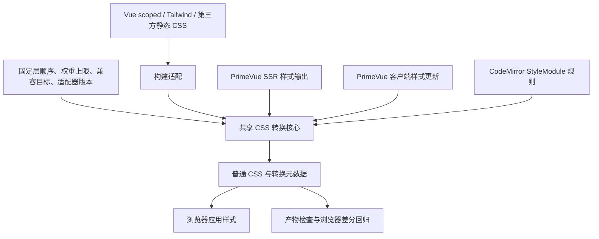

# 自定义 CSS 分层兼容插件设计

日期：2026-10-29。状态：**已完成动态入口可行性探针；公开扩展点不足，按已确认边界暂停适配。转换核心及框架接入尚未完成，未部署**。证据与阶段边界见[公开 API 可行性评估](../reviews/css-layer-public-api-feasibility-2026-10-29.md)。

后续已改走[官方主题 API 与 Tailwind 选择器策略](../reviews/css-official-apis-validation-2026-10-29.md)，并完成限定生产构建与旧引擎复验。本文保留插件的提案合同和立项观察；文中的 P0–P4 仅指暂停的插件路线，不代表当前官方 API 路线的交付阶段，也不因发布前整理而恢复实施。

本文承接 [CSS 层叠与生产构建一致性调查](../reviews/css-cascade-and-build-parity-2026-10-28.md)。目标是在保留现有浏览器支持范围和 CSS 懒加载的条件下，用统一编译规则表达样式来源之间的优先级。本文定义拟议合同、实现分解和验收门槛；实际行为仍以源码及[测试指南](../development/testing.md)为准。

用户已确认继续保留旧浏览器支持，接受普通模板工具类优先于组件普通样式，必要时使用有明确用途的 `!important`；并确认已知 CSS 问题的修复已部署生产。本文没有重新检查线上发布产物。最初交付设计和有限算法探针；后续已授权推进 P0–P2，具体约束及当前暂停原因如下。本轮未新增依赖、修改应用构建配置或迁移全站样式；验证命令触发了已有锁文件依赖的重链接及既有安装钩子。

## 1. 决策摘要

建议实现一个仓库内 Nuxt 模块，组合共享转换核心、静态 CSS 接入和 PrimeVue / CodeMirror 适配器。初版面向本项目受控的 CSS 子集，不承诺成为任意网站可直接使用的完整 CSS Cascade Level 5 polyfill。

| 决策 | 设计选择 |
| --- | --- |
| 层顺序 | 一份构建期固定的有序清单；不依赖文件处理顺序和首次动态注入 |
| 兼容方式 | 删除受支持的 `@layer` 包装，通过固定选择器权重区间表达层优先级 |
| 发布产物 | 所有受支持浏览器使用同一种转换模式；仍可有多个 CSS chunk，不按 UA 维护两套样式 |
| 开发与生产 | 共用语义、策略和转换核心；生产额外压缩后的结果必须复验 |
| 动态样式 | 在输出到 SSR HTML 或浏览器样式表前转换，保留原库的生命周期 |
| 源码 lint | 复用现有本地 ESLint 插件，结合共享 CSS 分析器；维护风险用 warning，破坏编译合同的输入用 error |
| 首版语法 | 固定的顶层命名层；支持普通声明、重要声明和受控未分层规则 |
| 不支持的输入 | 构建时明确失败；运行时拒绝替换当前有效样式并报告诊断 |
| 验证方法 | 原生 layer 与转换版本的浏览器差分测试，加真实旧引擎和应用回归 |

“转换版本”指新语法编译成旧引擎能理解的规则。它不降低视觉质量，也不表示必须增加一份专供旧浏览器下载的 CSS。

### 1.1 实施前确认的约束

- 首轮范围为 P0–P2；完成原型和评估后再决定 P3/P4，不直接全站启用。
- 本次范围内已有的 `:has()`、`@property` 等语法需要改写，旧浏览器的交互和动画效果均须等价，允许换用其他实现；不能仅登记为渐进增强后放行。
- 只使用公开 API 和官方扩展点。不使用依赖 patch、内部模块替换、依赖内部接口的包装或 alias；导出符号可被调用不等于存在官方扩展合同。
- 公开扩展点无法在插入前完整覆盖动态 CSS 时，暂停相关适配并重新评估。不能用事后 DOM 修补或额外覆盖样式冒充完整接入。

已按这一约束优先检查动态入口，结果未达到接入门槛。当前只交付可重复运行的诊断及评估，不宣称 P0 全量盘点、P1 核心或 P2 接入已经通过。本文其余章节保留原型的目标合同，不代表已有实现。

## 2. 现状与证据

### 2.1 立项时的项目入口

下表保留立项时的事实。后续官方 API 路线已显式接线 CSS target / minifier、共享 body 祖先标识、主题 preset，并增加保留 legacy 的生产测试 profile；当前配置及证据见上方当前路线入口。

| 入口 | 当前事实 | 对设计的影响 |
| --- | --- | --- |
| [nuxt.config.ts](../../nuxt.config.ts) | PrimeVue `cssLayer: false`；启用 legacy；未显式定义 CSS target/minifier | 插件接入时需要记录最终配置，不能只读取顶层默认值 |
| [package.json](../../package.json) | production Browserslist 为 Chrome/Edge 80、Firefox 78、Safari 13.1 起 | 这些版本构成保留的声明范围；现有声明不等于已经完成实际兼容验收 |
| [global.css](../../app/assets/css/global.css) | Tailwind 入口、应用规则、动画及部分第三方覆盖混合 | 不能按整份文件指定一个层 |
| [primevue-overrides.css](../../app/assets/css/primevue-overrides.css) | 已有 `html:root`、重复类名和状态覆盖 | 先迁移并验证，再逐项简化权重 |
| [Preview.vue](../../app/components/MyContent/Markdown/Preview.vue) / [Editor.vue](../../app/components/MyContent/Markdown/Editor.vue) | scoped / deep、标题吸顶、编辑器上下文覆盖 | scoped 与 layer 是不同维度；同层覆盖仍需明确 |
| [themes.ts](../../app/utils/content/editor/themes.ts) | CodeMirror theme 与 HighlightStyle 动态生成 CSS | 仅处理 `.vue` 和 `.css` 无法覆盖编辑器 |
| [browser.ts](../../scripts/testing/browser.ts) | 隔离 E2E 构建过滤 legacy，并设置 development 环境 | 现有浏览器测试不是生产 CSS 管线一致性的充分证据 |

### 2.2 已安装依赖的源码观察

本轮检查的是工作区安装版本：PrimeVue / Nuxt module 4.5.5、`@primeuix/styled` 0.7.4、CodeMirror view 6.43.6、`style-mod` 4.1.4、Vite 8.3.3、Lightning CSS 1.33.0。后续实现按 [pnpm-lock.yaml](../../pnpm-lock.yaml) 和真实安装路径重新核对，不能把这些版本号当作永久接口保证。

- `@primevue/core/base/style` 有 `load`、`loadCSS`、`loadStyle`，并存在独立的 `getStyleSheet`、`getThemeStyleSheet` 等 SSR 字符串生成路径。只包装 `Theme.transformCSS` 会遗漏部分基础 CSS。
- `@primevue/core/usestyle` 通过 `watch(cssRef)` 更新 `style.textContent`，并维护 style identity、加载状态及卸载。适配必须覆盖初始值与后续更新。
- `@primevue/nuxt-module` 生成 `#primevue-style`，Nitro 插件在 `render:html` 中输出 `stylesToTop`、`styles`、`themes`。客户端包装不会自动覆盖这条路径。
- CodeMirror view 的基础主题和 `EditorView.theme()` 经 `StyleModule` 创建；语言包中的 HighlightStyle 也会创建 StyleModule。只包装项目自己的 `theme_extensions()` 不够。
- `style-mod` 同时存在 `style.textContent` 和 `CSSStyleSheet.insertRule` 挂载分支，并维护模块顺序、去重及 nonce。只监听 `<style>` DOM 变化无法覆盖全部行为。
- Vite 将 CSS 编译、PostCSS、CSS 后处理和压缩分开；不能凭 `enforce: 'post'` 就认定拿到了最终 CSS 文本。钩子接入点必须通过实际转换链验证。

这些观察支持“存在可适配的入口”，尚未证明可以仅使用公开 API 完成所有适配。

## 3. 目标、保证与边界

对于同一文档作用域内、经过受支持的兼容规范化且由插件接管的作者样式，要求：

1. 改变不同层的 CSS 到达顺序，不改变跨层声明的胜负。
2. 同层的选择器权重及出现顺序继续生效。
3. 普通声明按层顺序递增；重要声明按反向层顺序生效；未分层规则分别位于对应端点。
4. 懒加载模块与运行时新生成样式使用与首屏相同的权重区间。
5. 处理后的选择器保持匹配集合，属性值、继承关系和媒体条件保持原意。
6. SSR 输出、hydration 后更新、开发 HMR 与生产输出使用相同策略身份。

保证是有条件的：全部参与同一覆盖关系的样式必须受控，输入符合声明的语法与权重上限，后续工具没有破坏产物。遇到未经转换的第三方规则，不能继续声称它遵循模拟的“未分层最高优先级”。

以下属于独立边界：

- 行内样式、CSS 动画与 transition 的优先级交给浏览器；不修改 JS 的尺寸、位置或几何计算。
- UA / 用户样式不接管。增权可能改变用户普通规则中的 `revert` 回退等复杂交互，因此初版禁止受控 CSS 使用 `revert` / `revert-layer`，不声称全规范等价。
- stacking context、`z-index` 数值、布局错误和同层公共规则冲突仍需组件自身修复。本插件不能替代标题公共 `z-10` 的局部修复。
- 外部 CAPTCHA、第三方 iframe 等单列边界；iframe 内部样式不属于父文档的层叠。位于同一 DOM 的外部样式必须经过适配或证明与受控规则不竞争。
- 不提供任意新 CSS / JS 能力的通用 polyfill。本次范围内已有的新语法按第 1.1 节改写并验证等价；`@layer` 编译成功不能证明 `:has()`、颜色函数或整个应用在旧引擎可用。

## 4. 总体结构与配置归属



建议组织如下。全部为拟议路径，不是已存在的模块：

```text
config/css-cascade.ts                 唯一策略与样式来源映射
modules/css-cascade/module.ts         Nuxt 注册、Vite/Nitro 接入
modules/css-cascade/core/             解析、验证、权重计算、输出
modules/css-cascade/adapters/         static / primevue / codemirror
modules/css-cascade/runtime/          浏览器安全的转换入口和有界缓存
modules/css-cascade/*.test.ts         接入合同测试，纯核心测试就近放置
tests/e2e/css-cascade-*.spec.ts        应用与浏览器场景
```

模块配置属于编译合同，不放入部署环境变量或业务 `app-settings.yaml`。Nuxt 生成浏览器安全的虚拟策略模块，客户端只能拿到必要的层表、目标、协议和适配版本，不运行服务端配置 loader。具体目录接入时同步调整 Vitest 和 TypeScript 的 include；当前配置不会自动覆盖新增 `modules/**/*.test.ts`。

核心返回 CSS 和元数据，不负责 DOM 插入。核心可在 Node 与浏览器执行，不依赖 Node 原生 Lightning CSS 二进制、网络或应用注入上下文。优先复用成熟 CSS / selector AST 解析能力；具体直接依赖与浏览器体积在原型中评估，不能依赖 pnpm 恰好提升的传递依赖或用正则实现 CSS 语法解析。

源码检查沿用 [eslint.local-rules.mjs](../../eslint.local-rules.mjs) 的 `local` 插件入口和 [eslint.local-rules.test.ts](../../eslint.local-rules.test.ts) 的 RuleTester / Vitest 结构。CSS 诊断复用核心的纯分析能力，不维护另一份层表、权重算法或语法黑名单；具体分工与告警等级见第 13.5 节。

## 5. 层策略与样式归属

### 5.1 固定顺序

普通声明从低到高：

```css
@layer tw-base, vendor, primevue, app-base, app-components, app-overrides, tw-utilities;
```

| 层 | 归属与限制 |
| --- | --- |
| `tw-base` | Tailwind Preflight 和基础初始化 |
| `vendor` | Viewer、Cropper、图标静态规则；初版 CodeMirror 整套主题规则 |
| `primevue` | PrimeVue 基础 CSS、组件 CSS、主题 token 和状态样式 |
| `app-base` | 网站排版、颜色及低优先级控件默认行为 |
| `app-components` | 自有组件、共享展示类、普通 SFC 样式 |
| `app-overrides` | 有明确归属的第三方适配和跨组件上下文覆盖 |
| `tw-utilities` | 模板显式工具类；普通声明可以覆盖组件普通规则 |

CodeMirror 初版将基础、扩展、项目主题和高亮一起归入 `vendor`，保留 CodeMirror 内部的 precedence / 模块顺序；不根据生成的随机类名推断归属。将自定义主题移入更高层属于后续独立设计。

层表是编译合同。增加、删除或重排层均生成新的策略身份，并要求全套 CSS 与动态适配器同步发布。不能在浏览器已加载旧样式时重新计算区间。

### 5.2 归属方式

- `global.css` 用不同名称的原生层包装 Tailwind 入口，并逐段迁移应用规则；保留 Tailwind 3 对 `@layer base/components/utilities` 的构建处理，避免把这些特殊名称当成最终原生层。见 [Tailwind 3 指令说明](https://v3.tailwindcss.com/docs/functions-and-directives#layer)。
- SFC 默认层由策略中的来源映射指定。显式命名层块可覆盖默认归属；插件不能把已有层块再盲目嵌套一层。
- 原始顶层规则缺少默认归属时失败。确需未分层规则，通过精确来源清单和理由登记，进入“受控未分层”槽位；文件通配例外不能覆盖整个 `app/`。
- `@apply` 的声明属于所在规则的层，不继承 `tw-utilities` 的优先级。
- 同一第三方资源只能有一种有效导入路径。避免同时存在已转换的全局副本和未转换的懒加载副本。
- 加载遮罩、Nuxt head 内联样式、图标模块生成 CSS 也要登记。它们在 JS / HTML 中生成并不代表天然免于层叠审计。

### 5.3 原生参考模式

仅供测试的原生参考模式保留 `@layer`，在任何层内容之前输出完整顺序声明，并按相同来源映射包装默认层。转换模式与参考模式共享归属，防止拿两套不同业务 CSS 比较。

生产初版只启用转换模式。避免通过 UA 检测分别选择两条未经同等验收的路径。

## 6. 核心算法

### 6.1 固定区间与证明

选择器权重记为 `(a, b, c)`，其中 `a` 为 ID 权重，按字典序比较，不是十进制加权求和。初版提议原始 `a <= M = 2`，区间步长 `D = M + 1 = 3`；这个上限是待扫描与原型验证的建议值，不是已完成的全仓审计结论。

`N` 为命名层数，层下标 `i` 从 0 开始：

```text
普通命名层：       offset = i × D
普通未分层：       offset = N × D
重要命名层：       offset = (N - i) × D
重要未分层：       offset = 0
最终权重：         (a + offset, b, c)
```

本设计七层、建议步长 3 时：

| 归属 | 普通声明增加 ID 权重 | 重要声明增加 ID 权重 |
| --- | --- | --- |
| `tw-base` | 0 | 21 |
| `vendor` | 3 | 18 |
| `primevue` | 6 | 15 |
| `app-base` | 9 | 12 |
| `app-components` | 12 | 9 |
| `app-overrides` | 15 | 6 |
| `tw-utilities` | 18 | 3 |
| 受控未分层 | 21 | 0 |

相邻区间满足 `iD + M < (i + 1)D`。因此较高区间中最弱的 ID 权重也大于较低区间中最强的 ID 权重，不受后两项及到达顺序影响。同层增加相同的 `offset`，原有比较关系保留。浏览器自身仍先区分普通与重要声明；插件不把普通声明升级为 `!important`。

这是本项目允许按文件转换的依据。现成 [PostCSS Cascade Layers](https://github.com/csstools/postcss-plugins/tree/main/plugins/postcss-cascade-layers#how-it-works) 根据完整输入计算权重间隔，要求完整 CSS bundle；这里使用固定上限和全来源校验替代动态计算。运行时出现更高权重必须拒绝，不能偷偷扩大间隔。

层顺序、未分层及重要声明的语义以 [CSS Cascade Level 5](https://www.w3.org/TR/css-cascade-5/#layer-order) 为参照。浏览器的权重计数上限也必须测试，不能无限增加层数或 guard 数量。

### 6.2 增权且保持匹配集合

讨论中的单分支 `:not(#reserved-id)` 需要保证页面永远不使用该 ID。正式设计建议改为两个等权重分支，消除这项 DOM 保留约束。

令两个不同 ID 为 `__stupig_layer_a__` 和 `__stupig_layer_b__`。给选择器 `S` 增加 `k > 0` 份 ID 权重时，生成：

```text
S + k 个 :not(#__stupig_layer_a__)
S + k 个 :not(#__stupig_layer_b__)
```

两条选择器组成逗号列表，共用原声明。例如 `k = 1`：

```css
.text-blue:not(#__stupig_layer_a__),
.text-blue:not(#__stupig_layer_b__) {
  color: blue;
}
```

在本项目 standards-mode HTML DOM 中，同一元素的 `id` 不可能同时等于这两个不同字符串，因此两个分支至少有一个成立；每个分支又都要求原 `S` 成立。匹配并集等于原选择器，且两个分支权重完全相同。即使元素碰巧使用其中一个 ID，也不丢失匹配。`k = 0` 不复制分支。

实现要求：

- 用 selector AST 将 guard 加到最右侧目标 compound 中，在 `::before` 等伪元素之前。不要加到 `:is()` 参数内部或祖先节点上。
- 每个原逗号列表分支独立处理；函数参数里的逗号不属于顶层分支。
- 使用重复的单参数 `:not(#id)`，不依赖旧引擎不支持的复杂 `:not()` 或 `:where()`。
- `:root`、通配符、组合器和支持的伪元素分别验收。XML 多 ID 类型、host/slotted/part 等跨 Shadow DOM 选择器不在初版范围。
- 最多将选择器分支数量翻倍，不按 `k` 指数展开；重复 guard 的原始字节和解析成本仍要实测。
- 禁止后续优化器删除重复 guard、只保留一个分支或改写为不等权重的表达式。应验证最终行为及权重；不能只检查某个固定输出字符串。

重复简单选择器与 `:not()` 权重的规则见 [Selectors Level 3](https://www.w3.org/TR/selectors-3/#specificity)。这里的双分支方案是项目设计，其支持边界和最终兼容性由本项目测试承担。

### 6.3 普通与重要声明拆分

同一规则同时含两种优先级时，分别输出使用两种 offset 的规则。保留各组内部声明顺序、重复 fallback、custom properties、简写和长写关系，以及原条件链和规则位置；两个结果相邻输出。

`!important` 必须按声明语法读取，不能匹配字符串中的感叹号；`content` 字符串和 URL 不参与判断。custom property 的 important 标记也属于优先级，不能把它错误保留为变量值的一部分。动画关键帧里的声明不走普通样式规则的拆分逻辑。

需要明确的产品语义：早层中的 important 会高于晚层中的 important。因此组件约束加 important 可以压过普通工具类，但工具类再加 important 未必能覆盖该组件约束。插件遵守已声明的反向层顺序，不增加另一个“important 永远最高”的特殊层。

### 6.4 选择器规范化与此次标题故障

权重上限检查以本阶段实际收到的选择器为准，并在最终产物中复核。`:is()`、`:not()`、`:where()` 等的权重不能按冒号个数计算；需要识别不同伪类的真实语义。

旧目标下的 `:is()` 前缀转换可能改变同层权重。本插件只保证层间规则，不能恢复每个同层选择器在标准语法下的胜负。继续保留标题局部修复，并单独测试真实组件的完整 CSS 转换。[Lightning CSS 文档](https://lightningcss.dev/transpilation.html#is-selector)描述了该前缀转换。

原生与转换模式的核心差分输入应共享同一份已规范化选择器，再分别保留或消除 layer；另做从原始项目源码出发的全管线测试。这样既能单独判断分层算法，又不会掩盖真实构建中的前缀问题。

## 7. 初版支持的 CSS 子集

| 输入 | 初版处理 |
| --- | --- |
| 策略中的顶层命名层 | 支持；同一层可在多文件中重复出现 |
| 层顺序声明 | 只接受与策略一致的完整顺序或相容子序列；不改变策略 |
| 默认归属与受控未分层规则 | 按来源映射处理；未知来源报错 |
| 普通声明 / `!important` / CSS 变量 | 支持，分别赋权；变量按原有继承规则计算 |
| `@media`、`@supports` 内已有层的规则 | 保留条件；所有层已由固定清单预声明，不靠条件建立顺序 |
| 嵌套层、匿名层、运行时新增层 | 初版拒绝；不能简单压成名字排序假装等价 |
| CSS nesting、scoped / deep、`@apply`、Tailwind 指令 | 必须在进入核心前展开；残留指令报错 |
| 本地 `@import` / `@import ... layer(...)` | 构建入口解析导入和来源，在内联或拆块前保留归属；运行时拒绝未解析 import |
| 远程 CSS import | 不下载并猜测；登记外部边界或在构建期纳入受控资产 |
| `revert`、`revert-layer`，包括变量间接产生的值 | 初版拒绝；不能把全局关键字替换成 initial/unset |
| `@scope`、`@property`、未审计的新 at-rule | 拒绝或单列已验证资产通道；不默默透传宣称等价 |
| `:has()`、复杂旧引擎不支持的选择器 | 交兼容能力检查；没有经验证降级则拒绝对应受控输入 |
| 简单受支持伪元素 | guard 插入伪元素前，单独验证匹配和计算样式 |
| CSS Modules、特殊 shadow selector | 初版无接入保证；引入时新增适配合同和测试 |

### 7.1 资产规则

`@keyframes`、`@font-face` 等不靠普通选择器权重决胜，不能通过增加 guard 模拟它们的层间重名关系。

- 初版允许已归属层内的 keyframes，但同一有效全局名称跨层出现不同定义时失败；不因展开 layer 而改变哪份动画生效。同层的合法重定义保留原顺序并专测。不同条件下的跨层重名也先拒绝。
- `@font-face` 走独立资产通道，保留字体源、字重、unicode-range、相对 URL 和顺序。第三方包包装进层前先区分字体资产与可匹配规则；初版拒绝依赖层顺序的字体定义冲突。
- keyframes 内的 `from` / `to` / 百分比节点不当作 selector 处理。字体描述符也不追加 selector guard。
- URL 重写、资源复制与内容哈希仍交原构建链；插件必须保留 source map 和依赖关系。

### 7.2 两类版本检查

“可解析”不等于“旧引擎可用”。核心首先验证分层子集；兼容入口再验证最终 CSS/JS 对应的浏览器目标。运行时不默认携带完整 Lightning CSS/WASM：优先要求依赖生成旧目标可用的语法，并使用经过审计的有限转换。遇到新语法时必须在依赖升级验收中发现，不能让客户端静默丢弃规则。

## 8. 静态构建接入

### 8.1 转换阶段

逻辑顺序如下；具体 Vite 钩子由原型记录并固定，不把下列概念阶段等同于已经找到一个公开“最终 CSS”钩子：

1. 识别样式来源和默认归属，解析导入，保留每个来源的层信息。
2. 完成 Vue scoped / deep、Tailwind、预处理及必要的选择器规范化；输出可解析的 CSS 规则。
3. 运行核心，验证上限、拆分 important、增加 guard、展开命名层。
4. 继续项目正常的兼容转换、URL 处理、CSS 分块及压缩。
5. 检查最终资产和 SSR 样式；运行浏览器回归，证明后续处理没有破坏匹配或权重。

若步骤 4 的 selector 转换无法保持核心合同，则需要把该转换提前，或选择更靠后的 CSS 文本接入点；禁止靠调一个钩子顺序猜测已解决。原型须记录每阶段的选择器、层信息、map 和实际插件顺序。

候选方案是 Nuxt 模块注入受控的 PostCSS 处理与 Vite 校验插件，并按 Vue 样式请求的真实顺序接线。`generateBundle` 首版用于检查而不事后改写已计算哈希的 CSS，避免 manifest、预加载链接、压缩包或缓存身份失配。Vite 钩子能力见[官方插件 API](https://vite.dev/guide/api-plugin.html)。

### 8.2 分块、开发和 HMR

固定区间不需要把所有 CSS 合并成单文件，也不应通过 `cssCodeSplit: false` 回避动态来源问题。它只消除跨层的到达顺序依赖；同层同权重冲突仍按浏览器中的实际位置决胜。

开发服务器也输出转换版本。HMR 更新从保存的原始 CSS 重新编译，不能对已经增加 guard 的结果再次转换。更新一个文件不能改变其他层的区间。层表、上限、目标或转换协议改变时，要求重启/完整重载，不热替换半套策略。

### 8.3 构建配置一致性

保留 `package.json` production Browserslist 作为支持范围入口，生成或映射 JavaScript legacy targets、CSS target 和兼容探针参数；各工具目标格式不同，映射结果必须检查全部声明引擎，不能只保留 Chrome。

在构建报告中记录最终 CSS target/minifier、Browserslist 环境及解析结果、legacy 开关、关键依赖版本、转换协议与策略摘要。测试可以继续用开发数据库和模拟云服务，但用于 CSS 一致性验收的前端构建不能因此切换到另一套 CSS 目标。

不要仅设置 `NODE_ENV=production` 来解决隔离测试问题；业务运行配置、数据库夹具与前端兼容目标需要明确传递。少量完整生产管线测试保留 legacy，并继续使用现有隔离数据和供应商边界。

## 9. PrimeVue 适配

初版建议保持 PrimeVue 自身 `cssLayer: false`，由适配器显式将其 CSS 归入 `primevue`。原生参考模式由同一适配器包装层，避免同时维护 PrimeVue layer order 与项目层表。

必须覆盖：

| 路径 | 要求 |
| --- | --- |
| 组件首次挂载 | 在 DOM 获得规则前转换基础 CSS、组件样式和变量 |
| 后续 cssRef 更新 | 从原始输入重新转换，维护已有 style identity |
| theme / preset 更新 | 转换整次更新；不得短暂混用两种策略或部分原始 CSS |
| SSR 基础样式 | 覆盖 `getStyleSheet` 及 Nuxt 输出入口 |
| SSR 主题样式 | 覆盖 common / component / global token 和变量生成路径 |
| 卸载、去重、nonce | 保留 PrimeVue 既有行为，不用第二套全局 style 管理器竞争 |

只使用有官方扩展合同的配置入口。当前版本没有覆盖全部路径的公开转换钩子时暂停适配；版本锁定的模块 wrapper / package patch 不属于已授权方案。只读诊断可以检查安装源码及调用导出函数以定位遗漏，但不能把这些观察转化成修改依赖内部行为的产品接入。

仅 alias `@primevue/core/usestyle` 不能视为完成：还需确认所有重导出、内部引用、Vite 预构建、SSR externalization 都指向受控实现；Nuxt 模块直接生成的 HTML 字符串也需要适配。SSR 应尽量在样式字符串生成处处理，若最后在 HTML 出口处理，必须使用结构化识别和已登记 style identity，不能正则重写整页 HTML。

不同 SSR 请求只共享纯转换结果和不可变策略，不共享用户级可变 style 状态。hydration 接管同一 style 节点时，校验策略身份，并保证初始输出与后续更新都是转换版本。

原子提交的最小单位是一份样式单元：先完成解析与全部转换，再替换该单元。多个 style 节点的主题更新继续遵守 PrimeVue 的调度，不额外承诺整个主题事务原子性；若原型发现可见的中间状态，再评估主题入口的批次适配。nonce 原样传递；若使用 CSP 样式内容哈希，必须根据最终 CSS 计算，不能在哈希生成后改写内容。

## 10. CodeMirror / style-mod 适配

在 StyleModule 完成规则生成之后、规则被挂载之前转换。选择器 `finish` 回调本身不足以处理同一规则内 important 的拆分，因此不把该回调当作完整方案。

原提案考虑在专用 adapter 中保存原始规则，并创建与原模块一一对应、identity 稳定的转换模块或规则视图，然后交回原来的挂载机制。当前检查发现公开 facet 是追加模块的入口，不能替换全套原始模块及内部基础主题；`WeakMap` 只能保存映射，不能补足挂载前转换钩子。该候选在第 1.1 节约束下暂停，不通过改写 `rules`、替换 `mount` 或 alias 内部模块接线。

需要保留：

- 基础主题、light/dark theme、HighlightStyle、提示、补全、lint 等扩展模块的全部样式来源。
- CodeMirror 模块 precedence、style-mod 去重、重排和卸载/重新挂载的实际行为。
- `style.textContent` 与 `insertRule` 两条路径；Document 与独立 ShadowRoot 的作用域分开验证。ShadowRoot 内不承诺支持跨边界 selector。
- nonce、规则索引、更新顺序以及多编辑器共享模块的语义。
- lazy import 和预构建中的 StyleModule 实例归属；不能出现一部分模块来自原包，另一部分来自不兼容包装。

[项目主题](../../app/utils/content/editor/themes.ts)继续通过 EditorView / HighlightStyle 定义；不复制整套 CodeMirror CSS 到静态文件。该适配层是版本敏感的，升级 CodeMirror 或 style-mod 必须跑实际编辑器合同测试。

## 11. 运行时协议、缓存与错误

### 11.1 样式单元

建议每次转换显式传入如下逻辑字段；这是接口设计，不是当前代码：

```text
source_id         稳定来源标识，不包含绝对用户路径或秘密
owner             app / primevue / codemirror / vendor / registered-exception
default_layer     指定命名层，或显式受控未分层
raw_css           原始 CSS，更新必须从这里重新开始
output_mode       compat / native-reference，后者仅供测试
protocol_version  转换协议版本
policy_hash       层表、上限、目标、转换选项、适配器身份的规范化摘要
scope_id          当前 Document / ShadowRoot 的作用域身份
```

输出包含 `css`、source map（适用时）、声明/选择器计数、最大原始权重、输入/输出摘要、已处理阶段和诊断。资源 URL 的合法值可以出现在 CSS 中，但日志只记录来源和摘要，不输出完整用户内容或带凭据 URL。

建议将核心接口固定为同步纯函数 `compile_css(unit, policy)`：一次输入返回完整成功结果或结构化错误，不返回部分 CSS，也不自行发起异步任务。构建 adapter 可以异步解析文件/预处理，随后调用同一核心；运行时 adapter 在原库插入规则之前同步调用它。该约束避免首次渲染先挂载原始规则、稍后再异步修正。核心及解析依赖的浏览器 JS 也必须经过既有兼容构建，不能只检查输出 CSS。

解析后的中间规则至少保留来源位置、已解析层、条件链、原 selector AST 和有序声明列表。先验证整个单元再输出；source map 中两个 guard 分支均映射回原 selector。原生参考模式复用解析、归属与子集验证，最终输出保留层的规则，不执行增权。

元数据是防止重复转换的主要依据，不依赖可被压缩器删除的注释。动态模块保留原始输入和输出的明确类型/状态；遇到已转换结果再次作为 raw 输入要拒绝。跨构建阶段传递 AST 元数据或构建 manifest，不能简单通过看到 guard ID 就猜测所有输入均已转换。

### 11.2 有界缓存

纯转换缓存键包含原始 CSS 摘要、默认层、输出模式、策略/协议、兼容配置和 adapter 版本。原生参考与转换输出不能共用命中结果。style identity、DOM root 和挂载状态不放进全局纯缓存。SSR 禁止无限积累用户可控 CSS；用条目数和总字节双重上限的 LRU，初始预算在原型测量后确定。

同一原始主题重复挂载可复用输出。切换主题不能持续追加永久 CSS，不能遗失原库的卸载逻辑。超出单次输入大小或复杂度预算时返回诊断，不阻塞主线程进行无界解析。

### 11.3 失败策略

| 情况 | 行为 |
| --- | --- |
| 构建发现未知来源、语法、层或权重超限 | 构建失败，定位文件/规则和建议处理方式 |
| SSR 转换失败或策略不匹配 | 该渲染路径报错并阻止发布验收，不输出一份声称已转换的原始 CSS |
| 已挂载主题更新失败 | 原有效样式继续保留；该次更新不提交，记录明确错误 |
| 首次动态模块转换失败 | adapter 报错，应用相关区域显示现有错误边界或可理解的失败状态；不静默插入未转换规则 |
| HMR 策略身份变化 | 全量重载，禁止局部混用 |
| 发布后异常 | 回滚整个一致版本，不在浏览器中临时关闭一个 adapter |

建议诊断码：`UNKNOWN_LAYER`、`UNKNOWN_OWNER`、`SPECIFICITY_LIMIT`、`UNSUPPORTED_SYNTAX`、`LAYER_ORDER_CONFLICT`、`ASSET_NAME_CONFLICT`、`POLICY_MISMATCH`、`ALREADY_TRANSFORMED`、`ADAPTER_INCOMPLETE`。诊断应附来源、位置和原因。

DOM 观察器只能作为开发时发现未知注入源的辅助工具。它不能可靠观察所有 CSSOM 修改、首屏时序或跨域样式内容，因此不能承担生产正确性。首版不全局替换 `CSSStyleSheet.prototype`、`appendChild` 或 `textContent` setter。

## 12. 发布、缓存和部分迁移

### 12.1 策略身份与发布一致性

CSS 资产与客户端适配器随同一个构建发布并使用内容哈希；SSR 内联样式绑定同一 `policy_hash`。HTML、动态 chunk 和缓存策略要防止新页面加载旧区间、旧页面导航加载不兼容的新区间。旧资产保留及 CDN 行为复用现有部署机制，实际一致性需验收，不能仅因文件名带哈希就认为已保证。

不从运行时环境变量动态修改层表。回滚必须回滚 SSR、CSS、客户端 adapter 与策略，保持同一构建身份。

### 12.2 迁移单位

转换规则与原始规则混用时，原始规则并不会自动获得“未分层最高优先级”，所以不能在一个相互竞争的页面上任意选几个文件先迁移。

分阶段迁移以完整的样式竞争范围为单位。原型使用隔离页面/作用域；正式切换前，把所有可能影响该范围的 reset、应用、组件库和动态规则一起纳入。暂时无法归属的规则可进入经过转换的未分层槽位，并登记移除计划；这会保留其高普通优先级，可能遮蔽新层效果，因此例外数量必须可见。

仅在选择器确实隔离、不存在继承变量或全局 reset 影响时，才能将某来源列为不竞争的外部边界。验证码出现在同一 DOM 中不等于自动隔离。

### 12.3 现有样式的处理顺序

1. 保留已验证的标题修复，建立生产 CSS 回归及最终配置记录。
2. 盘点全部静态和动态来源、ID 权重、important、资产重名、旧引擎不支持语法。
3. 在隔离原型中完成核心与两个动态适配器。
4. 为全局规则、SFC、第三方资源建立归属；让完整竞争范围使用同一策略。
5. 原有 `html:root` / 重复类名修复先保留；由浏览器回归证明无需额外权重后逐项简化。
6. 稳定后更新既有[前端规范](../../.github/instructions/frontend.instructions.md)与测试指南，标记本设计的实现状态，不复制多份配置清单。

迁移默认不删除或改写原注释中的个人表达，也不借迁移修改受保护内容；涉及这些内容时继续遵守项目规则。

## 13. 验证设计

### 13.1 核心与浏览器差分

| 场景 | 关键断言 |
| --- | --- |
| 各层两两竞争 | 普通/important、正序/反序、弱选择器胜过低层强选择器 |
| 同层竞争 | 原始权重、相同权重时的规则顺序保持 |
| 受控未分层 | 普通最高、important 最低；与行内普通/important 的关系正确 |
| guard | 普通 ID、两个 guard ID、转义、伪元素、组合器、多个 selector 分支的匹配集合不变 |
| 声明拆分 | 简写/长写、重复 fallback、变量、important、同属性重复声明正确 |
| 条件 | media 变化、supports 条件、条件内规则及固定预声明层不受加载顺序影响 |
| 动态更新 | 首次注入、晚到低层、主题切换、失败保留旧样式、重复挂载与移除 |
| 上限和非法输入 | 明确拒绝，诊断可定位；错误输入没有部分输出 |
| 最终压缩 | guard 权重与匹配保持；不存在未处理 layer 或被错误丢弃的声明 |
| 资产 | keyframes 名称、字体来源/范围、资源 URL、相对路径与 source map 正确 |

差分测试使用两个隔离的等价文档或作用域：一侧是固定顺序的原生层，另一侧为转换版本。除 `getComputedStyle()` 外，验证 selector 匹配集合、伪元素、实际重叠命中和可见动画。相同的源码和 DOM fixture 应驱动两侧，不能手写一份永远正确的替代 CSS。

增加有界生成测试，组合层、权重、顺序、条件和 important；固定 seed，失败保存最小复现。修改公式、删掉 important 反序或只保留一个 guard 分支时，相关用例应能发现错误。对标题故障则读取真实 Preview 样式，恢复公共 `z-10` 的版本必须失败，修复版本必须通过。

### 13.2 真实构建与应用场景

- Nuxt SSR 首屏、hydration、硬导航、站内导航、懒加载和开发 HMR。
- PrimeVue Dialog / ConfirmPopup 动画，分页器选中态、输入 invalid / disabled、深浅色变量、首次打开浮层。
- CodeMirror 首次打开、全屏/非全屏、light/dark、语法高亮、补全/提示/lint、多个编辑器、重复挂载及扩展切换。
- Markdown 六级吸顶层级和背景、编辑器上下文边距、图片过渡、Viewer 和头像裁剪。
- Nuxt loading mask、图标首次加载、Tailwind reset 与组件库的相互覆盖。
- 人为延迟独立 CSS chunk、交换不同层规则到达顺序；同层顺序仍按合同验收，不能要求所有排列完全一致。
- 完整生产 CSS 管线保留 legacy/minifier，继续隔离数据库和云服务；不用真实短信、上传或生产数据来验证 CSS。

### 13.3 浏览器范围

现代 Chromium、Firefox、WebKit 可用于原生与转换差分；最低版本验收必须包含真实 Chrome/Edge 80、Firefox 78、Safari 13.1 或能够运行相应真实引擎的已验证环境。Playwright 当前 WebKit 不等于 Safari 13.1，修改 UA 也不模拟旧引擎。

旧浏览器资源可在原型后确定本机/VM/外部测试服务方案，并记录实际版本和系统。未完成的引擎只能标为“未验证”，不能因为转换产物没有 `@layer` 就宣称全部支持。旧引擎上的应用失败需要区分插件回归与原有 CSS/JS 能力缺口。

### 13.4 性能与依赖升级

记录插件开关前后的 CSS 原始/gzip/Brotli 字节、JS 适配器体积、构建耗时、首次打开编辑器/弹窗耗时、主题更新耗时、样式重算与缓存峰值。测试冷缓存、暖缓存及长时间主题切换，确认不存在规则或内存持续增长。

正式迁移前根据现有基线确定预算并加入回归；本设计不编造尚未测量的固定性能承诺。若双分支增权或浏览器解析器带来的成本不可接受，暂停全站迁移，保留已完成的生产 CSS 回归，不通过削弱重要声明语义来换取通过。

升级 Nuxt、Vite、Vue SFC、Tailwind、Lightning CSS、PrimeVue、CodeMirror 或 style-mod 时，检查实际入口变化并运行对应合同测试。版本/源码校验是接入变化提示，不代替浏览器行为测试。

### 13.5 自定义 lint 与越界告警

建议把 lint 纳入插件交付，用于编辑时和提交前尽早指出风险。它提供源位置和修复方向，转换器继续负责执行不可绕过的编译合同；关闭某条 lint 规则不能使不受支持的 CSS 被正常发布。

#### 13.5.1 等级与规则范围

以下规则名是拟议名称，尚未注册。来源归属、允许的 adapter 路径、权重上限均读取第 4 节的唯一策略。

| 拟议检查 | 等级 | 触发条件与边界 |
| --- | --- | --- |
| `css-cascade-contract` | error | 明确的未知层、矛盾层顺序、不受支持的分层语法、无默认归属且未登记的样式来源；SFC 有合法默认层时不要求再手写包装 |
| `css-cascade-specificity` | error | 可以准确计算的输入已经超过 ID 权重上限；预处理前无法确定的规则交给展开后的检查，不能凭原始文本猜测通过 |
| `css-no-manual-weight-boost` | warn | 同一 compound 中重复相同类名/ID，或手写插件生成的增权结构且没有具体解释；不把所有 ID、祖先上下文、`:deep()` 或高 class 数量都视为错误 |
| `css-important-reason` | warn | 新增 `!important` 或静态可识别的 Tailwind important 工具类没有说明所需约束/覆盖关系；允许有理由的 important，不自动删除或替换 |
| `no-unmanaged-style-write` | error / warn | 能确认目标是 style 节点或 CSSStyleSheet、且在登记 adapter 外直接插入/替换规则时为 error；只能确认可疑入口、无法可靠判断对象来源时可给有针对性的 warn |
| `no-unowned-css-import` | error | 可解析的 CSS 导入或新增样式输出入口无法归入策略，或确认存在原始/转换副本混用；跨文件重复资源由构建来源清单最终确认 |

`!important` 是用户允许的例外机制。warning 的目的在于保留用途和提醒反向层顺序，不能把“出现 important”直接设为全仓错误。重复选择器有时也承担兼容修复，已有例外要保留其解释和对应回归。

规则诊断至少包含源文件、行列、规则 ID、触发原因和可行处理方式。例如对未知来源提示登记 owner / 默认层，对 important 提示说明为何 props、token 或普通层级不足；不能给出“随便包进最高层”的通用修复。

#### 13.5.2 JS / Vue / CSS 的检查入口

- **JS/TS 与 Vue script**：使用现有 ESLint AST 和作用域信息识别 import、对象来源及样式写入。不能仅按 `.insertRule` / `.replace` / `textContent` 属性名报错，避免把业务对象或普通文本节点误判为 CSS 注入。ESLint 自定义规则接口见[官方说明](https://eslint.org/docs/latest/extend/custom-rules)。
- **Vue template**：通过 Vue parser 的模板 AST 检查静态 class、可确定的数组/对象 class 候选以及位置；识别 Tailwind 3 的 variant / important 形式，不用搜索字符 `!` 代替工具类解析。无法静态求值的 class 不编造候选，也不对所有动态 `:class` 一律警告。[Vue ESLint 开发指南](https://eslint.vuejs.org/developer-guide/)说明了模板 AST 与 parser services。
- **独立 `.css` 与 SFC `<style>`**：复用 SFC 块定位和 CSS / selector AST 分析。现有 JS lint 不自动解析这些 CSS；首版可由专用源码检查入口调用核心分析器，再串入 `pnpm lint`。编辑器中的 CSS 告警若通过 ESLint processor 或语言接入呈现，必须另外验证与现有 Vue parser 的组合，不能声称普通 JS 规则已覆盖样式块。
- **预处理与生成代码**：源码检查识别 Tailwind 指令和 Vue deep 等前置语法，不直接套用“核心只接收已展开 CSS”的拒绝规则；无法确定的权重在真实展开后再校验。核心生成的 guard、Nuxt 产物和第三方包不跑作者写法建议，仍接受最终产物合同检查。

CSS 分析器应输出统一诊断对象，由 ESLint / CLI 适配器映射文件、块偏移和严重程度；不为两个入口复制解析器和规则。映射需要覆盖 CRLF、多个 style 块、`src` 外链、中文和转义。unsupported `lang` 或未接入语法不能被当作“没有错误”。

无须为本设计预先引入 Stylelint。拟议的 CSS 检查入口及脚本在实现时再命名、接入并登记到命令清单；当前 `pnpm lint` 尚未包含这套检查。

#### 13.5.3 动态写入规则的误报边界

明确允许以下路径：

- 已登记适配器内部的必要 style/CSSOM 操作；例外按具体模块和用途配置，不放行整个 `app/`。
- 通过已完成适配的 PrimeVue API、`EditorView.theme()`、HighlightStyle 创建主题。使用这些公开 API 本身不构成绕过。
- `element.style.width`、`top`、`transform`、Vue `:style` 等现有运行时几何值和其他合法行内样式；本插件不借 lint 把它们强行改写成样式表。
- 在受控测试夹具中故意插入原始 CSS，用于检验失败路径；只按明确夹具范围放行源码建议，不能隐藏产品代码里的绕过。

静态分析不承诺追踪任意反射、别名传播和第三方脚本行为。原型重点实现高置信度的入口检测，配合构建来源清单与真实 adapter 测试；不要通过大量低置信度告警弥补分析边界。

#### 13.5.4 例外、基线和自动修复

维护类 warning 可以用紧邻具体声明/规则的原因说明或范围明确的策略例外消除。JS/Vue 遵循现有带原因的 lint suppression 约定；CSS 若需要专用注释，建议形如 `/* cascade-allow css-no-manual-weight-boost -- 具体兼容原因 */`，仅作用于下一条声明或规则。模板 important 的说明定位到相应元素或静态 class 候选。最终语法和作用范围需测试后固定，不使用整文件任意关闭。

例外只能豁免维护建议。未知层、区间上限、策略不一致和未支持语法等正确性问题必须调整来源或实现合同，不能写一句理由就让转换器继续。

初次扫描保留已有兼容修复，不批量清除 `html:root`、重复类名或 important。确需临时基线时记录路径、规则、规范化 AST 片段身份和具体理由，不以易漂移的行号或一个总数量隐藏新增问题；基线不能覆盖新增规则或永久消音整个目录。

warning 默认在本地与 CI 可见，不阻断通过；error 阻断。现有 CI 不应为了这组建议直接加入全局 `--max-warnings 0`，否则 warning 会变成事实上的禁止。ESLint 的严重程度语义见[规则配置文档](https://eslint.org/docs/latest/use/configure/rules)。若以后要限制新增 warning，应在实测误报和维护成本后单独确定策略。

不对层归属、important、选择器权重、CSS 注入入口或兼容语法提供自动修复。它们会改变行为，需要开发者选择并跑回归；lint 可给出明确建议和定位。

#### 13.5.5 实施与规则验收

P0 先只读扫描并统计已有模式，形成小范围、低噪声的规则清单。P1 将核心分析函数接入源码检查，并覆盖已明确支持的样式范围。P2 在适配器真实可用后启用对应的动态写入边界检查。未接入的产品范围先报告迁移状态，不能在只有设计文件时让现有合法代码全仓报错；转入已治理范围后，硬合同的 error 不降为 warning。

每条新增规则都应有合法、非法和必要的误报用例，包括重要声明说明、静态 Tailwind variant、合法 `:style`、同名业务方法、动态 class、CSS 字符串/注释、Vue style/source 位置及明确 adapter 例外。沿用 RuleTester / Vitest，并增加实际 ESLint 配置和 CSS 检查入口的接线测试，证明文件 glob 与规则加载有效；单测调用了规则不代表 `pnpm lint` 会执行它。

验收要求：warning 保持成功退出、error 使入口失败，开发与 CI 严重程度一致，关闭源码告警后核心仍拒绝非法输入。基线/例外失效、生成产物误纳入作者检查、重复诊断及 CSS 未被解析都必须有可发现的结果。

## 14. 实施阶段与交付标准

| 阶段 | 交付内容 | 进入下一阶段的条件 |
| --- | --- | --- |
| P0：盘点与生产一致性 | 样式来源清单、实际目标记录、真实 Preview 转换回归、源码告警基线盘点 | 已知故障可被检出；未知语法与动态来源可见；保留已有兼容修复 |
| P1：转换核心原型 | 固定区间、双分支 guard、声明拆分、诊断、原生参考模式及共享源码分析 | 支持子集的差分与负向用例通过；压缩后行为一致；lint 等级与真实入口验证通过 |
| P2：框架接入原型 | 一个 scoped 组件、PrimeVue 弹窗、真实 CodeMirror；SSR、更新路径和动态写入 lint | 懒加载、主题更新、去重、nonce、scope、预构建和 SSR 入口均覆盖；合法 API 不误报 |
| P3：兼容与成本评估 | 最低引擎记录、资源/性能测量、直接依赖和 patch 清单 | 没有未解释的样式遗漏；达到确定的预算；维护方案可接受 |
| P4：全站迁移 | 全部竞争来源归属、回归、例外清单、文档更新 | 核心 UI 验收通过；可整体发布和回滚 |

P1/P2 失败是有效的原型结论。不能在只通过静态示例时就开启全站 layer，或把动态 adapter 留给后续修复。首轮 P0–P2 已获授权，公开扩展点不足时暂停的边界也已明确；当前正在此门槛处暂停。正式启用前，需要审阅选定依赖和构建改动；依赖 patch 已被排除，不作为默认备选。

## 15. 待实验确认的问题

已确定的产品方向不需要重复询问。以下是实现前需要用证据解决的技术问题：

| 问题 | 验证方式 | 未解决时的处理 |
| --- | --- | --- |
| 实际原始 ID 权重上限是否可取 2 | 对展开/前缀后的全量来源扫描 | 调整提案或局部简化后重新测试；禁止客户端动态扩容 |
| Vue / Vite 中哪个位置能完整保留层归属 | 记录真实 SFC→PostCSS→压缩链和 map | 保持原型，不猜测顺序 |
| PrimeVue 是否能通过公开扩展点覆盖 SSR 与客户端 | 实际组件、变量、主题和基础 CSS 的覆盖测试 | 暂停并重新评估；不使用版本 patch 或内部包装 |
| style-mod 包装是否保持模块 identity 和原 precedence | 多编辑器、补全、高亮、主题更新及两种注入路径测试 | 调整 adapter 或停止该迁移范围 |
| 动态依赖是否产生旧引擎不支持的语法 | 生成完整组件样式并在目标引擎运行 | 明确兼容缺口；不能只降低静态 CSS |
| 双分支 guard 的实际资源和解析成本 | 最终压缩、旧引擎和交互性能测量 | 收缩方案或暂停全站迁移 |
| 外部 SDK 是否与全局规则发生竞争 | 登记来源并检查具体作用域/场景 | 增加明确适配或隔离，不假定未知 CSS 可控 |
| HTML / chunk 缓存能否保证策略版本一致 | 实际发布及回滚演练 | 在部署层解决后再上线 |

## 16. 本轮验证记录与限制

### 16.1 只读检查

已读取项目规则、现有调查、Nuxt/Tailwind/测试配置、相关应用样式及安装依赖的上述入口。未重新检查生产页面，未执行完整 Nuxt 构建、全量 E2E 或旧引擎验收。

### 16.2 内存算法探针

使用现有 Playwright 在本机空白页面运行，浏览器报告为 Chromium `156.0.8078.4`。探针没有创建应用数据、访问站点或接入实际 Nuxt 模块。

- 四个命名层加未分层槽位，两两竞争，分别组合普通/important 和正序/反序，共 100 组；强侧选择器含两份 ID 权重，步长为 3。原生层与双分支增权版本的计算 `--winner` 全部一致。
- 单独将九份增权的双分支规则交给安装的 Lightning CSS，目标为 Chrome 80、Firefox 78、Safari 13.1 并开启 minify；输出保留了两个等权重分支和重复 guard。
- 将该压缩结果应用于无 ID、ID 等于 guard A、ID 等于 guard B 的三个元素，三者计算颜色均为预期的 `rgb(1, 2, 3)`。

这是手工构造 CSS 的算法可行性探针，不是已经实现的通用解析器、七层全站扫描、原生规范全量测试、旧版本浏览器验收或动态适配器验证。正式实现必须把等价场景落到真实转换入口，并扩大到第 13 节矩阵。

## 17. 官方依据

- [CSS Cascade Level 5](https://www.w3.org/TR/css-cascade-5/)：层顺序、重要声明和未分层规则。
- [Selectors Level 3](https://www.w3.org/TR/selectors-3/) 与 [Selectors Level 4](https://www.w3.org/TR/selectors-4/)：权重、重复选择器及函数选择器语义。
- [PostCSS Cascade Layers](https://github.com/csstools/postcss-plugins/tree/main/plugins/postcss-cascade-layers)：权重模拟、完整 bundle 要求及未支持语义。
- [Lightning CSS 转换](https://lightningcss.dev/transpilation.html)：目标浏览器与 selector 前缀转换。
- [Vite 插件 API](https://vite.dev/guide/api-plugin.html)：构建和开发插件接口；具体接入仍以项目安装版本为准。
- [Tailwind 3 指令](https://v3.tailwindcss.com/docs/functions-and-directives)：构建期 `@layer` / `@apply` 的语义。
- [CodeMirror view 源码](https://github.com/codemirror/view/blob/main/src/editorview.ts)：主题与样式模块机制；本设计中的适配事实另经本地安装版本核对。
- [ESLint 自定义规则](https://eslint.org/docs/latest/extend/custom-rules)、[规则配置](https://eslint.org/docs/latest/use/configure/rules)和 [Vue ESLint 开发指南](https://eslint.vuejs.org/developer-guide/)：源码检查接口、严重程度与 Vue 模板解析。

本文的固定区间、双分支 guard、适配器协议和发布方案是项目提案，不应表述为上述工具已经提供或保证的功能。
