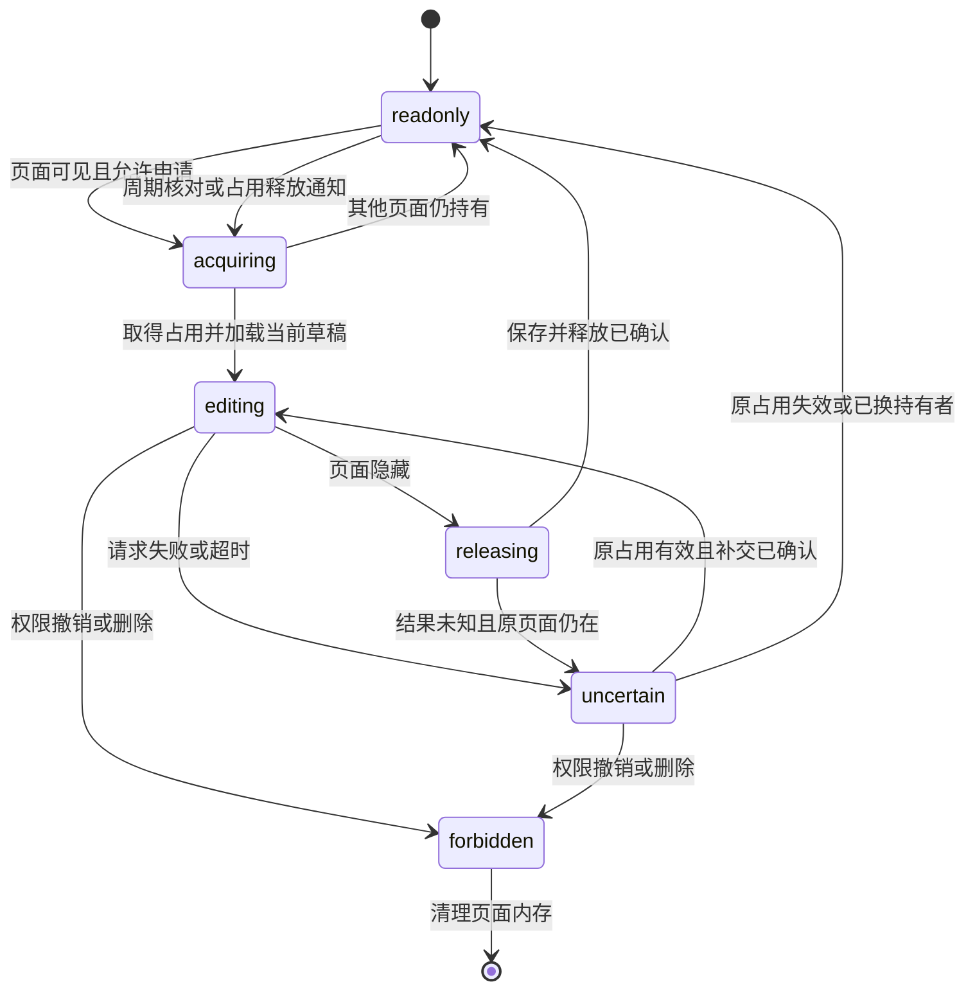

# 共享云端草稿与编辑租约设计

日期：2026-10-29。2026-10-31 状态核对：**实现已随 [PR #48](https://github.com/tangenty42/stupig.tv/pull/48) 合并；本地隔离验收和开发库迁移记录保留，生产状态以独立发布回执为准**。本页的阶段描述及“未部署”记录指当时验证范围，不作为当前线上状态证明。

本文承接 [A02 架构审查](../reviews/architecture-and-documentation-audit-2026-10-28.md)，保留协议及设计取舍。工作区现行行为以[草稿手册](../modules/content/drafts.md)、源码和[实施记录](shared-cloud-draft-implementation-2026-10-30.md)为准；概念接口名称不替代实际 DTO。代码落地不能证明线上已切换。

2026-10-30 的[实现方案](shared-cloud-draft-implementation-2026-10-30.md)承接本文，列出代码职责、P0–P6 实施顺序、审计项对应及上线条件。采纳选择与旧本地数据策略见第 16 节。

## 1. 目标与已确定的方向

每篇 story 在云端保留一份 main 和一份共享 draft。main 用于正式展示，draft 用于轮流编辑；不按账号、设备或标签页建立个人分支，不保存正文历史快照，不提供自动合并。

用户已明确的方向：

- 编辑器默认只读。页面可见后申请 reservation，成功取得占用并加载最新云端 draft 后解锁；页面隐藏后立即只读并请求释放。
- 正文草稿停止持久化到浏览器。输入尚未上传时只存在当前页面内存；云端确认后才显示已自动保存。
- 有输入时按节流窗口 N 请求；无请求的空窗达到 M 后，按 M 轮询保活。成功保存同时续租，没有变化时只保活。
- 复用 `useSyncedData` 现有的“请求完成后计算空窗”逻辑。租约有效期采用保守上界 `L = M + 2T + S`，T 为本地请求超时，S 为调度余量。
- 请求失败或超时立即锁住编辑器；恢复后必须核对租约是否仍属于本页面，不能仅因 HTTP 请求成功就解锁。
- main 和云端 draft 都参与统一引用更新；保留 A01 的 baseline + journal、每个作用域 200 个完整批次和悬空引用 warning 规则。

本文的表结构、新建草稿流程、权限收紧及旧本地数据处理是具体实施建议，需结合第 16 节决策确认。本文不授权删除现有本地草稿或修改业务数据库。

## 2. 现有实现与复用边界

| 当前入口 | 已有能力 | 本设计中的处理 |
| --- | --- | --- |
| [contentDraft.ts](../../app/stores/contentDraft.ts) | 按 story ID / `new` 保存 Pinia 状态和 localStorage 明文，拥有保存、引用结果应用及确认状态 | 改为内存中的编辑状态和串行命令；移除常规正文持久化、旧草稿自动恢复和个人正文冲突选择 |
| [useStoryEditSession.ts](../../app/composables/useStoryEditSession.ts) | 编辑页生命周期、store action 接线和同浏览器 Web Locks 交接 | 由服务端租约成为唯一编辑权依据；保留页面适配及身份/操作代次保护，业务状态继续由 store 拥有 |
| [useSyncedData.ts](../../app/composables/useSyncedData.ts) / [query.ts](../../app/utils/sync/query.ts) | 可见页面轮询、请求完成时间、事件失效、迟到结果过滤；共享查询可合并请求 | 复用 `polling_interval = M`。占用/保存使用页面独立请求，不共享查询结果 |
| [useTrpcClient.ts](../../app/composables/useTrpcClient.ts) | API 传输、统一 401 退出、站点在线保活 | 扩展草稿请求的超时/取消支持；站点 presence 保活不能替代 draft 续租 |
| [story.service.ts](../../server/services/content/story.service.ts) | main 创建/保存、正文 revision 检查、标题校验、引用事务 | 提取可复用的同事务发布步骤；正式写入 main 必须经过草稿租约 |
| [reference-history.service.ts](../../server/services/content/reference-history.service.ts) | 附件/标题历史、main 立即重写、客户端全文重放 | 扩展到持久化 draft；客户端在途输入仍需要引用 baseline |
| [delete-impact.service.ts](../../server/services/content/delete-impact.service.ts) | 当前可见 main 的引用预览 | 加入云端 draft 和当前页面尚未上传的引用摘要 |
| [实时同步](../modules/realtime.md) | Content 事务 outbox → MQTT → API 重新读取 | 添加 draft 资源失效通知；不在消息中发送正文或占用凭证 |

现有 `useSyncedData` **没有输入节流 N，也没有编辑租约协议**。其 `polling_interval` 在成功和失败完成后都重新计时，后台页和已有请求进行中不触发轮询。`universal: false` 的手动 `refresh()` 并不保证串行，因此草稿会话仍须统一协调保存、保活及显式操作。

## 3. 数据和编辑权的不变量

1. 每篇已发布 story 最多一条持久化 draft；首次发布前的每份草稿也有独立身份，不能共用全局 `new` 槽位。
2. 云端 draft 是唯一已确认的编辑内容。页面可暂时持有未确认输入，但不能将它称作已保存或当前云端 head。
3. 任一时刻只允许一个有效租约进行人工正文写入；服务端 MySQL 事务决定占用归属，前端只读状态不构成授权。
4. 租约属于“账号 + 登录会话 + 页面实例 + 本次占用代次”。同账号另一窗口也不能使用前一窗口的编辑权。
5. 失效租约不能复活。重新取得占用必须产生新代次，先读取云端状态，再允许输入。
6. 保存、发布、重置、删除和释放校验有效占用；旧请求不能覆盖新内容，也不能释放或续期别人的租约。
7. 自动保存允许不完整的 Markdown / front matter；只有正式发布要求正文语法、元数据和标题唯一性全部通过。
8. 引用机械更新可以在有人占用时执行，但不能与用户保存互相覆盖。它不占用人工编辑租约，仍受数据库事务和引用版本约束。
9. 自动保存不更新 main 的正文、公开标题、排序时间或公开列表；单纯续租不更新草稿正文时间，也不广播正文变化。
10. 权限撤销、退出登录、页面销毁或 story 删除后，迟到结果不能恢复可编辑状态或把机密内容重新放回页面。

## 4. 建议的数据模型

### 4.1 一张当前草稿表

建议新增 `content_story_drafts`，一行保存一份当前草稿及其当前租约。保留 `content_stories` 作为 main，不增加历史版本表、个人分支表或独立租约表。

选择独立表主要是为了容纳“尚无 main 的新建草稿”，避免在所有公开 story 查询中增加未发布状态过滤；它不改变“一篇 story 一份 draft”的产品模型。如果改为 story 上的若干 column，必须同时引入未发布 story 状态并审计所有公开查询，见第 16 节。

| 字段组 | 拟议字段 | 含义与约束 |
| --- | --- | --- |
| 身份 | `id`、`story_id` | `id` 为不可复用的草稿标识；`story_id` 可空且唯一。首次发布后绑定 story，之后不换绑；删除 story 时删除关联 draft，不能将其变回未发布草稿 |
| 创建幂等 | `create_request_id` | 新建请求的随机标识，与创建者组成唯一约束；已有 story 回填可为空。用于找回同一次创建的结果，不把请求标识当作可复用的 draft ID |
| 当前正文 | `markdown` | `MEDIUMTEXT`，继续受 `markdownMaxBytes` 限制；不存正文快照数组 |
| 状态序号 | `draft_revision` | 正文、引用基线或发布/重置状态变化时递增，用于客户端快照及响应顺序；不用于恢复历史版本 |
| 引用基线 | `namespace_revision`、`title_revision` | 已保存 markdown 所处的引用版本；未绑定 story 的附件基线为 0 |
| 发布状态 | `published_main_revision` | 最近一次由此 draft 发布/重置所对齐的 main revision；用于状态展示及识别绕过正式接口的异常 main 写入，不建立分支合并 |
| 归属 | `created_by`、`updated_by`、`created_at`、`updated_at` | 标明创建者/最后人工修改者与时间；作者身份不代表草稿私有，权限由当前授权决定 |
| 租约代次 | `lease_epoch` | 每次新占用递增，释放后不归零；不允许用旧代次重新申请续期 |
| 持有者 | `lease_actor_id`、`lease_session_id`、`lease_page_id` | 账号和真实服务端登录会话，页面 ID 仅在内存生成；登录会话取认证上下文，不能相信客户端传入值 |
| 占用凭证 | `lease_token_hash`、`lease_until` | 凭证校验值及 UTC 毫秒级到期时间；凭证不进入公开通知、日志、URL或浏览器持久化 |
| 最后命令回执 | `last_command_seq`、`last_command_hash`、`last_command_result` | 仅保存本次占用最后一条已接受命令的回执。结果含操作类型、确认序号、发布后的 story/main revision 等必要字段，不重复存正文 |

具体 SQL 类型、外键和索引在实现迁移时按现有 ID 类型确定；至少有 `UNIQUE(story_id)` 和管理列表所需的时间索引。租约按到期时间逻辑失效，不要求后台定时扫描才能释放。

`draft_revision`、`lease_epoch` 和 `command_seq` 职责不同：分别表示内容状态、编辑权代次和同一代次内的命令顺序。它们是当前状态校验值，不代表三套正文版本历史。

### 4.2 新建与首次发布

建议进入 `/content/new/edit` 后，在客户端通过幂等的创建请求生成独立 draft ID，再替换到带该 ID 的草稿编辑地址。创建响应丢失后重试同一请求标识，不得生成第二条存续草稿；创建只生成模板，不先创建公开 main，也不自动抢占。创建回执以该草稿仍存在为边界；删除后客户端取消对应创建任务，不再自动重试。若重新执行创建，必须得到新 draft ID，不能让旧正文/租约请求命中一条复活的同 ID 记录。

管理端提供“未发布草稿”入口，使关闭页面后仍能重新找到它。列表只对满足草稿权限的用户开放，所有合格编辑者可依次接手；草稿标题不会提前进入公开 story 列表、`content://` 标题目录或标题唯一约束。列表只取必要元数据，不批量下发正文。

首次发布在一个事务内创建 main、建立附件根、绑定 `story_id`、推进标题作用域并写 outbox；draft ID 保持不变。新建草稿在首次发布前仍不开放附件上传，与现有“请先保存档案”一致。

新建草稿的普通重置恢复模板；“删除未发布草稿”是单独的有确认操作。不默认定时删除未发布草稿；保留策略以后另行决定，不能假定临时内容可以静默清理。

### 4.3 已有 story

建议维护迁移时按 main 初始化 draft，基线取迁移时的当前附件和标题 revision，不创建任何占用。之后创建 story 必须同时建立关联 draft，或由首次发布绑定，不能靠公开 GET 请求隐式创建租约或补正文。

发布后 draft 保留并与 main 对齐；正常自动保存只修改 draft。显式“舍弃修改”把 draft 重置为当前 main，两种操作都增加状态序号并保留当前编辑权。“有未发布修改”按当前 draft 与 main 的正文比较得出，不能只看 draft revision 是否增加，因为机械引用更新也会推进它。

## 5. 调度参数与保守租约上界

拟在 [app-settings.yaml](../../config/app-settings.yaml) 的 `app.content.draft` 定义以下配置；下面是建议初值，不是当前仓库已生效值：

```yaml
draft:
  saveThrottleMs: 1000
  keepaliveIntervalMs: 10000
  requestTimeoutMs: 5000
  leaseMarginMs: 3000
```

| 符号 | 含义 | 建议初值 |
| --- | --- | --- |
| N | 输入保存节流窗口 | 1 秒 |
| M | 请求完成后的保守空窗 / 失败后重试间隔 | 10 秒 |
| T | 一次客户端请求从启动到本地结束的总超时 | 5 秒 |
| S | 轮询时钟粒度、调度等余量 | 3 秒 |
| L | 服务端租约时长，统一推导 `M + 2T + S` | 23 秒 |

配置 schema 校验正整数、`N < M`、合理范围和推导溢出；前后端复用同一纯计算函数。通过现有生成流程更新 settings，不手改生成文件，也不另设可与公式冲突的独立 lease 配置。

保守上界的推导：服务端在上次请求中续租后，响应到达客户端可能还需要接近 T；请求完成后空闲 M；下次请求到完成/超时又可能需要 T。因此从上次服务端续租到下一次客户端得到确定结果，按 `T + M + T` 预算，再加 S。

这个公式是正常运行时的时序预算，不保证浏览器冻结、长时间卡顿或数据库严重拥塞时不断租。超过有效期就按失去编辑权处理，正确性依靠服务端校验，不依靠“余量应该足够”。数据库使用自身时间判定到期；客户端使用保守的本地截止时间提前只读，不能凭客户端时钟续租。

成功响应返回在服务端取样时的 `lease_remaining_ms`。客户端从这个剩余时长减去本次完整往返耗时与安全余量，再从当前单调时钟推导保守截止时间；结果非正则保持只读并重新核对。这样不依赖客户端与数据库的时钟同步，也不会把旧回执当作新续租。只有明确发生了新续租时，才能用该次请求发起时间加 L 的方式推导下界；重复回执和重复申请不能假装又得到完整 L。

请求恢复、页面恢复及输入入口均检查该截止时间；不能只依赖一个可能被暂停的 `setTimeout`。时钟跳变或恢复状态不能确定时，先只读并请求服务端核对。

## 6. 复用 useSyncedData 的方式

### 6.1 单一周期与页面隔离

每个草稿页面通过一次 `useSyncedData` 注册租约/同步周期，设置 `server: false`、`universal: false`、`polling_interval: M`，查询身份绑定 draft ID、页面实例和本地身份代次。SSR 不申请占用，也不执行自动保存。

周期内由草稿会话决定当前应观察、申请、保存、续租还是重试待确认命令。无占用的观察请求只能读取和按规则申请，不能携带旧占用期间的待保存全文。MQTT 是刷新提示，不是编辑权证明。

不新增另一套 M 定时器，不改变其他 `useSyncedData` 消费者的完成时间计时语义。N 仅用于正文输入引起的主动 `refresh()`；同一个页面级协调器统一处理手动刷新、轮询、通知和发布/重置/释放。

现有查询层会吞掉已报告的 fetch 错误，`await refresh()` 完成并不意味着保存成功。草稿会话必须依据服务端确认回执更新状态；超时和错误要进入查询失败路径，避免误记为成功或触发解锁。401 的清理依靠统一认证失效及会话监听，不能只依赖会被查询层抑制的 `on_error`。

### 6.2 输入节流 N

- 空闲时第一次输入可立即发起；连续输入期间两次自动保存启动至少相隔 N，不因每个按键重置截止时间而变成无限等待的 debounce。
- N 窗口中仅保留最新待提交快照；最后一次输入必须有尾随保存。
- 已有请求未完成时只标记待提交，不并发；完成后在 N 窗口允许的最早时刻提交最新快照。
- 没有输入时，已有保存的完成时间自然推迟 M 保活；其他 story 请求、站点 presence 或读列表不推迟本草稿保活。
- 发布、重置和隐藏释放绕过 N 的等待，但仍进入同一命令队列。

### 6.3 空闲、失败和可见性

周期完成后没有其他请求，经过 M 再轮询；失败也按现有逻辑从完成时计 M。首次可见、再次可见及网络恢复事件触发一次立即核对。页面隐藏后立即关闭写入口、提交最后快照并释放、停止常规轮询。

可见性以 `document.visibilityState` 为准，不把所有 `blur` 都视为隐藏；窗口失焦但仍可见时继续持有。多个可见窗口竞争同一租约，由服务端裁决，不自动强抢有效持有者。手动让出编辑权可作为后续 UX，首版不默认增加抢占按钮。

失败状态在当前可见周期内保持只读。已收到明确权限拒绝或删除结果时停止重试；一般网络/服务不可用继续按 M 核对。可见性改变、账号改变和页面卸载都增加本地操作代次，旧成功回调不得解锁新页面或隐藏页面。

### 6.4 超时、失效通知和反馈循环

T 覆盖客户端批处理等待、网络和服务端等待，不包含主动调度前的 N/M 空窗。超时触发后本地结束本轮并保持只读，尽可能取消底层请求；取消不代表服务端没有提交。

`Query.invalidate()` 会使旧结果失效，并在在途请求结束后追加刷新；`universal: false` 的主动 refresh 也可能并发。会话协调器必须把这些触发合并为同一在途任务，确认请求结果之前不换序号、不换快照。超时后仍在服务端执行的旧请求由服务端命令序号和占用代次隔离。

失效通知可能恰好来自本次保存。若查询层丢弃了该次响应，下一次用同一命令身份核对回执，再接着保存；不能依赖每次 mutation 的响应一定会到达 `on_data`。重复回执不再发布 outbox，纯读/续租不发布正文事件，避免“保存 → 自己的通知 → 再保存”的无限循环。

只读页面通过通知和 M 周期更新正文；后台页不承诺实时更新，恢复可见时先核对再展示为最新。持有者收到云端数据时只确认已提交快照并应用安全引用补丁，不整篇覆盖请求发出之后新增的输入。

## 7. 编辑状态机



`readonly`、`acquiring`、`uncertain`、`releasing` 都禁止键入、粘贴、拖入引用、程序插入、undo/redo 修改及发布。隐藏时即使状态显示为待确认，也不能继续轮询争抢；下一次可见后再进入核对流程。

UI 最少区分“正在连接”“其他页面正在编辑”“修改待上传”“已自动保存”“连接中断，已暂停编辑”“编辑权已变更”。自动保存的成功提示不能表示 main 已发布。现有“保存”按钮可继续使用，但说明和状态必须明确它负责正式保存 main；按钮名称属于第 16 节待定项。

## 8. 租约和命令协议

### 8.1 取得与续期

申请时提交刚读取的 `expected_lease_epoch`、页面 ID 和本次申请的随机凭证；服务端只保存凭证校验值。凭证由客户端在本次申请前生成并留在内存，便于响应丢失后重试相同申请，不进入持久化或日志。

事务锁定当前草稿及必要 story 后，检查权限、会话和当前占用：

1. 有其他有效持有者：返回只读状态，不下发其凭证。
2. 相同申请已成功且租约仍有效：返回同一代次和最新快照；重复申请不创建新占用。
3. 当前代次与预期一致且没有有效占用：代次加一，绑定当前认证会话及页面凭证，设置到期时间，返回占用与当前快照。
4. 预期代次落后、申请对应租约已到期、被释放或被替换：拒绝旧申请。客户端重新观察后以新凭证申请，不能把迟到请求当作新申请。

续租、保存和释放必须同时匹配 actor、session、page、epoch、token，并且原租约尚未到期。单独比较账号或页面 ID 不足以保护交接。新租约从当前数据库时间延长 L，不能给已经过期的旧租约续命。

### 8.2 顺序与重复请求

同一有效租约中，客户端把所有人工命令串行编号，从 1 递增；尚未确认的命令保留原始负载、类型和摘要。重试必须使用同一编号和同一负载。

| 收到的命令 | 服务端行为 |
| --- | --- |
| `seq = last + 1`，占用仍有效 | 执行，记录回执，再返回当前状态 |
| `seq = last`，类型和负载摘要一致 | 返回已执行结果及当前状态，不再次发布、重置、续租、写 outbox 或重复改写正文 |
| `seq = last`，负载不同 | 拒绝，不能把新内容伪装为重试 |
| `seq < last` 或跳号 | 拒绝旧/乱序写入，引导核对 |
| epoch/token 已失效 | 无论序号如何都不能产生写入或续租；当前已知回执只用于告知结果，不证明编辑权 |

回执只保留最后一条命令，依靠客户端“前一条确认后才发下一条”的约束，不扩展为通用命令日志。释放后的最终回执可在本行保留到下次占用；换持有者后回执可能不可用，旧页面只能重新观察当前状态，不重新执行旧命令。草稿删除后返回不存在即可，不为删除建立长期 tombstone 正文副本。

在权限/租约有效且已取得事务锁后，发布校验失败、正文超限或需要人工核对等确定的业务结果，也记录为该命令的终态回执并消费序号；修正后使用新序号。传输失败或事务回滚才是执行结果未知。权限/租约拒绝不允许借机改写回执或续租。确定失败的正文不在后台无限重发；必要时用新序号的纯续租重新确认编辑权后，允许用户修正输入。

### 8.3 事务边界

所有写入在 MySQL 同一事务中完成授权所需核对、占用校验、引用重放、正文/回执修改和 outbox 写入。等待行锁后再次以数据库当前时间核对租约，不能沿用排队前的判断。

锁后授权必须核验本次请求的 token generation 仍存在且有效、会话未退出/过期、用户未禁用及当前权限。当前[登录服务](../../server/services/session.service.ts)会复用失效会话 row 并删除其旧 token generations，因此仅比较 `session_id` 或复用入站认证结果会接受某些排队中的旧请求。正常 token 轮换保留仍有效的旧 generation，不能要求每次请求都与申请租约时的 cookie generation 相同。授权读取应与退出/改权事务协调，不能读取事务旧快照。

取得必要锁后单独读取数据库当前时间；耗时引用处理后、最终受保护写入前再次检查期限。纯续租可走只锁必要草稿/授权记录的轻量路径，不扫描正文或工作区；该路径不得随后反向取标题锁升级为正文写入。

沿用全局标题锁先于 story/scope 锁的现行顺序，再取得草稿行锁；多 story / 多 draft 时按稳定顺序加锁。附件操作继续沿用现有 scope/附件锁纪律，在持有 story 锁后更新关联 draft。新建未发布草稿没有 story 行，首次发布与标题全局重写的锁顺序需在服务拆分时一并固定并通过并发测试验证。

不能在草稿事务内调用一个自己另开连接和提交的 `update_story()`。应将已有 main 解析、唯一性、写入和引用副作用提取为由调用者事务控制的内部步骤。数据库死锁重试必须保持原命令身份，不能生成一个新发布请求。

## 9. 拟议 API 合同

接口名用于评审，最终按现有 tRPC 命名约定落地。所有草稿过程走管理权限及草稿访问授权，不复用公开 `getStoryBody` 返回未发布正文。

| 操作 | 主要输入 | 结果与约束 |
| --- | --- | --- |
| `createDraft` | 幂等创建标识 | 创建独立未发布模板，返回 draft ID；不创建公开 main、不自动占用 |
| `listDrafts` | 管理列表筛选/分页 | 可访问的未发布草稿元数据；避免正文和机密标题进入公共目录 |
| `getDraft` | draft ID 或已有 story ID、已知 draft revision | 当前授权快照、main 对齐状态、占用是否空闲及 epoch；即使正文没变，也返回当前占用状态 |
| `acquireDraft` | expected epoch、page ID、本次随机凭证 | 原子取得占用和当前快照；忙碌是正常只读结果 |
| `syncDraft` | 占用信息、command seq、可选 markdown 和引用 baseline、与快照绑定的引用核对确认 | 保存并续租，或只续租；返回确认序号、当前 draft revision、引用结果和剩余有效期 |
| `releaseDraft` | 占用信息、seq、可选最后正文及 baseline | 在一个事务中保存最后快照并释放；不能先释放再单独上传 |
| `publishDraft` | 占用信息、seq、确认过的 draft revision | 仅发布指定云端 draft；不接受未校验的另一份客户端全文，成功返回 main revision / story ID |
| `resetDraft` | 占用信息、seq、用户确认的 draft revision | 恢复当前 main；未发布草稿恢复模板。返回新 draft 状态，保留租约 |
| `deleteDraft` / `deleteStory` | 对应身份、占用信息、seq | 删除未发布草稿或完整 story；保留现有权限、上传预约和引用提示约束 |

响应将“本次命令是否已执行”和“现在是否仍持有租约”分别表达，避免一个旧成功回执导致错误解锁。`draft_revision` 未变也不能跳过权限、租约或会话核对。请求/响应必须限长、禁用正文日志并避免凭证进入 GET 查询 URL。

结构化错误至少区分：租约失效、命令顺序不符、引用历史不可用、权限失效、目标不存在、正文超限和发布校验失败。租约已被占用属于正常等待；正文校验失败不能伪装成网络重试，也不能清空用户输入。

草稿错误应复用现有 tRPC `applicationError` 通道扩展类型，而不是靠中文文案分支。确定的业务终态可随命令回执返回；真正的服务不可用仍应保留正确状态映射。现有错误转换没有显式处理 503，实施涉及该路径时应补齐，避免只把所有异常当成相同的断网状态。

`createStory` / `updateStory` 等旧正文写入入口不得继续绕过租约。实施时删除旧客户端协议，更新所有调用者、测试及维护入口；不保留“缺少 token 就走老保存路径”的兼容分支。冻结迁移及其历史依赖保持不变。

## 10. 断线、迟到响应与恢复

| 场景 | 服务端与页面行为 |
| --- | --- |
| 保存未到服务端，下一次重试时原租约仍有效 | 用原序号重试；确认后再提交期间新增输入，完成同步后解锁 |
| 服务端已保存，响应丢失 | 同序号同负载返回回执，不能再执行；保留请求后新输入，不能用旧响应覆盖它 |
| 原租约过期，无其他人接手 | 旧占用仍然失效；重新观察并获取新代次，先加载云端，再编辑 |
| 原租约过期，B 已接手 | A 保持只读；旧保存/释放/续租均不能改变 B 的正文或占用 |
| B 接手、编辑、释放，A 再回来 | 即使此刻空闲，A 也不能复用旧凭证或自动提交断线前全文 |
| A→B→A 账号切换，或同 story 离开再回来 | 本地身份/页面代次已改变，旧回调不应用；服务端旧会话凭证不能转用 |
| 申请成功但响应到达前页面已隐藏 | 不解锁；可尽力按该次凭证释放，否则等待到期。后续页面使用新申请身份 |
| 最后保存不合法/超限，无法完成保存并释放 | 不假装已保存；冻结输入并保留内存内容，停止续租，最终自动过期 |
| 401 / 403 / 404 | 停止普通网络重试，清理不可再访问的正文、编辑器历史和回调，退出或进入无权/已删除状态 |

失去占用后，将尚未确认的文字放入当前页面的只读恢复区，说明“编辑权已变更，部分修改未上传”，仅允许显式复制，不自动导出、不落浏览器持久化、不自动覆盖云端。主编辑器继续跟随云端 draft。用户可以关闭恢复区；页面关闭则内容消失。

恢复区受当前权限约束；退出、撤权、切换账号必须清理，不能为“防丢”把机密正文留给下一位登录者。此机制不承诺崩溃、刷新或断电后找回未上传输入，也不引入第二份云端分支。

发布/重置期间短暂锁住编辑器，先完成在途保存，再执行明确序号的操作。成功后再解锁；若网络结果未知，先核对原命令回执，不直接重发另一条发布。引用变化导致确认快照过时时，重新核对状态；破坏性重置需要重新确认，不把旧确认套用到后来变化的正文。

## 11. 引用更新与人工编辑共存

### 11.1 持久化的 main 与 draft

附件 namespace 变更只作用于所属 story 的 main 和 draft。标题变化作用于全部 main 与 draft，包括尚未发布、尚无任何 main 引用的草稿。统一调用现有解析、归一化和重放模块，不另写草稿专用替换规则。

变更事务内依次记录 journal、更新 main / draft 正文与对应基线、推进必要状态序号、写入失效 outbox，再提交。创建、删除、空映射批次即使正文没变，也必须推进已消费的基线；否则长期不编辑的云端 draft 会无故落到历史窗口之外。

每个作用域保留 200 个完整批次的合同不变。云端草稿正常情况下随变更事务保持当前；历史窗口主要保护在途输入、长时间失联内存和切换前遗留数据。不能因为云端 draft 已更新就删掉 journal。

### 11.2 持有者尚未上传的输入

典型顺序：A 的编辑器仍含 `att://old.png` → 另一个操作将附件改名为 `new.png` 并更新云端 draft → A 提交带旧引用基线的全文。

服务端在租约有效且命令合法的前提下，先按 A 的基线重放到当前引用版本，再保存，避免把旧链接写回。不能单纯因 `draft_revision` 被机械更新就要求用户解决“多人正文冲突”。

客户端只在提交快照仍匹配时应用响应正文/补丁；发送后已有输入则保留新文本及其旧基线，用现有[引用 bridge](../../app/utils/content/draft-reference-bridge.ts)对当前文本重新核对，并在重放期间短暂只读。不能给尚未重放的新文本直接盖上响应中的新 baseline。

如果任一基线未知、早于 floor 或超前，不自动写入不确定正文。可在合法租约下仅续租并返回 `reference_review_required`；用户核对后以绑定当前快照的确认继续保存。现有手工核对流程应保留，不能把引用历史不足当成租约失效，也不能按 M 无限重试同一不确定写入。

删除目标保持原链接，编辑器 warning；同名重建沿用现有按名称解析。草稿里输入一个尚未正式发布的新标题不会触发全局标题改名，只有发布 main 时才产生标题变更。

### 11.3 附件操作与占用的范围

本设计中的 reservation 控制人工正文、发布、重置及 story 删除。它不替代现有上传路径预约、图片任务租约和工作区版本约束，也不让已开始的上传因切换标签页而必须取消。

附件操作可能由其他允许的入口或后台任务完成，因此要按上述机械引用更新保护正文。上传完成后的“向正文插入链接”仍是人工正文修改，必须检查当前页面占用和代次；失去占用后不执行迟到插入。若产品希望连所有附件操作也独占，需另行扩大 reservation 范围，不能在实现时隐式改变。

## 12. 权限、机密正文与存储边界

### 12.1 未完成正文的机密风险

当前 main 保存要求 Markdown/HTML 合法，而草稿必须允许输入一半的 `<good>`。现有[机密解析器](../../server/shared/content-private.ts)有“未闭合标签不形成机密节点”的处理，不能直接拿它为任意未完成 draft 脱敏后下发，否则可能把标签后的机密文字发给无权限账号。

为保持实现简单，**本文推荐全部草稿接口同时要求 `content_manage:full` 和 `content_private:read`**，包括列表、读取、申请和发布；管理员已有这些权限。公开 main 的脱敏读取保持现行规则。此方案会收紧受委派但无机密权限的编辑者能力，尚需确认，不能当作既有“admin-only”事实。

若必须保留普通编辑者的草稿能力，就要另设计保守机密标记和完整权限状态转移：main、旧 draft 或新输入出现机密迹象后，不能因临时删除/打断标签自动降级为公开；无法安全解析时拒绝向低权限账号返回正文。这是额外工作，不能只复用当前 `has_private_content()` 解决。

### 12.2 授权及客户端清理

- 每次草稿读写都使用当前认证会话及权限；有凭证不代表权限永久有效。申请和写入在服务端执行，等待锁后仍需有效性检查。
- 关联 story 的 main 权限和 draft 权限都参与核对，不能因为 main 当前公开就把 draft 当成公开。
- 页面首次进入只显示安全的加载状态，建议草稿正文仅客户端授权获取，不放入通用 SSR payload、公开 head/description 或静态预渲染数据。
- 草稿 HTTP 响应明确 `Cache-Control: no-store`；确认反向代理不缓存，混合 tRPC batch 也不能落入公开缓存。正文不写 localStorage、sessionStorage、IndexedDB 或 Service Worker 缓存。
- 占用凭证、正文和恢复区内容不进入日志、埋点、错误上报和 MQTT；通知只表示资源变化。`viewer_key` 和账号代次用于阻止旧身份数据进入新身份页面。
- 清理覆盖 Pinia、页面 ref、CodeMirror 文档/undo 历史、预览 HTML、共享查询缓存和恢复区。隐藏页面不得保留续租权；内存中的未上传文本保留不等同于磁盘持久化。

这些措施消除应用主动长期保存的本地草稿，不承诺浏览器/操作系统从不产生内存交换、会话恢复副本或用户复制件。云端存储沿用数据库与备份的访问保护，不能描述为端到端加密。

## 13. 删除提示与通知

删除影响预览同时检查已保存 main、云端 draft 和当前页面尚未上传的文本；标题删除还要检查未发布草稿。只返回调用者有权知道的摘要，不暴露引用位置、路径、行号或他人的未上传内容。

沿用用户已确定的弹窗标题“空城计？”和带 icon 的确认按钮。摘要采用“有正文正在引用。”“有云端草稿正在引用。”；当前页面还有尚未上传引用时显示“有未上传修改正在引用。”。不再把云端内容称为“本地草稿”。保留“删除后链接保留，目标不存在时编辑器提示警告”的含义。

影响预览不是锁或阻删依据；确认期间引用仍可能变化。正文占用、权限、上传预约和删除事务仍需在最终请求中重新校验。删除 story 同时删除关联 draft、使原租约失效，并通知相关编辑页清理；其他 story 中的引用保持悬空。

拟增加 `content_draft:<draft_id>` 和受控的草稿列表失效资源，沿用 Content outbox。正文/基线、占用归属、发布、重置和删除变化产生必要通知；只续租或重复命令回执不广播。租约自然到期不需要合成一条定时通知，等待页面靠现有 M 轮询发现可接手状态。

MQTT 当前允许匿名订阅应用前缀的通配主题。现有[HMAC 通道映射](../../server/lib/sync-channel.ts)可隐藏原始 draft ID，但不能阻止通配订阅者观察通道及活动时间，也不构成 broker 授权。第 16 节需选择仅授权订阅，或明确接受匿名可见的非身份活动；前者必须落实可信连接身份与资源权限，确保匿名通配规则不能覆盖草稿频道。通知中不发送账号、登录会话、token 或正文。

Content outbox 当前直接保存并发布传入的 resource，不经过 `publish_refresh()` 的映射；仅扩展 HMAC 类型列表并不足够。实施时 topic 与 payload 必须采用相同的 wire resource，并与授权查询下发的频道一致，不能有一处仍使用原始 ID。具体接线、密钥切换及验收安排见[实现方案 P3](shared-cloud-draft-implementation-2026-10-30.md#p3-引用发布和通知成为一个事务)。

## 14. 切换与旧本地草稿

先用维护迁移建立表和 main → draft 初始记录，验证数量、文本和引用基线，再以同一版本切换服务端协议与前端。旧页面没有新租约不能再保存；提示刷新，不维护双写、不接受旧字段回退，不把所有旧客户端全文无条件当作 cloud draft。

旧 localStorage 内容没有账号归属，服务器既无法枚举所有浏览器，也无法判断每份正文应归谁。**不能静默批量导入，也不能在没有明确决定时直接清空。** 以下保留原备选；最终按第 16 节由管理员自行处理，应用不导入或删除。

| 方案 | 行为 | 取舍 |
| --- | --- | --- |
| 上线前处理，之后定向清理（推荐） | 上线前由有权限编辑者确认需保留的本地内容；切换后清理精确的旧草稿前缀，移除自动恢复代码 | 运行时最简单；需要明确接受未处理旧草稿会被删除 |
| 一次性显式导入工具 | 仅当前具备草稿权限的用户可选择导入；必须取得目标 draft 租约并确认覆盖，成功后删除该本地记录 | 保留旧内容机会较多，但工具自身需处理无归属、引用历史和覆盖确认；不能长期兼容 |

没有再次访问站点的浏览器无法被远程清除。清理程序只删除明确的旧草稿键，不清空整个 localStorage，不碰上传恢复句柄、主题偏好或其他应用数据。

新增迁移遵循冻结规则，不修改已执行 SQL/TS 和历史 bundle。由于旧程序会重新开启本地草稿并绕过租约，不能把“回滚代码”当作安全的数据回滚；故障时先停止编辑，保留 cloud draft，按维护回执和备份制定恢复步骤。

## 15. 实施拆分与验收

### 15.1 建议实施顺序

以下保留合同层面的顺序；具体代码拆分、阶段完成条件和 A01–A10 / 审计 D01–D20 的安排以[实现方案](shared-cloud-draft-implementation-2026-10-30.md)为准。

1. 确认第 16 节的产品选择，固定共享类型、权限和 schema；为状态转换和请求时序建立可控时钟测试。
2. 新增冻结迁移、草稿存储和租约事务，接通 API、命令回执及 outbox；用独立 MySQL 测试库验证并发。
3. 把引用事务扩展到 draft，固定标题/附件/草稿锁顺序，覆盖创建、删除、空批次和裁剪。
4. 重构页面会话，复用 `useSyncedData` 的 M 轮询，加入 N 节流及串行协调；替换 Web Locks 和本地恢复 UI。
5. 接通新建草稿、正式发布、重置、删除摘要、权限清理及明确选定的旧本地数据处理。
6. 更新现行模块文档和架构入口，删除旧协议与无效测试假设，完成类型、lint、单元/组件、迁移及浏览器验收。

工作区中已有的 A01 引用改造、删除弹窗和无关同步修改必须保留。此前 A02 的部分本地会话围栏尝试不是完成的云端实现，应在重构时逐项整合或移除，不能直接据此关闭 A02。

### 15.2 必须覆盖的回归场景

| 类别 | 验收要求 |
| --- | --- |
| 节流 | 连续输入按 N 提交；尾随输入不遗漏；输入期间不额外发保活；在途请求不并发 |
| 现有轮询复用 | 成功/失败都从完成时计 M；隐藏不轮询；恢复立即核对；无额外 M 定时器；其他查询行为不改变 |
| 上界 | 上次响应延迟接近 T，下次请求延迟接近 T，按 `M + 2T + S` 不提前过期；超过边界时拒绝旧写入 |
| 争抢 | 两个独立浏览器上下文、同账号双窗口、不同账号同时申请，至多一个有效写者 |
| 幂等 | 创建/申请/保存/发布的响应丢失，重试无重复创建、发布或 outbox；同序号不同正文被拒绝 |
| 失效通知 | 自己的保存通知在响应前到达，查询层丢弃响应后仍能核对回执，不产生忙循环或重复发布 |
| 接管 | A 断线、到期、B 编辑；A 恢复的旧保存/释放不能影响 B；B 已退出也不能让 A 自动覆盖 |
| 隐藏交接 | 最后快照与释放原子提交；隐藏期间迟到申请不解锁；释放失败由到期兜底；快速隐藏/显示不串代次 |
| 迟到结果 | 页面销毁、同 story 重挂载、账号 A→B→A、退出及撤权后，旧响应不恢复正文或编辑权 |
| 输入保护 | 保存期间继续输入，响应只确认提交快照；未上传内容不被整篇刷新覆盖；程序插入遵守只读 |
| 引用 | 附件/标题改名同时更新 main 和 draft；未发布草稿也追赶标题；旧基线提交不会恢复旧链接 |
| 裁剪与删除 | 两种作用域各保留 200 个完整批次；历史不足仍要求核对；删除保留悬空 warning，同名重建沿用名称语义 |
| 发布/重置 | main 只在发布时变更；无效 Markdown 能自动保存但不能发布；无租约不能发布/重置/删除 |
| 机密与授权 | 按选定权限模型测试未闭合 `<good>`、原有机密被临时编辑、撤权/换号、非管理员委派权限；不泄露草稿正文 |
| 本地与通知 | localStorage / sessionStorage / IndexedDB 不出现新正文；SSR/HTTP 缓存和 MQTT 无正文/凭证；日志不记录敏感负载 |
| 新建 | 多个新建页不共用 `new`；关闭后从管理入口找回；首次发布只有一条 main；未发布草稿不进入公共目录 |
| 数据与事务 | 初始回填、回滚、重试、引用并发、租约到期等待锁、story 删除及 outbox 原子性，用真实隔离 MySQL 验证 |

单元测试使用假时钟验证 N/M/T 和状态转移；服务层测试使用实际事务边界；浏览器测试使用独立上下文及可控网络阻断/延迟，不能只派发 `online`/`offline` 事件冒充真实请求失败。先证明关键数据丢失/安全回归能检出被破坏的约束，再完成现有引用和上传回归。

文档阶段只运行文档 lint 和链接/源码一致性检查。实际实施后按[测试手册](../development/testing.md)运行相关测试、`pnpm lint`、Nuxt typecheck，以及使用独立数据库的迁移验证和 Playwright；不对业务库执行测试或维护迁移。

## 16. 产品决策记录

2026-10-30 用户要求按方案完整实现，采纳 D01、D02、D04、D05、D06 的建议。D03 另有明确答复：“不用管，现在只有我一个管理员，我自己清理localstorage”。因此应用退出旧协议，保留旧键，不新增导入或清理工具；历史正文是否保留由管理员负责，不声称所有浏览器残留已清除。下表保留原备选项作为设计历史。

| 编号 | 问题 | 本文建议 | 其他选择与影响 |
| --- | --- | --- | --- |
| D01 | 草稿存储及新建身份 | 一张当前草稿表，已有 story 一对一；新建独立 draft ID，首次发布绑定 main；提供管理恢复入口 | 直接加 story columns 必须新增未发布状态并改所有公开读取；暂时只把已发布 story 云端化则不能满足“所有草稿云端保存” |
| D02 | 无机密权限的委派编辑者 | 所有 draft 接口要求管理与机密读取双权限，以简化未完成正文的保密边界 | 保留普通编辑者需要新增保守机密标记和状态转换，另做权限设计与验收 |
| D03 | 旧本地草稿 | 上线前确认需保留内容，再明确授权定向清理；不保留运行时旧协议 | 一次性显式导入工具，成本更高；不决策就不能保证清除历史残留 |
| D04 | 初始时序 | N=1 秒、M=10 秒、T=5 秒、S=3 秒，L=23 秒 | 数值可调整，`M + 2T + S` 及现有完成时间计时方式已确定 |
| D05 | 正式保存按钮 | 保留“保存”，旁边明确“自动保存草稿 / 保存到正文”的差别 | 改为“发布到正文”语义更明确，但需统一快捷键提示和现有测试文案 |
| D06 | 草稿通知的可见性 | 仅授权订阅草稿通知，落实 broker 可信身份、资源授权、撤权和 ACL，匿名通配不能覆盖 | 使用 HMAC 隐藏原始 ID 并经授权 API 下发频道，但明确接受匿名通配订阅仍可观察通道活动；此选择不等价于私有通知 |

实际采用独立表及 draft ID、全部入口双权限、N=1s/M=10s/T=5s/S=3s/L=23s、保留正式保存按钮，以及独立前缀的授权通知。通知凭据最长 30 秒，当前连接的活动信号撤权以票期为界，API 授权不等待通知。新建／保存／申请响应丢失沿用原请求身份重试。

## 17. 证据与后续文档归属

本设计基于 2026-10-29 的当前工作区源码，未连接生产数据库或验证云端部署。浏览器生命周期限制参考 [Chrome Page Lifecycle API](https://developer.chrome.com/docs/web-platform/page-lifecycle-api) 和 [MDN visibilitychange](https://developer.mozilla.org/en-US/docs/Web/API/Document/visibilitychange_event)：页面可能被冻结/丢弃，因此离开时请求仅是尽力交接，服务端到期机制不可省略。

实现并验收后，将当前行为写入[草稿手册](../modules/content/drafts.md)、[实时同步](../modules/realtime.md)、[Content 总览](../modules/content/README.md)、[架构](../architecture.md)和[测试手册](../development/testing.md)；本文保留为设计决策记录，注明实际采纳的选择，不让提案与现行手册同时声称不同的线上合同。
