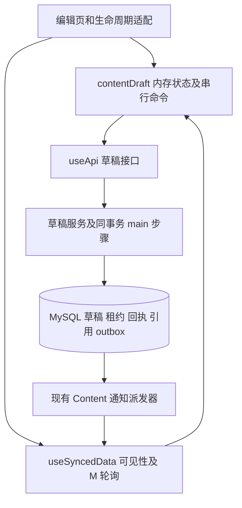

# 共享云端草稿实现方案

日期：2026-10-30。状态：**工作区实现、本地隔离验收及开发库迁移已完成；未迁移生产业务库、未部署生产**。原阶段说明保留为验收依据，实际选择和证据见第 8 节。

目标是在现有引用改造和 Pinia 整理的基础上，接入一份共享云端 draft、服务端独占编辑和自动保存。先完成服务端事务与交接协议，再替换编辑页，最后通过并发、权限和容量验证切换。无需先解决全部架构审计项，但不能把会话失效、引用同步或通知隐私留到上线以后。

## 1 与已有文档的关系

| 文档 | 负责的内容 | 本方案如何承接 |
| --- | --- | --- |
| [共享云端草稿与编辑租约设计](shared-cloud-draft-2026-10-29.md) | 目标行为、数据模型、租约和命令协议、产品选择 | 继续作为合同来源；本方案负责代码落点、实施依赖和完成条件，不复制一套协议 |
| [架构与文档一致性审查](../reviews/architecture-and-documentation-audit-2026-10-28.md) | A01–A10、D01–D20 的发现与历史证据 | 第 3 节逐项安排；修正文档与解决实现问题分别验收 |
| [当前草稿手册](../modules/content/drafts.md)、[Markdown](../modules/content/markdown.md)、[工作区](../modules/content/workspace.md) | 当前本地草稿、引用和附件合同 | 保留已经实现的正确行为；云端化验收后才更新为新行为 |
| [实时同步](../modules/realtime.md)、[MQTT 部署](../deployment/mqtt.md)、[账号](../modules/accounts.md) | 查询生命周期、通知传输和认证边界 | 复用现有接线，补草稿所需的事务授权和通知可见性 |
| [测试](../development/testing.md)、[迁移](../operations/migrations.md)、[备份恢复](../operations/backup-recovery.md) | 验证入口、冻结规则和恢复流程 | 沿用现有工具，增加草稿场景；不另造迁移账本或通用任务平台 |

下文的“审计 Dxx”指 10 月 28 日审计；“设计 Dxx”指 10 月 29 日设计第 16 节。两组编号不能混用。P0–P6 是实施阶段，不是审计严重级别。

### 当前可以直接复用的基础

- `contentDraft` 已拥有保存、引用应用和确认状态；页面代次与身份检查已覆盖部分旧请求写回问题。继续保留这些回归，不把改成 store 当作全部隔离问题已解决。
- 当前语法不再在普通初始化、恢复和保存回读时升级旧引用；旧语法转换仅属于明确的旧 schema 恢复路径。
- 引用重放已按批次建立查找表，保留同批同时解释、跨批按顺序执行、文件精确匹配和目录前缀匹配。云端 draft 直接复用同一模块。
- 引用历史不足的确认已绑定提交快照和引用版本。该摘要用来防止误用旧确认，不是授权签名；云端实现仍需单独检查账号、权限和租约。

以上为编写方案时的基础。实施现已替换 localStorage/Web Locks，新增独立草稿表与 MySQL 租约；完成证据按第 8 节记录，不能以原有引用回归替代云端并发验证。

## 2 实施前需要固定的选择

采纳记录在[设计第 16 节](shared-cloud-draft-2026-10-29.md#16-产品决策记录)。用户已要求完整实现，并明确旧本地数据自行处理；下表保留最初建议及依赖顺序。

| 选择 | 建议及影响 | 最晚决定阶段 |
| --- | --- | --- |
| 设计 D01 存储与新建 | 独立 `content_story_drafts` 表；已有 story 一对一，新建有独立 draft ID，管理端可找回 | P0，影响迁移和路由 |
| 设计 D02 访问权限 | 全部草稿入口要求 `content_manage:full` 与 `content_private:read`；这会收紧部分委派编辑者能力 | P0，影响全部读取和写入 |
| 设计 D03 旧本地正文 | 上线前处理需要保留的内容，明确授权后定向清理；若选显式导入工具，则纳入 P5 | P5 前决定，上线前执行；未经决定不删除或自动上传 |
| 设计 D04 时序 | 先按 N=1s、M=10s、T=5s、S=3s、L=23s 验证，容量结果可以调整数值 | P0 固定测试参数，P6 确定发布值 |
| 设计 D05 正式保存按钮 | 保留“保存”，明确“自动保存草稿”和“保存到正文”的区别 | P5 |
| 设计 D06 通知可见性 | 推荐草稿通知仅授权订阅；若接受匿名观察不含身份的活动，则明确采用 HMAC 通道并接受该边界 | P0，P3 完成对应接线，P6 验收真实 broker |

设计 D06 是本次补充：当前匿名客户端可订阅 `stupig/sync/#`。HMAC 可以隐藏原始 ID，不能阻止通配订阅观察某个通道的活动。若选择授权订阅，需落实可信连接身份、资源授权、撤权及 ACL，私有频道不能仍被匿名通配规则覆盖；这是部署和客户端连接改动。若选择 HMAC 方案，文档必须明确活动仍可观察，不能声称只有获准用户能收到通知。

## 3 审计项对应与范围

### 架构项

| 审计项 | 本次安排 | 完成边界 |
| --- | --- | --- |
| A01 统一引用 | P3 扩展到持久化 draft、未发布 draft 和在途输入 | 保留现有名称语义及 200 完整批次；不重做引用存储，不恢复不完整反向索引 |
| A02 草稿归属与旧回调 | P1、P2、P4、P5 核心目标 | 云端共享访问受当前权限控制；无常规本地持久化；旧页面/旧身份不能写回，历史本地数据按选定策略处理 |
| A03 工作区重复扫描 | P4 避免每次保存/续租拉工作区；P6 测量，必要时先做 Map/树的单次构造 | 保留快照 API；分页、增量树独立推进，不作为默认前置 |
| A04 全局标题锁及 scope 锁 | P1 固定锁顺序，P3 同事务更新 main/draft，P6 测量长事务 | 不在没有证据时拆细锁；上线须证明目标规模下不会常态触发草稿超时和断租 |
| A05 连接池及后台争用 | P2 提供轻量续租路径，P6 测连接等待和前后台混合负载 | 按结果做有界等待、背压、连接预算或 worker 隔离；不以缓存授权弱化撤权 |
| A06 账本保留 | 草稿仅存当前租约最后一条命令回执，租约逻辑到期 | 不新增过期草稿扫描器；旧命令回执等清理另案，退役墓碑和迁移回执不按统一 TTL 删除 |
| A07 兼容与宽类型 | P1 新增明确的草稿 DTO，P5 退出普通本地草稿协议 | 不夹带删除历史原图、加密迁移字段或全仓配置重构；存量盘点单独完成 |
| A08 通知保证 | P1 锁后重新授权，P3 草稿 outbox 与可见性，P4 轮询补偿 | 不依赖账号 MQTT 通知成功才撤权；账号域全面 outbox 化可独立推进 |
| A09 发布身份与回滚 | P6 固定应用/维护包版本与 digest，记录 schema、配置和前端协议 | 云端切换不能只依赖可变 `latest`；无需为此先完成整套蓝绿部署 |
| A10 编排复杂度 | P4 由一个 store 管状态和命令，composable 接生命周期，纯工具负责计算 | 不将 MQTT 连接、共享查询、CodeMirror/DOM 一起搬进 store，也不新增一组重复业务 composables |

### 文档与合同项

| 审计项 | 本次处理 |
| --- | --- |
| D03、D10 旧引用转换及示例 | 普通流程的转换已收窄；P3 保留当前方言回归，P5 如选导入才保留明确旧 schema 转换，当前注释统一用 `att://` / `content://` |
| D04 同名公开封面回退 | 2026-10-31 单独修复：仅使用指定附件的公开／同 row 删减表示，否则占位；回归覆盖同名附件、改名、目标缺失及删除删减版，不与草稿表迁移绑定 |
| D05 历史祖先原图 | 单独补兼容范围说明，完成存量盘点后再决定退出；云端草稿不删除该分支 |
| D06 错误状态映射 | P1 补 503 → `SERVICE_UNAVAILABLE`，通过实际 tRPC 响应验证；草稿业务错误另有结构化类型 |
| D08、D09 共享 DTO 与版本含义 | P1/P3 新合同明确 draft revision、main revision、引用 baseline 和编辑权代次；附件旧字段清理另案 |
| D11、D12 正文读取与删除前置条件 | P1 拆 main 事务步骤时一并核对调用者及注释，保留正确的正文表示版本和附件先删顺序 |
| D13、D14 旧冲突与 Web Locks 交接 | 当前草稿手册已收窄到实际行为；P4/P5 用服务端交接替换，验收后重写现行手册，不先新增一套即将退出的本地冲突流程 |
| D15 旧异步结果与 store 隔离 | 已补的代次保护作为回归基础；P4 覆盖重挂载、A→B→A、撤权、缓存和恢复区清理，再按证据关闭 |
| D01、D02、D07、D16 拓扑、Redis、预热和后台清单 | 独立文档校正；P6 涉及这些运行边界时引用其拥有者文档，不因云端草稿重写无关业务 |
| D17 测试入口 | P6 更新新增验证入口；现有 `pnpm test` 的三个串行分组不接受统一文件筛选，定向运行用对应分组 |
| D18 OSS 列举说明 | 独立校正文档与策略边界，不改变草稿方案和 OSS 权限 |
| D19、D20 发布记录和运维命令 | P6 的切换记录必须有版本、日期和环境参数；既有历史证据保留，不凭 Git 状态推断已上线 |

以上“独立”表示不与草稿协议捆绑，各项按对应证据单独关闭；审计 D04 的后续修复见[审查记录](../reviews/architecture-and-documentation-audit-2026-10-28.md)。

## 4 代码职责与依赖



图中通知只是重新核对的触发；编辑权始终由 API 的当前授权与租约结果决定。

| 代码入口 | 拟议改动 |
| --- | --- |
| [contentDraft.ts](../../app/stores/contentDraft.ts) | 保存当前编辑文本、云端确认快照、待确认命令、租约状态、引用核对及只读恢复区；管理状态转换和单一命令队列 |
| [useStoryEditSession.ts](../../app/composables/useStoryEditSession.ts) | 保留 facade，捕获 API/认证上下文，接可见性、销毁、路由、查询与编辑器；调用 store actions，不另存一份业务状态 |
| [useSyncedData.ts](../../app/composables/useSyncedData.ts)、[query.ts](../../app/utils/sync/query.ts) | 沿用请求完成后计 M；使用页面独立实例，不共享租约命令结果；不改变其他消费者语义 |
| [useStoryEditor.ts](../../app/composables/useStoryEditor.ts)、[引用 bridge](../../app/utils/content/draft-reference-bridge.ts) | 保留 CodeMirror 及快照补丁；统一遵守 store 的写入许可，迟到上传不得插入文本 |
| [useApi.ts](../../app/composables/useApi.ts)、[useTrpcClient.ts](../../app/composables/useTrpcClient.ts) | 接草稿方法和总请求超时，保留统一 401 清理；取消仅表示客户端停止等待 |
| [Content router](../../server/trpc/routers/content.ts)、[schemas.ts](../../server/trpc/schemas.ts)、`server/shared/types/content-draft.ts`（拟新增） | 薄入口、公共 DTO、长度与结构校验；草稿权限覆盖列表、正文、占用及所有命令 |
| `server/services/content/draft.service.ts`、`draft.repository.ts`（拟新增） | 服务组织事务、授权和命令；repository 使用传入连接读写草稿/租约/回执，不自行提交 |
| [story.service.ts](../../server/services/content/story.service.ts) | 拆出接受调用方连接的创建、发布、删除内部步骤；最终正文写入走草稿协议，冻结迁移不受影响 |
| [reference-history.service.ts](../../server/services/content/reference-history.service.ts) | 在原变更事务内更新 main 和持久化 draft，推进所有已消费基线 |
| [outbox repository](../../server/services/content/sync-outbox.repository.ts)、[派发器](../../server/services/content/sync-outbox.service.ts)、[sync-channel.ts](../../server/lib/sync-channel.ts) | 完成草稿通知的 topic 与 payload 映射，复用事务入队及 ACK/重试，不另建消息系统 |
| [配置](../../config/app-settings.yaml)、[schema](../../config/lib/schema.ts)、[迁移目录](../../migrations/) | 加入经选择的参数和新表；通过生成器更新 settings；新增迁移和冻结摘要 |

只在状态转换或调度计算足够独立时增加纯工具文件；API、时钟、页面状态作为参数传入。store 仍属于客户端编辑会话，不承接所有服务端资源缓存。凭证仅在客户端会话内存中存在，不进入 Nuxt SSR payload 或持久化插件。

## 5 分阶段实施

### P0 固定合同和验证边界

产出：记录设计 D01/D02/D04/D06 的选择，确定本轮采用的数据模型、权限和通知方案；整理所有 main 创建/修改/删除调用者与旧本地存储键。为每项关键合同指定后续测试入口。

以设计第 8–10 节为协议来源，先固定可判别的响应类型：命令是否已执行、当前是否仍持有编辑权、当前快照及引用核对要求分别表达。不得用 `refresh()` 正常返回或 HTTP 200 代替命令确认。有效授权和租约下的确定业务终态消费序号；权限/租约拒绝不修改回执或续租，事务回滚和网络未知结果保留原序号核对或重试。

完成条件：前后端对忙碌、租约失效、重复命令、历史不足、发布失败和权限拒绝有同一解释；未决产品项仍明确标注。后续阶段可分批评审，但不能把新旧写入协议混合部署。

### P1 整理事务与授权基础

1. 将 main 写入的解析、唯一性、附件根、引用副作用和 outbox 拆成调用方持有事务的内部步骤。现有入口暂用包装函数，行为保持可回归；P5 切换时封闭旧协议。
2. 固定“标题作用域 → story/scope → draft”的内容锁顺序，多行按稳定 ID 排序。首次发布未绑定 story 的草稿、全局标题更新、附件更新和删除都必须遵循同一顺序，不能拿了 draft 锁再反向申请标题锁。
3. 在内容锁取得后，用同一连接重新校验当前用户、权限、会话及本次请求携带的 `token_generation_id`。采用能读取当前授权状态并与退出/改权写入协调的锁定读取，明确认证行的锁顺序和授权判定时点；不只复用入站认证上下文或事务旧快照。
4. 取得所需锁之后，再单独读取数据库当前时间检查租约及令牌期限；避免使用请求入站时或等待锁之前的时间。耗时引用处理后，在最终受保护写入前再次核对到期条件。
5. 补齐 tRPC 503 映射；公共草稿错误使用结构化 code，区分应稍后核对的服务失败和需要用户修正的业务失败。

会话校验的原因见 [session.service.ts](../../server/services/session.service.ts)：重新登录可能复用原会话 row，同时删除旧 token generations。若一个旧保存请求早已认证、后来在数据库锁上排队，仅检查 `session_id` 会错误接受它。与此同时，正常 token 轮换会保留尚有效的旧 generation，不能把租约永远绑死在第一次 cookie 的 generation 上。

完成条件：原正文行为回归通过；真实事务测试能拒绝“排队中退出再登录”的旧请求，并允许正常令牌轮换；事务失败不留下单独提交的 main 或通知。

### P2 草稿表和租约命令

按设计第 4 节新增当前草稿表、唯一约束、索引及维护回填。初始 draft 精确复制 main 和当前引用基线，不解析重写正文，不分配占用。维护期间停止业务写入；回填支持验证和恢复，外键删除规则不得把已绑定 draft 变回未发布草稿。

实现创建、列表、读取、申请、同步、释放的服务基础，随后接入发布/重置/删除。创建幂等身份绑定创建者，draft ID 不复用；列表有界、只取授权元数据。所有正文访问使用 `no-store`，包括错误、增量响应及混合 tRPC batch 的缓存策略；列表及占用信息也不能绕过草稿权限。

租约比较账号、真实登录会话、页面、epoch、token 和数据库到期时间；同时使用 P1 的当前授权核验。命令回执只保留当前占用的最后一条。同序号同负载只能返回结果，不能再次执行、续租或入队；有效授权和租约下的发布校验失败、正文超限及引用核对要求也记终态，修正后用下一序号。新占用不能复活旧命令。

纯续租作为轻量分支，只锁必要草稿与授权记录、读取当前状态，不执行引用重放或工作区全量读取，也不发布正文通知。该分支不能随后升级成正文写入并反向取内容锁；需要保存时按完整锁顺序另起命令。到期按数据库时间判断，不新增清理定时器。

完成条件：隔离 MySQL 验证双客户端争抢只有一个成功、响应丢失重试不重复执行、等待锁后过期被拒绝、旧释放不能影响新持有者、回执和正文一起回滚。迁移完成空库、已有 main 回填和恢复演练；新协议尚不开放生产。

### P3 引用发布和通知成为一个事务

引用变更同时处理 main 与 draft。标题作用域遍历全部持久化草稿，包括尚未发布的草稿；附件作用域只处理所属 story。复用现有重放模块及命名归一化规则，不另写字符串替换。

特别修改当前 `record_title_change()` 在创建/删除时提前返回的路径：即使没有旧名到新名映射，draft 也要消费新版本。附件创建、删除、表示变化和空映射批次同样推进对应 baseline；基线变化递增 draft revision，但不冒充人工编辑或更新人工修改者。main 的正文并发 revision 仍与机械引用更新分离。

人工保存先按提交 baseline 重放，再写草稿和回执。历史不足返回绑定 draft 身份、提交快照、租约代次及当前引用版本的核对信息；确认时重新验证。当前摘要工具可以复用，不把它当成权限凭证。未修改字符保持原样，同批交换、查询参数、目录匹配、悬空引用和 200 批裁剪合同不变。

发布只接受已确认的云端 draft revision，完整验证 Markdown/元数据/标题唯一性后写 main。首次发布在同一事务创建 main 和附件根、绑定 draft、更新标题作用域及所有受影响正文、记录回执和 outbox。重置从当前 main 或新建模板恢复；删除遵循上传预约与对象退役约束，并让关联 draft/租约失效。

按 P0 选定的可见性接通通知。当前 Content outbox 将传入 resource 同时写入 topic 字段和事件 payload，派发器直接发送；只在 `secret_id_types` 加类型不会自动保护这条链路。若使用 HMAC，明确在入队边界只映射一次，topic 和 payload 使用同一 wire resource，授权 API 返回对应频道，派发器不再次哈希。还需处理密钥切换时旧积压通知与重新订阅，轮询负责补读。授权订阅方案另需真实 broker 的拒绝/撤权验证。

完成条件：引用变更、main/draft、回执和 outbox 任一步失败都整体回滚；未发布草稿不会落后于新标题基线；旧基线保存不恢复旧名字；重复回执和纯续租不制造通知循环。

### P4 将编辑页改为内存会话

`contentDraft` 统一维护状态机、待确认命令及用户输入。保留当前 generation 检查，并将 draft ID、页面实例、身份代次贯穿 action 和回调。离开后重新进入同一 draft 也产生新会话；只给 store 换一个 key 不构成完整隔离。

`useStoryEditSession` 通过页面独立的 `useSyncedData` 复用 M 轮询，并将通知、恢复可见、网络恢复及手动操作送入同一个协调器。N 只调度输入保存，保留尾随提交；在途未确认时不能发送下一序号。超时保留原始命令负载，不能拿后续输入替换重试正文。确认提交快照后，再保存其间新增输入。

复用设计第 5–7 节的截止时间和状态转换：只在占用有效且已加载当前草稿后解锁；失败立即只读，恢复先核对。页面隐藏立即关闭所有写入口，最后快照与释放走同一命令；离开请求只尽力发送，服务端到期兜底。没有第二套 M 定时器，站点 presence 不算草稿续租。

服务端机械改写期间，沿用引用 bridge 安全应用补丁；不能用整篇响应覆盖发送后新输入，也不能给未重放文本直接更新 baseline。失去占用后的未确认输入仅留在当前页面只读恢复区，允许显式复制；不自动覆盖云端。

移除常规 localStorage 正文写入、自动恢复、storage 事件和 Web Locks 编辑权依赖。账号切换、退出、撤权及删除清理 store、CodeMirror 文档/undo、预览、查询缓存、恢复区和凭证，旧请求不能重新填入。保留上传自己的持久化与恢复句柄。

完成条件：假时钟验证 N/M/T；组件验证输入入口和迟到回调；两个真实浏览器上下文验证交接。没有 Web Locks 的目标浏览器可以通过服务端租约正常编辑，不能靠测试强制关闭只读来通过。

### P5 接通完整产品流程并退出旧协议

提供未发布草稿列表与独立编辑路由；`/content/new/edit` 只承担幂等创建和跳转，同一次响应丢失不会生成两份。已有 story 可定位到对应 draft。新建草稿首次发布前不开放附件上传；发布后 draft 身份保持不变。

接通正式保存、舍弃、删除、快捷键和状态文案；自动保存成功只表示 draft 已确认。发布/重置前等待在途命令，短暂冻结输入；确认快照已变化时重新核对，不复用旧破坏性确认。删除摘要分别检查 main、云端 draft 和当前页未上传引用，沿用“空城计？”及权限过滤，不暴露他人的未上传内容。

收口所有正文入口：移除旧 `createStory` / `updateStory` 直写协议或明确拒绝旧客户端，并更新全部实际调用者。未附租约不得退回旧保存路径；维护内部函数不作为公开旁路。旧标签页应收到可识别的升级提示，不能继续本地恢复并覆盖云端。

落实设计 D03：若选择定向清理，先完成需保留正文的处理，清理精确旧键；若选择一次性导入，则在获得权限、租约及覆盖确认后导入，并正确处理旧 schema 和未知引用基线。不得批量猜测原作者或清空整个浏览器存储。未再次访问的浏览器不能宣称已远程清除。

完成条件：新建、关闭后找回、发布、重置、删除、旧页升级与选定的旧数据处理形成完整流程；所有新写入都经过租约；现有附件上传/替换和引用回归仍通过。

### P6 容量验收和维护切换

先测再决定 A03/A04/A05 的优化量。采集连接池等待、事务锁等待、草稿保存/续租耗时、标题事务耗时、API payload、超时/断租次数及 outbox 队列年龄；日志不记录正文或凭证。

使用工作区 100/1,000/10,000 节点及平坦/深层结构，组合不同正文大小、story/draft 数量、200 个历史批次和超过 200 行的批次。并发场景包括多人各编辑一篇、竞争同一篇、标题改名、附件发布、图片后台工作和读取授权。先覆盖计划上线的数据规模及合理增长，再扩展压力范围，不将最大合成规模视为已经承诺的容量。

发布门槛：在选定目标负载下，保存/续租 P99 小于 T、无持续排队增长和常态误断租；超限及故障注入时立即只读、拒绝过期写入并可恢复。P99 通过不能代替超时尾部的正确性测试。若不达标，先减少重复查询、全量扫描和非必要通知，再根据证据调整时序、连接预算/有界背压或 worker 交付；不只延长 L 掩盖拥塞。

切换流程沿用[迁移](../operations/migrations.md)和[恢复](../operations/backup-recovery.md)手册：固定不可变代码/镜像与维护包身份，备份并在副本演练，停止旧写入，执行新增迁移及 main/draft 一致性校验，同版本部署 API/前端及必要 broker 配置，验收后恢复编辑。各阶段不是可随意独立上线的版本。

故障时先停止编辑，保留云端草稿和回执，选择修复前进或经核验的备份恢复。旧应用会重新开启本地草稿和直写正文，不能直接回滚旧代码继续服务。生产执行及旧正文删除按实际切换范围另行获得授权。

## 6 验收矩阵

| 范围 | 必须检出的错误 | 验证层 |
| --- | --- | --- |
| 事务与授权 | main 已提交但 draft/outbox 失败；排队旧请求遇到退出、撤权、会话 row 复用；正常 token 轮换被误拒 | service 回归及真实隔离 MySQL |
| 租约及命令 | 两人都能写；等待锁后续活过期租约；同 seq 不同正文；重复发布/续租；旧释放影响新持有者 | 可控时钟、真实 MySQL 并发 |
| 调度 | 连续输入永远不保存；丢尾随输入；保存与保活并发；自通知使响应丢失后换 seq 或忙循环 | store/query 回归及浏览器网络延迟 |
| 断线交接 | A 到期、B 编辑后 A 旧全文覆盖；隐藏后迟到申请解锁；响应丢失被当作未执行 | 两个独立浏览器上下文及真实请求阻断 |
| 输入与引用 | 回包覆盖新输入；把未重放文本标成当前 baseline；创建/删除/空批次不推进云端草稿基线 | bridge/service 回归及浏览器 |
| 引用窗口 | 两类作用域 200 批裁剪错误；250 行批次被截断；未知/过期 baseline 绕过重新核对 | 现有引用回归扩展及 MySQL |
| 发布与重置 | 不完整 Markdown 不能自动保存；不合法正文却能发布；快照变化后复用旧重置确认 | service、组件及浏览器 |
| 机密与身份 | 未闭合 `<good>` 向低权限账号泄漏；A→B→A 或同 draft 重挂载重新填入旧正文；token 出现在 SSR payload | 真实权限入口、组件及浏览器 |
| 通知与缓存 | MQTT payload/主题泄漏原始敏感标识或正文；选定 ACL 可被匿名通配绕过；草稿或混合 batch 被缓存 | outbox 回归、实际 broker、HTTP/代理验收 |
| 本地残留 | 新正文进入 localStorage/sessionStorage/IndexedDB；撤权后恢复区、undo 或预览仍可读；误删上传恢复信息 | 浏览器和选定旧数据切换演练 |
| 新建与旧客户端 | 多个新建页共用 `new`；首次发布重复创建 main；未发布草稿进入公共目录；旧直写绕过租约 | MySQL、router 及浏览器 |
| 容量与兼容 | 重任务挤占导致常态断租；缺 Web Locks 仍不能编辑；超时、随机凭证和取消在目标浏览器失效 | 混合负载及 production 浏览器 profile |

测试按[现有指南](../development/testing.md)组织，安全和数据丢失回归应证明能检出被破坏的约束。浏览器场景沿用一场景一文件；只派发 `offline` 事件不能代替真正的网络失败。云端草稿验证不能使用业务库。

实施阶段运行相关 `pnpm test`、`pnpm lint`、`pnpm exec nuxt typecheck`；涉及工具、浏览器和配置时分别补对应 TypeScript 检查、`pnpm settings:check`。新增隔离 MySQL 验证复用现有迁移工具。用户已明确授权本轮隔离浏览器验收及所需构建。

## 7 文档更新与完成标准

| 实施落地后更新 | 需要写明的当前行为 |
| --- | --- |
| [草稿](../modules/content/drafts.md) | 云端状态、租约、断线恢复、正式保存与自动保存、本地正文退出；移除不再成立的 Web Locks/个人冲突说明 |
| [Content 总览](../modules/content/README.md)、[Markdown](../modules/content/markdown.md)、[工作区](../modules/content/workspace.md) | 未发布草稿入口、引用同时更新 main/draft、正文与附件操作权限边界 |
| [账号](../modules/accounts.md)、[实时同步](../modules/realtime.md)、[MQTT](../deployment/mqtt.md) | 双权限或最终选择、锁后认证、通知可见性、资源映射、撤权及轮询边界 |
| [架构](../architecture.md)、[配置](../deployment/configuration-reference.md) | 新表与服务职责、经验证的参数及资源预算；删除过期的引用清理插件说明 |
| [测试](../development/testing.md)、[命令清单](../development/commands.md) | 新场景、隔离验证入口、生产浏览器覆盖和实际未验收范围 |
| [迁移](../operations/migrations.md)、[备份恢复](../operations/backup-recovery.md)、[部署](../deployment/README.md) | 新版本链、回填校验、旧客户端门禁、明确的故障恢复和不可变交付身份 |
| [审计](../reviews/architecture-and-documentation-audit-2026-10-28.md)、[原设计](shared-cloud-draft-2026-10-29.md)、[导航](../README.md) | 分别记录采纳选择、验证结果和部署状态；保留原审查证据，不把计划写成已完成 |

可开始编码的条件是 P0 已固定影响数据和权限的选择；可切换的条件是 P1–P6 完成、旧本地数据策略已落实且关键验证通过。A02 只有在共享访问、旧请求隔离、内存清理及历史本地数据处理都得到证据后才能关闭；其余审计项按各自范围单独结案。

## 8 实施记录与发布边界

- P0：采纳独立表／独立 draft ID、双权限、授权通知及原时序。旧 localStorage 由管理员自行处理，应用不读写、不导入、不删除旧键。
- P1–P3：`draft.service` 串行事务与同连接 main 步骤落地；锁后读取当前权限、会话及实际 token generation，等待后与最终写入前检查数据库时间。新增冻结 SQL `20261030120000_shared_content_drafts.sql`，精确回填 main；原 SQL 和已开始 TS bundle 摘要不变。引用同时更新所有 main/draft，创建／删除／空批次也推进基线。通知入事务 outbox，统一 HMAC 映射并经私有 listener 发送。
- P4–P5：Pinia 拥有内存状态、原申请／命令重试及恢复区，composable 接页面与现有 query 调度；CodeMirror 文档事务过滤和程序插入统一检查许可。新建、找回、正式发布、重置、删除摘要与旧客户端门禁已接线。小 release 直接 fetch keepalive，大快照和强关页仍由到期交接。
- P6：部署运行 env 固定应用和 broker RepoDigest，发布回执包含 commit、schema、settings 摘要和 cloud-v1；首次跨协议失败停止应用并保留数据，禁止自动恢复旧写者。业务库、生产反代及公网 WSS 尚未操作或验收。

### 可重复验证入口

```powershell
pnpm exec tsx --tsconfig scripts/tsconfig.json scripts/verify/cloud-drafts.ts --mqtt --capacity
pnpm exec vitest run --project app --project server
pnpm exec vitest run --project tools
pnpm test:component
pnpm test:e2e tests/e2e/content-cloud-draft.spec.ts tests/e2e/content-draft-history.spec.ts tests/e2e/content-draft-tabs.spec.ts tests/e2e/content-draft-lost-response.spec.ts tests/e2e/content-draft-expiry.spec.ts
```

隔离 MySQL 已通过 19 项合同：回填与重复迁移、双会话争抢、原样保存不完整正文、重复命令无副作用、发布原子性、持久化引用追赶、outbox 故障回滚、快照核对、排队旧 generation／session row 复用拒绝、正常轮换、锁等待后的租约到期、首次发布幂等、级联删除、当前双权限和不透明通知。额外验证 token 在授权行锁等待中自然过期：新读取拒绝，旧的语句起始时间 SQL 同时返回“有效”，证明该回归能检出原问题。真实临时 EMQX 6.2.2 已通过匿名／伪票／发布拒绝、QoS1 收发、到期断开及撤权后重连拒绝；broker 现限制 2 CPU／768MiB，使用随机测试发布凭据并清理自己的匿名卷。

2026-10-30 本机有界测量（单独运行服务调用，不含公网延迟）：平坦目录 100／1000／10000 文件，三次快照最大 15.7／36.6／221.1ms；深度 8 为 8.7／38.7／266.2ms，最大响应约 10MB。负载同时包含两个写者各 40 命令、4／64／256KiB 输入并重放 199–200 批历史、4 个后台 SQL 占位、100 份 64KiB draft 的标题改名、万文件 scope 的 250 行附件改名、两项真实图片任务（512×512 随机 RGB、实际 profile／AVIF effort 4、Sharp 与 SQL 账本）、40 次实际在线读取授权，以及真实 outbox SQL 派发器。远程 OSS 仅用内存替身，派发 ACK 用 2ms 本地边界；真实 broker 权限和交付另由 MQTT QA 验证。

本轮标题事务 1087.5ms，附件命名空间事务 523.4ms；40 个保存样本 P99 1003.9ms、40 个纯续租样本 P99 119.6ms，均在 T=5s 内。连接获取最大等待 66.1ms、23 次入队事件，采样锁等待关系峰值 5；锁等待包含在事务总时延，未单独还原每条 SQL 的等待时长。outbox 峰值 116 项、最大年龄约 1203ms，累计派发 317 项后清空。额外占满十个连接，再让排队写者过期，释放连接后旧写被拒绝且原文不变。

早期与构建／组件测试争用主机的测量超过 T；随后去掉持久化重放的编辑补丁解析，并用 Map／Set 消除工作区版本与附件前后快照的重复扫描，单独复测。本记录不是生产容量承诺。全局标题串行、全量响应及 10 连接无限等待池仍是扩展上限，未引入缓存授权或拆锁；扩大规模前复测，必要时补背压和独立 worker 预算。

最终回归：app／server／tools 全量通过 2021 项，另补真实 H3／tRPC HTTP 的 3 项及实际 503 响应的 1 项，共 2025 项不同测试通过；现有依赖镜像环境的集成测试 1 项跳过。组件 30 项通过。HTTP 回归覆盖正文和未授权响应、混合 batch、编码路径与上下文错误的 `no-store`，并验证错误日志不包含正文或凭据。

用户授权后，本地开发库在停止应用并备份、隔离恢复核对后执行四个待办迁移；5 篇正文均回填为一份内容和基线一致的草稿，83 批引用历史保留，迁移账本无待办。开发应用和私有 MQTT 监听器已恢复；生产数据库和外部 WSS 尚未切换。

生产编译后的浏览器验收分轮通过 20 个不同场景，包含原生 Chromium 80、Firefox 78、共享草稿交接、强关页到期接管、丢响应后的原命令重试、机密正文隔离、引用重放及历史裁剪；整轮中的两项失败修正后使用新生产构建定向复验通过。Nuxt、scripts 和浏览器测试 TypeScript 检查、settings 生成一致性、全仓 ESLint、迁移冻结摘要及 `git diff --check` 均通过。本轮随机隔离数据库和临时 broker 已清理。

审计 D04 同名公开封面回退于 2026-10-31 单独修复；D05 历史祖先原图、A06 其他账本保留、A07 兼容退出及账号域完整 outbox 仍是独立事项，不随云端草稿一并关闭。
